# Run profile — super-plan-998

```
Profile: super-plan-998 · 1 invocation · 2026-10-11T15:08Z → 2026-10-11T16:03Z · wall 55m (task graph 26m, after the last landing 29m) · agents 59 (timed 59) · beads dispatched 7, landed 6, planned 7
Profile: shape — 7 beads · 1 edges · depth 2 · width 3.5 · beads per level 6/1 · widest fan-out super-plan-998.3 (1 direct, 1 transitive dependents)
Profile: bound — graph lower bound 24m along super-plan-998.3 → super-plan-998.4 (unlimited slots and merge lanes) · model of the run 25m (cap 8, one merge lane) vs actual 26m (97%) → graph-bound: the 2-bead dependency chain set the pace — reshaping it is the lever
Profile: critical path — 26m = implement 7m · review 44s · merge 2m · planning 15m · ready 7s · startup 7s · dispatch 45s · of which other beads' merge-lane turns 59s
Profile: critical chain — bd-ready ready 7s → plan planning 15m → super-plan-998.6 implement+review+merge 5m → merge lane ×2 1m → super-plan-998.4 implement+review+merge 4m
Profile: bottleneck — super-plan-998.6 — 5m on the critical path (20%) · implement 4m · review 19s · merge 28s · dispatch 9s · implement on the path 4m: git 2s · shell 3m · model 51s (longest: "r(){ echo "== $*"" 3m, "git worktree list" 1s) · dependents 0
Profile: waits — ready→start, summed per bead (beads wait at the same time, so not wall time): 2m over 1 of 6 landed beads — waited-for-merge 2m (1)
Profile: early unblock — 1 landed beads had in-run blockers · stacked on an implementation 0 · bounced on a stack conflict then waited for the merge 0 (0s) · waited for a merge without one 1
Profile: rework — 19m of dispatch time in attempts that did not land — super-plan-998.7 19m (IMPLEMENTED, IMPLEMENTED; never landed)
Profile: tests — implementers and fixers, summed: 4m running tests and 6m polling background runs, 27% of their 37m · 0 Bash call(s) ran into the 10-minute tool limit
Profile: slow tests — node tests/super-code/replay-harness.mjs 4m (2 runs, longest 2m)
Profile: merge lane — busy 3m of 6m (46%) · seam reviews and fixes 0s (0% of busy) · 6 merge dispatches, first try not merged for 0 of 6 · queue wait 6m total, peak 4 waiting · stack-parent wait 0s
Profile: runtime — peak 8 agents at once of 10 runtime slots · full 0% of the run · slot cap 8
Profile: what-if — cut super-plan-998.4 <- super-plan-998.3 → 22m (−3m, 12%) — payoff if this edge were cut — whether it can be is a design call
Profile: what-if — faster super-plan-998.3 → 22m (−3m, 11%) — its implement time halved
Profile: what-if — split super-plan-998.3 → 23m (−3m, 11%) — its 1 dependent(s) wait only for a contract slice ≈30% of its implement time
Profile: what-if — every early unblock taken → 23m (−2m, 7%) — no stack conflicts: dependents stack on implemented blockers instead of waiting for their merge
Profile: what-if — faster super-plan-998.4 → 24m (−2m, 6%) — its implement time halved
Profile: unmeasured — 1 dispatched bead(s) did not land (not in the model): super-plan-998.7
```

## Per bead

Offsets are from the run's first dispatch. `wait` is from the moment every blocker was usable (its implementation under early unblock, else its merge) to the implementer starting, with its cause; `stack` is a stacked task waiting for its parents to merge; `queue` is the wait for the single merge lane; `lane` is its lane turn (merge plus seam work).

| bead | deps | dependents | attempts | wait (cause) | implement | of it: tools | review | fix | stack | queue | lane (seam) | landed | critical |
|---|---|---|---|---|---|---|---|---|---|---|---|---|---|
| super-plan-998.1 | 0 | 0 | IMPLEMENTED | - | 4m | git 1s · shell 4m | 20s | - | - | 36s | 30s | +21m | 39s |
| super-plan-998.2 | 0 | 0 | IMPLEMENTED | - | 4m | poll 1m · git 1s · shell 2m | 24s | - | - | 2m | 26s | +22m |  |
| super-plan-998.3 | 0 | 1 | IMPLEMENTED | - | 4m | test 2m · poll 2s · bd 3s · read 1s · shell 8s | 30s | - | - | 1m | 30s | +22m | 39s |
| super-plan-998.6 | 0 | 0 | IMPLEMENTED | - | 4m | git 2s · shell 3m | 19s | - | - | 2s | 28s | +20m | 5m |
| super-plan-998.5 | 0 | 0 | IMPLEMENTED | - | 4m | test 2m · poll 1m · git 1s · shell 4s | 26s | - | - | 2m | 27s | +23m |  |
| super-plan-998.4 | 1 | 0 | IMPLEMENTED | 2m (waited-for-merge) | 3m | test 17s · git 1s · bd 1s · shell 2m | 25s | - | - | 2s | 26s | +26m | 4m |
| super-plan-998.7 | 0 | 0 | IMPLEMENTED, IMPLEMENTED | 12m (retry) | 6m | read 2m · shell 4m | 0s | - | - | - | - | not landed |  |

## Critical path, step by step

| at | step | kind | via | duration |
|---|---|---|---|---|
| +0s | run start | startup |  | 7s |
| +7s | bd-ready | ready |  | 7s |
| +14s | previous → plan | dispatch |  | 2s |
| +16s | plan | planning | previous | 15m |
| +15m | planned → impl:super-plan-998.6 | dispatch |  | 5s |
| +15m | impl:super-plan-998.6 | implement | planned | 4m |
| +20m | chain → review:super-plan-998.6 | dispatch |  | 2s |
| +20m | review:super-plan-998.6 | review | chain | 19s |
| +20m | chain → merge:super-plan-998.6 | dispatch |  | 2s |
| +20m | merge:super-plan-998.6 | merge | chain | 28s |
| +20m | merge-lane → merge:super-plan-998.1 | dispatch |  | 9s |
| +21m | merge:super-plan-998.1 | merge | merge-lane | 30s |
| +21m | merge-lane → merge:super-plan-998.3 | dispatch |  | 9s |
| +21m | merge:super-plan-998.3 | merge | merge-lane | 30s |
| +22m | dep → impl:super-plan-998.4 | dispatch |  | 12s |
| +22m | impl:super-plan-998.4 | implement | dep | 3m |
| +25m | chain → review:super-plan-998.4 | dispatch |  | 2s |
| +25m | review:super-plan-998.4 | review | chain | 25s |
| +25m | chain → merge:super-plan-998.4 | dispatch |  | 2s |
| +26m | merge:super-plan-998.4 | merge | chain | 26s |

## Longest tool calls in the bottleneck's implement (super-plan-998.6)

| tool | category | what | duration |
|---|---|---|---|
| Bash | shell | r(){ echo "== $*" | 3m |
| Bash | git | git worktree list | 1s |
| Bash | git | git add TODO-OOP-RECOMMENDATIONS.md | 1s |
| Bash | shell | W=/Users/alepar/AleCode/superpowers/.worktrees/super-auto/k… | 1s |
| Bash | shell | bash $TMPDIR/check.sh | 1s |
| Bash | shell | python3 -I - <<'EOF' | 0s |
| Bash | shell | mkdir -p /tmp/sp-15adfc13/super-plan-998.6 | 0s |
| Bash | git | ls docs/superpowers/runs/2026-10-10-key-abstractions-design… | 0s |
| Bash | read | f=TODO-OOP-RECOMMENDATIONS.md | 0s |
| Bash | git | cat TODO-OOP-RECOMMENDATIONS.md | 0s |

## Schedule model

Landed beads replayed with their measured implement, review+fix and lane times; planner timing kept as it ran; dependents start at a blocker's implementation except over edges where this run's dependent waited for the merge. Model of the run: 25m against 26m measured. Estimates, not measurements.

| scenario | makespan | saving |
|---|---|---|
| as run (cap 8, one merge lane) | 25m | - |
| unlimited slots | 25m | 0s |
| unlimited merge lanes | 24m | 51s |
| graph lower bound (both) | 24m | 51s |
| cut super-plan-998.4 <- super-plan-998.3 | 22m | 3m |
| faster super-plan-998.3 | 22m | 3m |
| split super-plan-998.3 | 23m | 3m |
| every early unblock taken | 23m | 2m |
| faster super-plan-998.4 | 24m | 2m |

## Timeline

each bead's final attempt; critical-path steps are marked crit.

```mermaid
gantt
  dateFormat x
  axisFormat %H:%M
  section super-plan-998.1
  impl :1791732222104, 1791732474553
  review :1791732477717, 1791732497646
  merge :crit, 1791732533281, 1791732563349
  close-check :1791732565368, 1791732570034
  section super-plan-998.2
  impl :1791732224087, 1791732477014
  review :1791732479076, 1791732503322
  merge :1791732614263, 1791732640479
  close-check :1791732642528, 1791732650609
  section super-plan-998.3
  impl :1791732224088, 1791732469556
  review :1791732471906, 1791732501825
  merge :crit, 1791732572063, 1791732602348
  close-check :1791732604542, 1791732612106
  section super-plan-998.6
  impl :crit, 1791732224089, 1791732472584
  review :crit, 1791732474642, 1791732493975
  merge :crit, 1791732496026, 1791732524479
  close-check :1791732526672, 1791732531290
  section super-plan-998.5
  impl :1791732224089, 1791732480816
  review :1791732482912, 1791732508781
  merge :1791732652655, 1791732679718
  close-check :1791732682984, 1791732686989
  section super-plan-998.4
  impl :crit, 1791732614262, 1791732802401
  review :crit, 1791732804491, 1791732829130
  merge :crit, 1791732831190, 1791732856820
  close-check :1791732858820, 1791732866334
  section super-plan-998.7
  impl :1791733890551, 1791734258146
  commit-nudge :1791734260330, 1791734267231
  missing-blocker :1791734269369, 1791734282515
  triage :1791734284631, 1791734324911
  notify :1791734326988, 1791734332552
```



## Unmeasured

- 1 dispatched bead(s) did not land (not in the model): super-plan-998.7
