# Run profile — super-plan-998

```
Profile: super-plan-998 · 1 invocation · 2026-10-11T16:16Z → 2026-10-11T16:34Z · wall 18m (task graph 14m, after the last landing 5m) · agents 30 (timed 30) · beads dispatched 3, landed 3, planned 10
Profile: shape — 10 beads · 0 edges · depth 1 · width 10 · beads per level 10
Profile: bound — graph lower bound 13m (unlimited slots and merge lanes) · model of the run 13m (cap 8, one merge lane) vs actual 14m (96%) → bead-bound: super-plan-998.8 alone set the pace — split it or make it faster
Profile: critical path — 14m = implement 4m · review 17s · merge 2m · seam 17s · planning 7m · ready 7s · startup 10s · dispatch 40s · of which other beads' merge-lane turns 55s
Profile: critical chain — bd-ready ready 7s → plan planning 7m → super-plan-998.10 implement+review+merge 4m → merge lane ×2 1m (seam 17s)
Profile: bottleneck — super-plan-998.10 — 5m on the critical path (33%) · implement 4m · review 17s · merge 27s · dispatch 9s · implement on the path 4m: poll 46s · read 3s · shell 2m · model 46s (longest: "for c in "node tests/super-code/replay-harness.mjs" "bash t…" 2m, "until grep -q "leak=" /private/tmp/claude-501/-Users-alepar…" 46s) · dependents 0
Profile: waits — ready→start, summed per bead (beads wait at the same time, so not wall time): 0s over 0 of 3 landed beads
Profile: early unblock — 0 landed beads had in-run blockers · stacked on an implementation 0 · bounced on a stack conflict then waited for the merge 0 (0s) · waited for a merge without one 0
Profile: tests — implementers and fixers, summed: 0s running tests and 2m polling background runs, 14% of their 12m · 0 Bash call(s) ran into the 10-minute tool limit
Profile: merge lane — busy 2m of 2m (80%) · seam reviews and fixes 17s (16% of busy) · 4 merge dispatches, first try not merged for 1 of 3 · queue wait 1m total, peak 2 waiting · stack-parent wait 0s
Profile: conflicts — skills/super-design/SKILL.md (stack conflicts 0, seam overlaps 1, declared by 4)
Profile: runtime — peak 4 agents at once of 10 runtime slots · full 0% of the run · slot cap 8
Profile: what-if — none saves more than 1% of the modelled 13m
Profile: unmeasured — none
```

## Per bead

Offsets are from the run's first dispatch. `wait` is from the moment every blocker was usable (its implementation under early unblock, else its merge) to the implementer starting, with its cause; `stack` is a stacked task waiting for its parents to merge; `queue` is the wait for the single merge lane; `lane` is its lane turn (merge plus seam work).

| bead | deps | dependents | attempts | wait (cause) | implement | of it: tools | review | fix | stack | queue | lane (seam) | landed | critical |
|---|---|---|---|---|---|---|---|---|---|---|---|---|---|
| super-plan-998.8 | 0 | 0 | IMPLEMENTED | - | 4m | poll 55s · shell 2m | 18s | - | - | 54s | 57s (17s) | +14m | 1m |
| super-plan-998.10 | 0 | 0 | IMPLEMENTED | - | 4m | poll 46s · read 3s · shell 2m | 17s | - | - | 2s | 27s | +12m | 5m |
| super-plan-998.9 | 0 | 0 | IMPLEMENTED | - | 4m | read 6s · edit 5s · shell 3m | 18s | - | - | 23s | 28s | +12m | 39s |

## Critical path, step by step

| at | step | kind | via | duration |
|---|---|---|---|---|
| +0s | run start | startup |  | 10s |
| +10s | bd-ready | ready |  | 7s |
| +18s | previous → plan | dispatch |  | 3s |
| +21s | plan | planning | previous | 7m |
| +7m | planned → impl:super-plan-998.10 | dispatch |  | 5s |
| +7m | impl:super-plan-998.10 | implement | planned | 4m |
| +11m | chain → review:super-plan-998.10 | dispatch |  | 2s |
| +11m | review:super-plan-998.10 | review | chain | 17s |
| +11m | chain → merge:super-plan-998.10 | dispatch |  | 2s |
| +11m | merge:super-plan-998.10 | merge | chain | 27s |
| +12m | merge-lane → merge:super-plan-998.9 | dispatch |  | 11s |
| +12m | merge:super-plan-998.9 | merge | merge-lane | 28s |
| +12m | merge-lane → merge:super-plan-998.8 | dispatch |  | 12s |
| +13m | merge:super-plan-998.8 | merge | merge-lane | 9s |
| +13m | chain → seam-review:super-plan-998.8 | dispatch |  | 2s |
| +13m | seam-review:super-plan-998.8 | seam | chain | 17s |
| +13m | chain → merge:super-plan-998.8:seam-cleared | dispatch |  | 2s |
| +13m | merge:super-plan-998.8:seam-cleared | merge | chain | 27s |

## Longest tool calls in the bottleneck's implement (super-plan-998.10)

| tool | category | what | duration |
|---|---|---|---|
| Bash | shell | for c in "node tests/super-code/replay-harness.mjs" "bash t… | 2m |
| Bash | poll | until grep -q "leak=" /private/tmp/claude-501/-Users-alepar… | 46s |
| Bash | read | cat > /Users/alepar/AleCode/superpowers/.worktrees/super-au… | 2s |
| Bash | shell | git worktree add /Users/alepar/AleCode/superpowers/.worktre… | 1s |
| Bash | git | grep skill-scripts /private/tmp/claude-501/-Users-alepar-Al… | 1s |
| Bash | read | cat /private/tmp/claude-501/-Users-alepar-AleCode-superpowe… | 1s |
| Bash | shell | for c in "node tests/super-code/replay-harness.mjs" "bash t… | 1s |
| Bash | read | cat ../../.superpowers/sdd/super-plan-998-plan/task-10-brie… | 0s |
| Bash | shell | mkdir -p /tmp/sp-15adfc13/super-plan-998.10 | 0s |
| Bash | shell | python3 - <<'EOF' | 0s |

## Conflict files

Files named in stack-conflict findings and in merges' seam overlaps, with how many planned beads declared them.

| file | stack conflicts | seam overlaps | declared by |
|---|---|---|---|
| skills/super-design/SKILL.md | 0 | 1 | 4 |

## Schedule model

Landed beads replayed with their measured implement, review+fix and lane times; planner timing kept as it ran; dependents start at a blocker's implementation except over edges where this run's dependent waited for the merge. Model of the run: 13m against 14m measured. Estimates, not measurements.

| scenario | makespan | saving |
|---|---|---|
| as run (cap 8, one merge lane) | 13m | - |
| unlimited slots | 13m | 0s |
| unlimited merge lanes | 13m | 27s |
| graph lower bound (both) | 13m | 27s |

## Timeline

each bead's final attempt; critical-path steps are marked crit.

```mermaid
gantt
  dateFormat x
  axisFormat %H:%M
  section super-plan-998.8
  impl :1791735797124, 1791736042772
  review :1791736044937, 1791736063173
  merge :crit, 1791736117302, 1791736126535
  seam-review :crit, 1791736128527, 1791736145197
  merge seam-cleared :crit, 1791736147504, 1791736174022
  close-check :1791736176155, 1791736180467
  section super-plan-998.10
  impl :crit, 1791735798860, 1791736017867
  review :crit, 1791736019922, 1791736036707
  merge :crit, 1791736039028, 1791736065924
  close-check :1791736067995, 1791736073652
  section super-plan-998.9
  impl :1791735798861, 1791736033564
  review :1791736035720, 1791736053674
  merge :crit, 1791736076904, 1791736105057
  close-check :1791736107033, 1791736115235
```


