# Run profile — super-plan-goq

```
Profile: super-plan-goq · 1 invocation · 2026-10-16T08:32Z → 2026-10-16T09:12Z · wall 40m (task graph 31m, after the last landing 8m) · agents 40 (timed 40) · beads dispatched 11, landed 0, planned 31
Profile: shape — 31 beads · 0 edges · depth 1 · width 31 · beads per level 31
Profile: bound — no model: nothing landed
Profile: critical path — 31m = implement 13m · review 29s · planning 17m · ready 6s · startup 52s · dispatch 8s
Profile: critical chain — bd-ready ready 6s → plan planning 17m → super-plan-goq.34 implement+review 13m
Profile: bottleneck — super-plan-goq.34 (did not land) — 13m on the critical path (43%) · implement 13m · review 29s · dispatch 6s · implement on the path 13m: test 3m · poll 5m · read 4s · shell 2m · model 2m (longest: "sed -n '/^parity=/,/^NODE/p' tests/super-code/test-dispatch…" 2m, "python3 - <<'EOF'" 2m) · dependents 0
Profile: waits — ready→start, summed per bead (beads wait at the same time, so not wall time): 0s over 0 of 0 landed beads
Profile: early unblock — 0 landed beads had in-run blockers · stacked on an implementation 0 · bounced on a stack conflict then waited for the merge 0 (0s) · waited for a merge without one 0
Profile: rework — 1h07m of dispatch time in attempts that did not land — super-plan-goq.34 13m (IMPLEMENTED; never landed) · super-plan-goq.36 10m (IMPLEMENTED; never landed) · super-plan-goq.40 9m (IMPLEMENTED; never landed) · 8 more
Profile: tests — implementers and fixers, summed: 30m running tests and 6m polling background runs, 59% of their 1h01m · 0 Bash call(s) ran into the 10-minute tool limit
Profile: slow tests — node tests/super-code/replay-harness.mjs 17m (14 runs, longest 6m) · bash tests/hooks/test-run-block.sh 3m (3 runs, longest 2m) · bash tests/super-code/test-dispatch-text.sh 3m (5 runs, longest 2m)
Profile: merge lane — busy 14s of 14s (100%) · seam reviews and fixes 0s (0% of busy) · 1 merge dispatches, first try not merged for unknown (no merge results) · queue wait 0s total, peak 0 waiting · stack-parent wait 0s
Profile: runtime — peak 9 agents at once of 10 runtime slots · full 0% of the run · slot cap 8
Profile: unmeasured — 11 dispatched bead(s) did not land (not in the model): super-plan-goq.34, super-plan-goq.35, super-plan-goq.38, super-plan-goq.37, super-plan-goq.39, …
```

## Per bead

Offsets are from the run's first dispatch. `wait` is from the moment every blocker was usable (its implementation under early unblock, else its merge) to the implementer starting, with its cause; `stack` is a stacked task waiting for its parents to merge; `queue` is the wait for the single merge lane; `lane` is its lane turn (merge plus seam work).

| bead | deps | dependents | attempts | wait (cause) | implement | of it: tools | review | fix | stack | queue | lane (seam) | landed | critical |
|---|---|---|---|---|---|---|---|---|---|---|---|---|---|
| super-plan-goq.34 | 0 | 0 | IMPLEMENTED | - | 13m | test 3m · poll 5m · read 4s · shell 2m | 29s | - | - | - | - | not landed | 13m |
| super-plan-goq.35 | 0 | 0 | IMPLEMENTED | - | 7m | test 2m · git 1s · read 6s · edit 1s · shell 4m | 27s | - | - | - | - | not landed |  |
| super-plan-goq.38 | 0 | 0 | IMPLEMENTED | - | 2m | test 32s · git 1s · bd 3s · read 4s · shell 11s | 27s | 1m | - | - | - | not landed |  |
| super-plan-goq.37 | 0 | 0 | IMPLEMENTED | - | 4m | test 3m · git 2s · read 4s · shell 3s | 24s | - | - | - | - | not landed |  |
| super-plan-goq.39 | 0 | 0 | IMPLEMENTED | - | 5m | test 54s · git 1s · read 1s · shell 3m | 19s | - | - | - | - | not landed |  |
| super-plan-goq.40 | 0 | 0 | IMPLEMENTED | - | 9m | test 7m · read 48s · edit 2s · shell 8s | 24s | - | - | - | - | not landed |  |
| super-plan-goq.36 | 0 | 0 | IMPLEMENTED | - | 10m | test 8m · read 4s · shell 6s | 30s | - | - | - | - | not landed |  |
| super-plan-goq.42 | 0 | 0 | IMPLEMENTED | - | 1m | test 7s · read 3s · shell 14s | 20s | - | - | 2s | 14s | not landed |  |
| super-plan-goq.43 | 0 | 0 | BLOCKED | - | 6m | test 3m · poll 1m · git 1s · bd 3s · shell 6s | 0s | - | - | - | - | not landed |  |
| super-plan-goq.44 | 0 | 0 | IMPLEMENTED | 2m (slot) | 1m | test 38s · read 2s · shell 7s | 18s | - | - | - | - | not landed |  |
| super-plan-goq.41 | 0 | 0 | IMPLEMENTED | 3m (slot) | 2m | test 1m · read 4s · shell 3s | 19s | - | - | - | - | not landed |  |

## Critical path, step by step

| at | step | kind | via | duration |
|---|---|---|---|---|
| +0s | run start | startup |  | 52s |
| +52s | bd-ready | ready |  | 6s |
| +58s | previous → plan | dispatch |  | 2s |
| +1m | plan | planning | previous | 17m |
| +18m | planned → impl:super-plan-goq.34 | dispatch |  | 3s |
| +18m | impl:super-plan-goq.34 | implement | planned | 13m |
| +31m | chain → review:super-plan-goq.34 | dispatch |  | 3s |
| +31m | review:super-plan-goq.34 | review | chain | 29s |

## Longest tool calls in the bottleneck's implement (super-plan-goq.34)

| tool | category | what | duration |
|---|---|---|---|
| Bash | shell | sed -n '/^parity=/,/^NODE/p' tests/super-code/test-dispatch… | 2m |
| Bash | test | python3 - <<'EOF' | 2m |
| Bash | poll | for i in $(seq 18) | 2m |
| Bash | poll | for i in $(seq 18) | 2m |
| Bash | poll | for i in $(seq 15) | 2m |
| Bash | test | bash tests/super-code/test-dispatch-text.sh 2> | 35s |
| Bash | test | python3 - <<'EOF' | 31s |
| Bash | test | python3 - <<'EOF' | 6s |
| Bash | test | bash tests/super-code/test-dispatch-text.sh > $TMPDIR/red.t… | 6s |
| Bash | shell | W=$PWD/.worktrees/super-auto-coordinator-subagent-compactio… | 4s |

## Timeline

each bead's final attempt; critical-path steps are marked crit.

```mermaid
gantt
  dateFormat x
  axisFormat %H:%M
  section super-plan-goq.34
  impl :crit, 1792140625596, 1792141398969
  review :crit, 1792141402076, 1792141431337
  section super-plan-goq.35
  impl :1792140627378, 1792141052466
  review :1792141054817, 1792141081544
  section super-plan-goq.38
  impl :1792140627379, 1792140728746
  review :1792140731022, 1792140758479
  fix :1792140760682, 1792140839558
  section super-plan-goq.37
  impl :1792140627379, 1792140895805
  review :1792140898074, 1792140922104
  section super-plan-goq.39
  impl :1792140627379, 1792140938232
  review :1792140940922, 1792140959721
  section super-plan-goq.40
  impl :1792140627379, 1792141148949
  review :1792141151358, 1792141175082
  section super-plan-goq.36
  impl :1792140627379, 1792141218922
  review :1792141221241, 1792141251509
  section super-plan-goq.42
  impl :1792140627380, 1792140703073
  review :1792140705354, 1792140725337
  merge :1792140727728, 1792140741240
  section super-plan-goq.43
  impl :1792140727727, 1792141064592
  triage :1792141066812, 1792141152963
  clarify :1792141155509, 1792141163958
  section super-plan-goq.44
  impl :1792140841804, 1792140908889
  review :1792140911174, 1792140929586
  section super-plan-goq.41
  impl :1792140924258, 1792141059695
  review :1792141061834, 1792141080441
```



## Unmeasured

- 11 dispatched bead(s) did not land (not in the model): super-plan-goq.34, super-plan-goq.35, super-plan-goq.38, super-plan-goq.37, super-plan-goq.39, …
