# Run profile — super-plan-goq

```
Profile: super-plan-goq · 1 invocation · 2026-10-16T10:06Z → 2026-10-16T10:29Z · wall 23m (task graph 13m, after the last landing 10m) · agents 34 (timed 34) · beads dispatched 4, landed 4, planned 35
Profile: shape — 35 beads · 0 edges · depth 1 · width 35 · beads per level 35
Profile: bound — graph lower bound 12m (unlimited slots and merge lanes) · model of the run 13m (cap 8, one merge lane) vs actual 13m (98%) → bead-bound: super-plan-goq.45 alone set the pace — split it or make it faster
Profile: critical path — 13m = implement 3m · review 17s · merge 2m · seam 54s · planning 5m · ready 14s · startup 1m · dispatch 25s · of which other beads' merge-lane turns 48s
Profile: critical chain — close-epics ready 14s → plan planning 5m → super-plan-goq.46 implement+review+merge 5m → merge lane ×1 2m (seam 54s)
Profile: bottleneck — super-plan-goq.46 — 5m on the critical path (36%) · implement 3m · review 17s · merge 48s · dispatch 10s · implement on the path 3m: test 7s · shell 2m · model 51s (longest: "for t in tests/super-code/test-run-marker.sh tests/hooks/te…" 1m, "python3 - <<'EOF'" 1m) · dependents 0
Profile: waits — ready→start, summed per bead (beads wait at the same time, so not wall time): 0s over 0 of 4 landed beads
Profile: early unblock — 0 landed beads had in-run blockers · stacked on an implementation 0 · bounced on a stack conflict then waited for the merge 0 (0s) · waited for a merge without one 0
Profile: tests — implementers and fixers, summed: 3m running tests and 0s polling background runs, 34% of their 9m · 0 Bash call(s) ran into the 10-minute tool limit
Profile: slow tests — bash tests/hooks/test-run-block.sh 2m (2 runs, longest 1m)
Profile: merge lane — busy 4m of 5m (84%) · seam reviews and fixes 54s (21% of busy) · 5 merge dispatches, first try not merged for 1 of 4 · queue wait 2m total, peak 1 waiting · stack-parent wait 0s
Profile: conflicts — skills/super-code/scripts/run-marker (stack conflicts 0, seam overlaps 1, declared by 5) · tests/super-code/test-run-marker.sh (stack conflicts 0, seam overlaps 1, declared by 5)
Profile: runtime — peak 5 agents at once of 10 runtime slots · full 0% of the run · slot cap 8
Profile: what-if — none saves more than 1% of the modelled 13m
Profile: unmeasured — none
```

## Per bead

Offsets are from the run's first dispatch. `wait` is from the moment every blocker was usable (its implementation under early unblock, else its merge) to the implementer starting, with its cause; `stack` is a stacked task waiting for its parents to merge; `queue` is the wait for the single merge lane; `lane` is its lane turn (merge plus seam work).

| bead | deps | dependents | attempts | wait (cause) | implement | of it: tools | review | fix | stack | queue | lane (seam) | landed | critical |
|---|---|---|---|---|---|---|---|---|---|---|---|---|---|
| super-plan-goq.45 | 0 | 0 | IMPLEMENTED | - | 4m | test 2m · git 2s · read 3s · shell 3s | 19s | - | - | 55s | 2m (54s) | +13m | 2m |
| super-plan-goq.46 | 0 | 0 | IMPLEMENTED | - | 3m | test 7s · shell 2m | 17s | - | - | 2s | 48s | +11m | 5m |
| super-plan-goq.48 | 0 | 0 | IMPLEMENTED | - | 1m | test 6s · shell 7s | 21s | - | - | 2s | 57s | +9m |  |
| super-plan-goq.47 | 0 | 0 | IMPLEMENTED | - | 1m | test 34s · shell 8s | 37s | - | - | 40s | 46s | +10m |  |

## Critical path, step by step

| at | step | kind | via | duration |
|---|---|---|---|---|
| +0s | run start | startup |  | 1m |
| +1m | close-epics | ready |  | 14s |
| +1m | previous → plan | dispatch |  | 2s |
| +1m | plan | planning | previous | 5m |
| +6m | planned → impl:super-plan-goq.46 | dispatch |  | 5s |
| +7m | impl:super-plan-goq.46 | implement | planned | 3m |
| +10m | chain → review:super-plan-goq.46 | dispatch |  | 2s |
| +10m | review:super-plan-goq.46 | review | chain | 17s |
| +10m | chain → merge:super-plan-goq.46 | dispatch |  | 2s |
| +10m | merge:super-plan-goq.46 | merge | chain | 48s |
| +11m | merge-lane → merge:super-plan-goq.45 | dispatch |  | 9s |
| +11m | merge:super-plan-goq.45 | merge | merge-lane | 15s |
| +12m | chain → seam-review:super-plan-goq.45 | dispatch |  | 2s |
| +12m | seam-review:super-plan-goq.45 | seam | chain | 54s |
| +12m | chain → merge:super-plan-goq.45:seam-cleared | dispatch |  | 2s |
| +13m | merge:super-plan-goq.45:seam-cleared | merge | chain | 39s |

## Longest tool calls in the bottleneck's implement (super-plan-goq.46)

| tool | category | what | duration |
|---|---|---|---|
| Bash | shell | for t in tests/super-code/test-run-marker.sh tests/hooks/te… | 1m |
| Bash | shell | python3 - <<'EOF' | 1m |
| Bash | test | python3 - <<'EOF' | 7s |
| Bash | shell | W=/Users/alepar/AleCode/superpowers/.worktrees/super-auto-c… | 5s |
| Bash | shell | git worktree add $W -b task-super-plan-goq.46 super-auto/co… | 2s |
| Bash | shell | git branch --list task-super-plan-goq.46 | 1s |
| Bash | read | grep -n -i 'fallback\\|gitignore' skills/super-code/scripts/… | 0s |
| Bash | read | sed -n 165,180p skills/super-code/scripts/run-marker | 0s |
| Bash | git | git worktree list | 0s |
| Read | read |  | 0s |

## Conflict files

Files named in stack-conflict findings and in merges' seam overlaps, with how many planned beads declared them.

| file | stack conflicts | seam overlaps | declared by |
|---|---|---|---|
| skills/super-code/scripts/run-marker | 0 | 1 | 5 |
| tests/super-code/test-run-marker.sh | 0 | 1 | 5 |

## Schedule model

Landed beads replayed with their measured implement, review+fix and lane times; planner timing kept as it ran; dependents start at a blocker's implementation except over edges where this run's dependent waited for the merge. Model of the run: 13m against 13m measured. Estimates, not measurements.

| scenario | makespan | saving |
|---|---|---|
| as run (cap 8, one merge lane) | 13m | - |
| unlimited slots | 13m | 0s |
| unlimited merge lanes | 12m | 41s |
| graph lower bound (both) | 12m | 41s |

## Timeline

each bead's final attempt; critical-path steps are marked crit.

```mermaid
gantt
  dateFormat x
  axisFormat %H:%M
  section super-plan-goq.45
  impl :1792145607931, 1792145820266
  review :1792145822487, 1792145841118
  merge :crit, 1792145895895, 1792145910703
  seam-review :crit, 1792145912985, 1792145966520
  merge seam-cleared :crit, 1792145968755, 1792146007345
  close-check :1792146009490, 1792146014412
  section super-plan-goq.46
  impl :crit, 1792145610732, 1792145816954
  review :crit, 1792145819253, 1792145836522
  merge :crit, 1792145838591, 1792145886965
  close-check :1792145889230, 1792145893694
  section super-plan-goq.48
  impl :1792145610733, 1792145673137
  review :1792145675314, 1792145696265
  merge :1792145698472, 1792145755023
  close-check :1792145757388, 1792145763649
  section super-plan-goq.47
  impl :1792145610733, 1792145685991
  review :1792145688405, 1792145725501
  merge :1792145765895, 1792145812357
  close-check :1792145814644, 1792145818854
```


