# Run profile — super-plan-goq

```
Profile: super-plan-goq · 1 invocation · 2026-10-16T10:30Z → 2026-10-16T11:07Z · wall 37m (task graph 18m, after the last landing 19m) · agents 18 (timed 18) · beads dispatched 1, landed 1, planned 36
Profile: shape — 36 beads · 0 edges · depth 1 · width 36 · beads per level 36
Profile: bound — graph lower bound 18m (unlimited slots and merge lanes) · model of the run 18m (cap 8, one merge lane) vs actual 18m (99%) → bead-bound: super-plan-goq.49 alone set the pace — split it or make it faster
Profile: critical path — 18m = implement 11m · review 27s · merge 37s · planning 5m · ready 7s · startup 1m · dispatch 11s
Profile: critical chain — close-epics ready 7s → plan planning 5m → super-plan-goq.49 implement+review+merge 12m
Profile: bottleneck — super-plan-goq.49 — 12m on the critical path (67%) · implement 11m · review 27s · merge 37s · dispatch 8s · implement on the path 11m: test 2m · poll 4m · read 2s · shell 2m · model 3m (longest: "python3 - <<'EOF'" 2m, "cat > $TMPDIR/ins.txt 2>/dev/null" 2m) · dependents 0
Profile: waits — ready→start, summed per bead (beads wait at the same time, so not wall time): 0s over 0 of 1 landed beads
Profile: early unblock — 0 landed beads had in-run blockers · stacked on an implementation 0 · bounced on a stack conflict then waited for the merge 0 (0s) · waited for a merge without one 0
Profile: tests — implementers and fixers, summed: 2m running tests and 4m polling background runs, 51% of their 11m · 0 Bash call(s) ran into the 10-minute tool limit
Profile: slow tests — bash tests/super-code/test-report-verdict.sh 2m (3 runs, longest 2m)
Profile: merge lane — busy 37s of 37s (100%) · seam reviews and fixes 0s (0% of busy) · 1 merge dispatches, first try not merged for 0 of 1 · queue wait 2s total, peak 1 waiting · stack-parent wait 0s
Profile: runtime — peak 3 agents at once of 10 runtime slots · full 0% of the run · slot cap 8
Profile: what-if — faster super-plan-goq.49 → 13m (−6m, 31%) — its implement time halved
Profile: unmeasured — none
```

## Per bead

Offsets are from the run's first dispatch. `wait` is from the moment every blocker was usable (its implementation under early unblock, else its merge) to the implementer starting, with its cause; `stack` is a stacked task waiting for its parents to merge; `queue` is the wait for the single merge lane; `lane` is its lane turn (merge plus seam work).

| bead | deps | dependents | attempts | wait (cause) | implement | of it: tools | review | fix | stack | queue | lane (seam) | landed | critical |
|---|---|---|---|---|---|---|---|---|---|---|---|---|---|
| super-plan-goq.49 | 0 | 0 | IMPLEMENTED | - | 11m | test 2m · poll 4m · read 2s · shell 2m | 27s | - | - | 2s | 37s | +18m | 12m |

## Critical path, step by step

| at | step | kind | via | duration |
|---|---|---|---|---|
| +0s | run start | startup |  | 1m |
| +1m | close-epics | ready |  | 7s |
| +1m | previous → plan | dispatch |  | 2s |
| +1m | plan | planning | previous | 5m |
| +6m | planned → impl:super-plan-goq.49 | dispatch |  | 3s |
| +6m | impl:super-plan-goq.49 | implement | planned | 11m |
| +17m | chain → review:super-plan-goq.49 | dispatch |  | 4s |
| +17m | review:super-plan-goq.49 | review | chain | 27s |
| +18m | chain → merge:super-plan-goq.49 | dispatch |  | 2s |
| +18m | merge:super-plan-goq.49 | merge | chain | 37s |

## Longest tool calls in the bottleneck's implement (super-plan-goq.49)

| tool | category | what | duration |
|---|---|---|---|
| Bash | shell | python3 - <<'EOF' | 2m |
| Bash | test | cat > $TMPDIR/ins.txt 2>/dev/null | 2m |
| Bash | poll | for i in $(seq 18) | 2m |
| Bash | poll | for i in $(seq 15) | 2m |
| Bash | poll | for i in $(seq 18) | 19s |
| Bash | shell | S=/Users/alepar/.claude/plugins/cache/superpowers-alepar/su… | 3s |
| Bash | shell | git worktree add $W -b task-super-plan-goq.49 super-auto/co… | 2s |
| Bash | test | python3 - <<'EOF' | 2s |
| Bash | test | cat > /tmp/sp-4d3bafd8/super-plan-goq.49/ins.txt <<'EOF' | 1s |
| Bash | shell | W=$PWD | 1s |

## Schedule model

Landed beads replayed with their measured implement, review+fix and lane times; planner timing kept as it ran; dependents start at a blocker's implementation except over edges where this run's dependent waited for the merge. Model of the run: 18m against 18m measured. Estimates, not measurements.

| scenario | makespan | saving |
|---|---|---|
| as run (cap 8, one merge lane) | 18m | - |
| unlimited slots | 18m | 0s |
| unlimited merge lanes | 18m | 0s |
| graph lower bound (both) | 18m | 0s |
| faster super-plan-goq.49 | 13m | 6m |

## Timeline

each bead's final attempt; critical-path steps are marked crit.

```mermaid
gantt
  dateFormat x
  axisFormat %H:%M
  section super-plan-goq.49
  impl :crit, 1792146994585, 1792147660996
  review :crit, 1792147664549, 1792147691711
  merge :crit, 1792147693856, 1792147730433
  close-check :1792147732491, 1792147745139
```


