# Run profile — super-plan-goq

```
Profile: super-plan-goq · 1 invocation · 2026-10-16T05:24Z → 2026-10-16T08:06Z · wall 2h43m (task graph 2h29m, after the last landing 13m) · agents 136 (timed 136) · beads dispatched 20, landed 20, planned 20
Profile: shape — 20 beads · 47 edges · depth 5 · width 4 · beads per level 8/3/5/3/1 · widest fan-out super-plan-goq.8 (3 direct, 10 transitive dependents)
Profile: bound — graph lower bound 2h29m along super-plan-goq.12 → super-plan-goq.13 → super-plan-goq.16 → super-plan-goq.20 (unlimited slots and merge lanes) · model of the run 2h29m (cap 8, one merge lane) vs actual 2h29m (100%) → graph-bound: the 4-bead dependency chain set the pace — reshaping it is the lever
Profile: critical path — 2h29m = implement 1h51m · review 1m · merge 2m · seam 3m · planning 30m · ready 8s · startup 34s · dispatch 38s
Profile: critical chain — bd-ready ready 8s → plan planning 13m → plan-rest planning 18m → super-plan-goq.12 implement 36m → super-plan-goq.13 implement+review+merge+seam 29m → super-plan-goq.16 implement 23m → super-plan-goq.20 implement+review+merge 30m
Profile: bottleneck — super-plan-goq.12 — 36m on the critical path (24%) · implement 36m · dispatch 3s · implement on the path 36m: test 16m · poll 10m · git 5s · read 4s · shell 6m · model 3m (longest: "cat > skills/super-code/assembler-prompt.md <<'EOF'" 5m, "bash tests/skill-scripts/test-bash-invocation.sh) 2>" 5m) · dependents 4 direct, 5 transitive
Profile: waits — ready→start, summed per bead (beads wait at the same time, so not wall time): 12m over 2 of 20 landed beads — stack-conflict 12m (2)
Profile: early unblock — 12 landed beads had in-run blockers · stacked on an implementation 8 · bounced on a stack conflict then waited for the merge 2 (12m) · waited for a merge without one 0
Profile: rework — 1m of dispatch time in attempts that did not land — super-plan-goq.16 42s (STACK_CONFLICT; landed later) · super-plan-goq.14 36s (STACK_CONFLICT; landed later)
Profile: tests — implementers and fixers, summed: 1h24m running tests and 1h59m polling background runs, 69% of their 4h56m · 0 Bash call(s) ran into the 10-minute tool limit
Profile: slow tests — node tests/super-code/replay-harness.mjs 13m (12 runs, longest 2m) · bash tests/skill-scripts/test-bash-invocation.sh 10m (7 runs, longest 2m) · bash tests/super-code/test-dispatch-text.sh 7m (10 runs, longest 2m) · bash tests/super-auto/test-contract-lint.sh 7m (6 runs, longest 2m) · bash tests/hooks/test-reinject-smoke.sh 6m (4 runs, longest 5m)
Profile: redo — on the critical path, up to stack-conflict re-cuts 6m (super-plan-goq.16) — from a bead's first attempt to its final one; the what-ifs model the real saving
Profile: merge lane — busy 31m of 2h15m (23%) · seam reviews and fixes 3m (10% of busy) · 21 merge dispatches, first try not merged for 1 of 20 · queue wait 4m total, peak 1 waiting · stack-parent wait 4m
Profile: conflicts — skills/super-code/coordinator.js (stack conflicts 2, seam overlaps 1, declared by 5) · tests/super-code/test-dispatch-text.sh (stack conflicts 2, seam overlaps 1, declared by 5) · skills/super-code/scripts/dispatch-text.mjs (stack conflicts 2, seam overlaps 0, declared by 2) · tests/super-code/replay-harness.mjs (stack conflicts 2, seam overlaps 0, declared by 3)
Profile: runtime — peak 9 agents at once of 10 runtime slots · full 0% of the run · slot cap 8
Profile: what-if — cut super-plan-goq.13 <- super-plan-goq.12 → 1h53m (−36m, 24%) — payoff if this edge were cut — whether it can be is a design call
Profile: what-if — split super-plan-goq.12 → 2h04m (−25m, 17%) — its 4 dependent(s) wait only for a contract slice ≈30% of its implement time
Profile: what-if — cut super-plan-goq.16 <- super-plan-goq.13 → 2h08m (−21m, 14%) — payoff if this edge were cut — whether it can be is a design call
Profile: what-if — cut super-plan-goq.20 <- super-plan-goq.16 → 2h08m (−21m, 14%) — payoff if this edge were cut — whether it can be is a design call
Profile: what-if — split super-plan-goq.13 → 2h10m (−19m, 13%) — its 3 dependent(s) wait only for a contract slice ≈30% of its implement time
Profile: what-if — faster super-plan-goq.12 → 2h11m (−18m, 12%) — its implement time halved
Profile: unmeasured — none
```

## Per bead

Offsets are from the run's first dispatch. `wait` is from the moment every blocker was usable (its implementation under early unblock, else its merge) to the implementer starting, with its cause; `stack` is a stacked task waiting for its parents to merge; `queue` is the wait for the single merge lane; `lane` is its lane turn (merge plus seam work).

| bead | deps | dependents | attempts | wait (cause) | implement | of it: tools | review | fix | stack | queue | lane (seam) | landed | critical |
|---|---|---|---|---|---|---|---|---|---|---|---|---|---|
| super-plan-goq.1 | 0 | 3 | IMPLEMENTED | - | 9m | read 3m · edit 25s · shell 5m | 27s | - | - | 2s | 2m | +25m |  |
| super-plan-goq.2 | 0 | 5 | IMPLEMENTED | - | 11m | test 3m · poll 5m · bd 1s · read 3s · shell 32s | 29s | - | - | 49s | 1m | +27m |  |
| super-plan-goq.3 | 0 | 2 | IMPLEMENTED | - | 6m | test 4m · git 2s · shell 51s | 27s | - | - | 2s | 1m | +21m |  |
| super-plan-goq.8 | 0 | 3 | IMPLEMENTED | - | 12m | test 4m · poll 3m · git 1s · read 6s · edit 4s · shell 1m | 27s | - | - | 28s | 2m | +28m |  |
| super-plan-goq.4 | 0 | 5 | IMPLEMENTED | - | 15m | test 4m · poll 9m · shell 36s | 27s | - | 2m | - | 2m | +32m |  |
| super-plan-goq.17 | 0 | 1 | IMPLEMENTED | - | 43s | test 4s · read 3s · shell 6s | 19s | - | - | 2s | 1m | +16m |  |
| super-plan-goq.18 | 0 | 3 | IMPLEMENTED | - | 15m | test 7m · poll 5m · read 4s · shell 25s | 27s | - | - | 3s | 1m | +30m |  |
| super-plan-goq.15 | 0 | 2 | IMPLEMENTED | - | 16m | test 5m · poll 7m · git 2s · read 3s · edit 1s · shell 1m | 30s | - | 2m | 1m | 1m | +34m |  |
| super-plan-goq.6 | 2 | 3 | IMPLEMENTED | - | 14m | test 3m · poll 8m · read 2s · shell 24s | 38s | - | - | 2s | 1m | +47m |  |
| super-plan-goq.12 | 1 | 4 | IMPLEMENTED | - | 36m | test 16m · poll 10m · git 5s · read 4s · shell 6m | 27s | - | - | 9s | 1m | +1h09m | 36m |
| super-plan-goq.5 | 4 | 4 | IMPLEMENTED | - | 18m | test 5m · poll 10m · git 5s · read 6s · shell 7s | 32s | - | - | 2s | 50s | +51m |  |
| super-plan-goq.7 | 2 | 2 | IMPLEMENTED | - | 16m | test 1s · poll 5m · git 2s · read 2s · shell 9m | 24s | - | - | 15s | 3m | +1h04m |  |
| super-plan-goq.9 | 4 | 1 | IMPLEMENTED | - | 17m | test 2m · poll 13m · git 3s · read 14s · shell 18s | 30s | - | - | 3s | 56s | +1h08m |  |
| super-plan-goq.10 | 4 | 2 | IMPLEMENTED | - | 10m | test 5m · poll 2m · git 2s · read 2s · shell 1m | 1m | - | - | 3s | 1m | +1h01m |  |
| super-plan-goq.19 | 3 | 1 | IMPLEMENTED | - | 13m | test 8m · poll 21s · git 36s · read 5s · shell 2m | 22s | - | - | 2s | 1m | +1h15m |  |
| super-plan-goq.11 | 1 | 1 | IMPLEMENTED | - | 10m | test 4m · poll 4m · read 2s · shell 30s | 24s | - | - | 2s | 1m | +1h19m |  |
| super-plan-goq.13 | 1 | 3 | IMPLEMENTED | - | 23m | test 4m · poll 12m · git 3s · read 16s · shell 31s | 41s | - | - | 2s | 5m (3m) | +1h36m | 29m |
| super-plan-goq.14 | 4 | 1 | STACK_CONFLICT, IMPLEMENTED | 6m (stack-conflict) | 2m | test 1m · shell 5s | 23s | - | - | 2s | 2m | +1h40m |  |
| super-plan-goq.16 | 2 | 1 | STACK_CONFLICT, IMPLEMENTED | 6m (stack-conflict) | 23m | test 6m · poll 11m · git 2s · read 9s · shell 47s | 36s | - | - | 2s | 2m | +2h01m | 23m |
| super-plan-goq.20 | 19 | 0 | IMPLEMENTED | - | 29m | test 2m · poll 13m · bd 3s · read 9s · shell 11m | 31s | - | - | 2s | 46s | +2h29m | 31m |

## Critical path, step by step

| at | step | kind | via | duration |
|---|---|---|---|---|
| +0s | run start | startup |  | 34s |
| +34s | bd-ready | ready |  | 8s |
| +42s | previous → plan | dispatch |  | 2s |
| +44s | plan | planning | previous | 13m |
| +13m | previous → plan-rest | dispatch |  | 2s |
| +13m | plan-rest | planning | previous | 18m |
| +31m | planned → impl:super-plan-goq.12 | dispatch |  | 3s |
| +31m | impl:super-plan-goq.12 | implement | planned | 36m |
| +1h07m | dep → impl:super-plan-goq.13 | dispatch |  | 2s |
| +1h07m | impl:super-plan-goq.13 | implement | dep | 23m |
| +1h30m | chain → review:super-plan-goq.13 | dispatch |  | 2s |
| +1h30m | review:super-plan-goq.13 | review | chain | 41s |
| +1h31m | chain → merge:super-plan-goq.13 | dispatch |  | 2s |
| +1h31m | merge:super-plan-goq.13 | merge | chain | 14s |
| +1h31m | chain → seam-review:super-plan-goq.13 | dispatch |  | 2s |
| +1h31m | seam-review:super-plan-goq.13 | seam | chain | 3m |
| +1h34m | chain → merge:super-plan-goq.13:seam-cleared | dispatch |  | 3s |
| +1h35m | merge:super-plan-goq.13:seam-cleared | merge | chain | 1m |
| +1h36m | stack-conflict → impl:super-plan-goq.16 | dispatch |  | 11s |
| +1h36m | impl:super-plan-goq.16 | implement | stack-conflict | 23m |
| +1h59m | dep → impl:super-plan-goq.20 | dispatch |  | 2s |
| +1h59m | impl:super-plan-goq.20 | implement | dep | 29m |
| +2h28m | chain → review:super-plan-goq.20 | dispatch |  | 2s |
| +2h28m | review:super-plan-goq.20 | review | chain | 31s |
| +2h29m | chain → merge:super-plan-goq.20 | dispatch |  | 2s |
| +2h29m | merge:super-plan-goq.20 | merge | chain | 46s |

## Longest tool calls in the bottleneck's implement (super-plan-goq.12)

| tool | category | what | duration |
|---|---|---|---|
| Bash | shell | cat > skills/super-code/assembler-prompt.md <<'EOF' | 5m |
| Bash | test | bash tests/skill-scripts/test-bash-invocation.sh) 2> | 5m |
| Bash | poll | for i in $(seq 45) | 5m |
| Bash | poll | for i in $(seq 45) | 5m |
| Bash | test | bash tests/super-code/test-assembled-size.sh | 4m |
| Bash | test | node tests/super-code/replay-harness.mjs) > /tmp/sp-4d3bafd… | 2m |
| Bash | test | python3 - <<'EOF' | 2m |
| Bash | test | python3 - <<'EOF' | 2m |
| Bash | poll | for i in $(seq 45) | 1m |
| Bash | test | bash tests/skill-scripts/test-bash-invocation.sh > /tmp/sp-… | 42s |

## Conflict files

Files named in stack-conflict findings and in merges' seam overlaps, with how many planned beads declared them.

| file | stack conflicts | seam overlaps | declared by |
|---|---|---|---|
| skills/super-code/coordinator.js | 2 | 1 | 5 |
| tests/super-code/test-dispatch-text.sh | 2 | 1 | 5 |
| skills/super-code/scripts/dispatch-text.mjs | 2 | 0 | 2 |
| tests/super-code/replay-harness.mjs | 2 | 0 | 3 |
| skills/super-code/coordinator-subagents.md | 0 | 1 | 4 |
| skills/super-code/coordinator-workflow.md | 0 | 1 | 4 |

## Schedule model

Landed beads replayed with their measured implement, review+fix and lane times; planner timing kept as it ran; dependents start at a blocker's implementation except over edges where this run's dependent waited for the merge. Model of the run: 2h29m against 2h29m measured. Estimates, not measurements.

| scenario | makespan | saving |
|---|---|---|
| as run (cap 8, one merge lane) | 2h29m | - |
| unlimited slots | 2h29m | 0s |
| unlimited merge lanes | 2h29m | 0s |
| graph lower bound (both) | 2h29m | 0s |
| cut super-plan-goq.13 <- super-plan-goq.12 | 1h53m | 36m |
| split super-plan-goq.12 | 2h04m | 25m |
| cut super-plan-goq.16 <- super-plan-goq.13 | 2h08m | 21m |
| cut super-plan-goq.20 <- super-plan-goq.16 | 2h08m | 21m |
| split super-plan-goq.13 | 2h10m | 19m |
| faster super-plan-goq.12 | 2h11m | 18m |
| faster super-plan-goq.20 | 2h14m | 15m |
| every early unblock taken | 2h23m | 6m |

## Timeline

each bead's final attempt; critical-path steps are marked crit.

```mermaid
gantt
  dateFormat x
  axisFormat %H:%M
  section super-plan-goq.1
  impl :1792129068078, 1792129628389
  review :1792129631934, 1792129659364
  merge :1792129661664, 1792129773385
  close-check :1792129775570, 1792129779852
  section super-plan-goq.2
  impl :1792129069403, 1792129702333
  review :1792129704689, 1792129733939
  merge :1792129783365, 1792129860283
  close-check :1792129862476, 1792129867471
  section super-plan-goq.3
  impl :1792129069404, 1792129433691
  review :1792129436181, 1792129462988
  merge :1792129465136, 1792129552900
  close-check :1792129555051, 1792129562108
  section super-plan-goq.8
  impl :1792129069404, 1792129812162
  review :1792129814738, 1792129841413
  merge :1792129869642, 1792129962033
  close-check :1792129964341, 1792129969608
  section super-plan-goq.4
  impl :1792129069404, 1792129997753
  review :1792130000109, 1792130027465
  merge :1792130071502, 1792130184272
  review-bead :1792130139515, 1792130158604
  close-check :1792130186871, 1792130196954
  close-only :1792130199179, 1792130232041
  close-check :1792130234325, 1792130239803
  section super-plan-goq.17
  impl :1792129069405, 1792129112039
  review :1792129114181, 1792129132684
  merge :1792129134938, 1792129204892
  close-check :1792129207065, 1792129212543
  section super-plan-goq.18
  impl :1792129069405, 1792129954961
  review :1792129957577, 1792129984144
  merge :1792129987569, 1792130062327
  close-check :1792130064676, 1792130069332
  section super-plan-goq.15
  impl :1792129069405, 1792130003978
  review :1792130006325, 1792130036317
  review-bead :1792130144163, 1792130157530
  merge :1792130242455, 1792130320909
  close-check :1792130323110, 1792130337436
  section super-plan-goq.6
  impl :1792130139513, 1792130958140
  review :1792130960644, 1792130998819
  review-bead :1792130960645, 1792130969985
  merge :1792131000911, 1792131076661
  close-check :1792131079042, 1792131085922
  section super-plan-goq.12
  impl :crit, 1792130139513, 1792132290730
  review-bead :1792132293089, 1792132301136
  review :1792132293089, 1792132320266
  merge :1792132329485, 1792132405334
  close-check :1792132407463, 1792132413250
  section super-plan-goq.5
  impl :1792130139516, 1792131211720
  review :1792131214061, 1792131245802
  review-bead :1792131214062, 1792131226671
  merge :1792131247972, 1792131297872
  close-check :1792131300085, 1792131310106
  section super-plan-goq.7
  impl :1792130960645, 1792131910733
  review :1792131913109, 1792131937445
  review-bead :1792131913110, 1792131923094
  merge :1792131952135, 1792132108852
  close-check :1792132111060, 1792132122067
  section super-plan-goq.9
  impl :1792131214061, 1792132225763
  review-bead :1792132229130, 1792132237646
  review :1792132229130, 1792132259565
  merge :1792132263003, 1792132319154
  close-check :1792132321316, 1792132327344
  section super-plan-goq.10
  impl :1792131214062, 1792131793302
  review :1792131795535, 1792131866884
  review-bead :1792131795536, 1792131808448
  merge :1792131870200, 1792131936944
  close-check :1792131939066, 1792131949018
  section super-plan-goq.19
  impl :1792131913110, 1792132692232
  review :1792132694586, 1792132717079
  review-bead :1792132694588, 1792132704212
  merge :1792132719420, 1792132786931
  close-check :1792132789096, 1792132796819
  section super-plan-goq.11
  impl :1792132293090, 1792132906033
  review :1792132909451, 1792132933636
  review-bead :1792132909452, 1792132921252
  merge :1792132936068, 1792133005647
  close-check :1792133007794, 1792133015620
  section super-plan-goq.13
  impl :crit, 1792132293090, 1792133682407
  review :crit, 1792133684885, 1792133725489
  review-bead :1792133684886, 1792133701726
  merge :crit, 1792133727680, 1792133741891
  seam-review :crit, 1792133744138, 1792133933411
  merge seam-cleared :crit, 1792133935961, 1792134024569
  close-check :1792134026815, 1792134033602
  section super-plan-goq.14
  impl :1792134035778, 1792134155494
  review :1792134157734, 1792134180718
  review-bead :1792134157735, 1792134166228
  merge :1792134182992, 1792134291851
  close-check :1792134294169, 1792134301932
  section super-plan-goq.16
  impl :crit, 1792134035778, 1792135389734
  review :1792135392226, 1792135428683
  review-bead :1792135392227, 1792135404276
  merge :1792135430912, 1792135527397
  close-check :1792135529632, 1792135538745
  section super-plan-goq.20
  impl :crit, 1792135392227, 1792137143710
  review :crit, 1792137145970, 1792137176736
  merge :crit, 1792137179046, 1792137224683
  close-check :1792137227122, 1792137239877
```


