# Run profile — super-plan-goq

```
Profile: super-plan-goq · 1 invocation · 2026-10-16T09:12Z → 2026-10-16T09:57Z · wall 45m (task graph 23m, after the last landing 22m) · agents 76 (timed 76) · beads dispatched 11, landed 11, planned 31
Profile: shape — 31 beads · 0 edges · depth 1 · width 31 · beads per level 31
Profile: bound — graph lower bound 11m (unlimited slots and merge lanes) · model of the run 20m (cap 8, one merge lane) vs actual 23m (89%) → merge-lane-bound: 9m of the 10m above the graph's bound is the serial merge lane
Profile: critical path — 23m = implement 15s · review 36s · merge 12m · seam 5m · planning 1m · ready 7s · startup 52s · dispatch 3m · of which other beads' merge-lane turns 14m
Profile: critical chain — bd-ready ready 7s → plan planning 1m → super-plan-goq.36 implement+review+merge 2m → merge lane ×10 16m (seam 5m)
Profile: bottleneck — super-plan-goq.41 — 3m on the critical path (14%) · merge 2m · seam 55s · dispatch 23s · dependents 0
Profile: waits — ready→start, summed per bead (beads wait at the same time, so not wall time): 31s over 1 of 11 landed beads — unexplained 31s (1)
Profile: early unblock — 0 landed beads had in-run blockers · stacked on an implementation 0 · bounced on a stack conflict then waited for the merge 0 (0s) · waited for a merge without one 0
Profile: tests — implementers and fixers, summed: 6m running tests and 0s polling background runs, 44% of their 13m · 0 Bash call(s) ran into the 10-minute tool limit
Profile: slow tests — bash tests/hooks/test-run-block.sh 4m (3 runs, longest 2m)
Profile: merge lane — busy 17m of 20m (86%) · seam reviews and fixes 5m (28% of busy) · 16 merge dispatches, first try not merged for 5 of 11 · queue wait 1h10m total, peak 8 waiting · stack-parent wait 0s
Profile: conflicts — skills/super-code/coordinator.js (stack conflicts 0, seam overlaps 3, declared by 9) · tests/super-code/replay-harness.mjs (stack conflicts 0, seam overlaps 3, declared by 7) · skills/super-code/coordinator-workflow.md (stack conflicts 0, seam overlaps 2, declared by 7) · hooks/session-start-codex (stack conflicts 0, seam overlaps 1, declared by 2)
Profile: runtime — peak 9 agents at once of 10 runtime slots · full 0% of the run · slot cap 8
Profile: what-if — unlimited merge lanes → 11m (−9m, 45%) — merges in parallel, each still after its stack parents
Profile: what-if — seam work off the merge lane → 16m (−5m, 23%) — rebase and seam review/fix before queueing; the lane only merges (an engine change)
Profile: unmeasured — none
```

## Per bead

Offsets are from the run's first dispatch. `wait` is from the moment every blocker was usable (its implementation under early unblock, else its merge) to the implementer starting, with its cause; `stack` is a stacked task waiting for its parents to merge; `queue` is the wait for the single merge lane; `lane` is its lane turn (merge plus seam work).

| bead | deps | dependents | attempts | wait (cause) | implement | of it: tools | review | fix | stack | queue | lane (seam) | landed | critical |
|---|---|---|---|---|---|---|---|---|---|---|---|---|---|
| super-plan-goq.34 | 0 | 0 | IMPLEMENTED | - | 40s | git 2s | 27s | - | - | 50s | 52s | +5m | 1m |
| super-plan-goq.35 | 0 | 0 | IMPLEMENTED | - | 1m | git 2s · bd 1s · shell 55s | 37s | - | - | 9m | 2m (23s) | +15m | 2m |
| super-plan-goq.36 | 0 | 0 | IMPLEMENTED | - | 15s | git 1s | 36s | - | - | 2s | 45s | +4m | 2m |
| super-plan-goq.37 | 0 | 0 | IMPLEMENTED | - | 24s | git 1s · bd 1s | 41s | - | - | 3m | 3m (1m) | +9m | 3m |
| super-plan-goq.39 | 0 | 0 | IMPLEMENTED | - | 51s | git 2s · shell 19s | 30s | - | - | 5m | 45s | +10m | 1m |
| super-plan-goq.38 | 0 | 0 | IMPLEMENTED | - | 1m | test 37s · shell 5s | 16s | - | - | 6m | 50s | +11m | 1m |
| super-plan-goq.42 | 0 | 0 | IMPLEMENTED | - | 47s | test 3s · git 5s · shell 3s | 17s | - | - | 2m | 48s | +6m | 1m |
| super-plan-goq.40 | 0 | 0 | IMPLEMENTED | - | 1m | test 31s · git 1s · shell 8s | 24s | - | - | 7m | 2m (1m) | +14m | 3m |
| super-plan-goq.41 | 0 | 0 | IMPLEMENTED | - | 1m | test 34s · git 2s | 23s | - | - | 11m | 3m (55s) | +19m | 3m |
| super-plan-goq.43 | 0 | 0 | IMPLEMENTED | - | 5m | test 4m · git 2s · shell 4s | 29s | - | - | 11m | 3m (1m) | +23m | 3m |
| super-plan-goq.44 | 0 | 0 | IMPLEMENTED | 31s (unexplained) | 59s | test 23s · git 1s · shell 4s | 19s | - | - | 14m | 1m | +20m | 1m |

## Critical path, step by step

| at | step | kind | via | duration |
|---|---|---|---|---|
| +0s | run start | startup |  | 52s |
| +52s | bd-ready | ready |  | 7s |
| +59s | previous → plan | dispatch |  | 2s |
| +1m | plan | planning | previous | 1m |
| +2m | planned → impl:super-plan-goq.36 | dispatch |  | 7s |
| +2m | impl:super-plan-goq.36 | implement | planned | 15s |
| +3m | chain → review:super-plan-goq.36 | dispatch |  | 3s |
| +3m | review:super-plan-goq.36 | review | chain | 36s |
| +3m | chain → merge:super-plan-goq.36 | dispatch |  | 2s |
| +3m | merge:super-plan-goq.36 | merge | chain | 45s |
| +4m | merge-lane → merge:super-plan-goq.34 | dispatch |  | 13s |
| +4m | merge:super-plan-goq.34 | merge | merge-lane | 52s |
| +5m | merge-lane → merge:super-plan-goq.42 | dispatch |  | 14s |
| +5m | merge:super-plan-goq.42 | merge | merge-lane | 48s |
| +6m | merge-lane → merge:super-plan-goq.37 | dispatch |  | 12s |
| +6m | merge:super-plan-goq.37 | merge | merge-lane | 19s |
| +7m | chain → seam-review:super-plan-goq.37 | dispatch |  | 2s |
| +7m | seam-review:super-plan-goq.37 | seam | chain | 1m |
| +8m | chain → merge:super-plan-goq.37:seam-cleared | dispatch |  | 2s |
| +8m | merge:super-plan-goq.37:seam-cleared | merge | chain | 1m |
| +9m | merge-lane → merge:super-plan-goq.39 | dispatch |  | 21s |
| +9m | merge:super-plan-goq.39 | merge | merge-lane | 45s |
| +10m | merge-lane → merge:super-plan-goq.38 | dispatch |  | 12s |
| +10m | merge:super-plan-goq.38 | merge | merge-lane | 50s |
| +11m | merge-lane → merge:super-plan-goq.40 | dispatch |  | 11s |
| +11m | merge:super-plan-goq.40 | merge | merge-lane | 21s |
| +12m | chain → seam-review:super-plan-goq.40 | dispatch |  | 3s |
| +12m | seam-review:super-plan-goq.40 | seam | chain | 1m |
| +13m | chain → merge:super-plan-goq.40:seam-cleared | dispatch |  | 3s |
| +13m | merge:super-plan-goq.40:seam-cleared | merge | chain | 46s |
| +14m | merge-lane → merge:super-plan-goq.35 | dispatch |  | 13s |
| +14m | merge:super-plan-goq.35 | merge | merge-lane | 17s |
| +14m | chain → seam-review:super-plan-goq.35 | dispatch |  | 2s |
| +14m | seam-review:super-plan-goq.35 | seam | chain | 23s |
| +15m | chain → merge:super-plan-goq.35:seam-cleared | dispatch |  | 2s |
| +15m | merge:super-plan-goq.35:seam-cleared | merge | chain | 48s |
| +15m | merge-lane → merge:super-plan-goq.41 | dispatch |  | 18s |
| +16m | merge:super-plan-goq.41 | merge | merge-lane | 56s |
| +17m | chain → seam-review:super-plan-goq.41 | dispatch |  | 2s |
| +17m | seam-review:super-plan-goq.41 | seam | chain | 55s |
| +18m | chain → merge:super-plan-goq.41:seam-cleared | dispatch |  | 2s |
| +18m | merge:super-plan-goq.41:seam-cleared | merge | chain | 1m |
| +19m | merge-lane → merge:super-plan-goq.44 | dispatch |  | 13s |
| +19m | merge:super-plan-goq.44 | merge | merge-lane | 1m |
| +20m | merge-lane → merge:super-plan-goq.43 | dispatch |  | 11s |
| +20m | merge:super-plan-goq.43 | merge | merge-lane | 19s |
| +21m | chain → seam-review:super-plan-goq.43 | dispatch |  | 3s |
| +21m | seam-review:super-plan-goq.43 | seam | chain | 1m |
| +22m | chain → merge:super-plan-goq.43:seam-cleared | dispatch |  | 2s |
| +22m | merge:super-plan-goq.43:seam-cleared | merge | chain | 1m |

## Longest tool calls in the bottleneck's implement (super-plan-goq.41)

| tool | category | what | duration |
|---|---|---|---|
| Bash | test | W=/Users/alepar/AleCode/superpowers/.worktrees/super-auto-c… | 34s |
| Bash | git | W=/Users/alepar/AleCode/superpowers/.worktrees/super-auto-c… | 1s |
| Bash | git | D=/Users/alepar/AleCode/superpowers/.worktrees/super-auto-c… | 1s |
| Bash | shell | W=/Users/alepar/AleCode/superpowers/.worktrees/super-auto-c… | 1s |
| Bash | git | git worktree list | 0s |
| Read | read |  | 0s |

## Conflict files

Files named in stack-conflict findings and in merges' seam overlaps, with how many planned beads declared them.

| file | stack conflicts | seam overlaps | declared by |
|---|---|---|---|
| skills/super-code/coordinator.js | 0 | 3 | 9 |
| tests/super-code/replay-harness.mjs | 0 | 3 | 7 |
| skills/super-code/coordinator-workflow.md | 0 | 2 | 7 |
| hooks/session-start-codex | 0 | 1 | 2 |
| skills/super-code/coordinator-card.md | 0 | 1 | 3 |
| skills/super-code/scripts/run-marker | 0 | 1 | 3 |
| tests/hooks/test-run-block.sh | 0 | 1 | 4 |

## Schedule model

Landed beads replayed with their measured implement, review+fix and lane times; planner timing kept as it ran; dependents start at a blocker's implementation except over edges where this run's dependent waited for the merge. Model of the run: 20m against 23m measured. Estimates, not measurements.

| scenario | makespan | saving |
|---|---|---|
| as run (cap 8, one merge lane) | 20m | - |
| unlimited slots | 20m | 0s |
| unlimited merge lanes | 11m | 9m |
| graph lower bound (both) | 11m | 10m |
| seam work off the merge lane | 16m | 5m |

## Timeline

each bead's final attempt; critical-path steps are marked crit.

```mermaid
gantt
  dateFormat x
  axisFormat %H:%M
  section super-plan-goq.34
  impl :1792142092232, 1792142132449
  review :1792142134611, 1792142161515
  merge :crit, 1792142211147, 1792142262771
  close-check :1792142266252, 1792142274136
  section super-plan-goq.35
  impl :1792142097233, 1792142179096
  review :1792142181495, 1792142218594
  merge :crit, 1792142781314, 1792142798025
  seam-review :crit, 1792142800425, 1792142823434
  merge seam-cleared :crit, 1792142825816, 1792142874093
  close-check :1792142876469, 1792142890125
  section super-plan-goq.36
  impl :crit, 1792142097234, 1792142112202
  review :crit, 1792142114842, 1792142151162
  merge :crit, 1792142153369, 1792142198618
  close-check :1792142200925, 1792142207555
  section super-plan-goq.37
  impl :1792142097235, 1792142121663
  review :1792142124000, 1792142164764
  merge :crit, 1792142335988, 1792142354600
  seam-review :crit, 1792142356779, 1792142423613
  merge seam-cleared :crit, 1792142425961, 1792142485788
  close-check :1792142488029, 1792142502769
  section super-plan-goq.39
  impl :1792142097236, 1792142148392
  review :1792142150831, 1792142181072
  merge :crit, 1792142506599, 1792142551203
  close-check :1792142553557, 1792142561188
  section super-plan-goq.38
  impl :1792142097236, 1792142169219
  review :1792142171461, 1792142187667
  merge :crit, 1792142563622, 1792142613702
  close-check :1792142616024, 1792142622213
  section super-plan-goq.42
  impl :1792142097237, 1792142143860
  review :1792142146829, 1792142163334
  merge :crit, 1792142276280, 1792142324416
  close-check :1792142326677, 1792142333610
  section super-plan-goq.40
  impl :1792142097237, 1792142173413
  review :1792142175618, 1792142199625
  merge :crit, 1792142624614, 1792142645817
  seam-review :crit, 1792142648334, 1792142718869
  merge seam-cleared :crit, 1792142722307, 1792142768344
  close-check :1792142770525, 1792142779009
  section super-plan-goq.41
  impl :1792142153368, 1792142215004
  review :1792142217260, 1792142240523
  merge :crit, 1792142892300, 1792142948358
  seam-review :crit, 1792142950580, 1792143005104
  merge seam-cleared :crit, 1792143007282, 1792143069718
  close-check :1792143072126, 1792143078904
  section super-plan-goq.43
  impl :1792142163718, 1792142443791
  review :1792142446081, 1792142474601
  merge :crit, 1792143164005, 1792143183249
  seam-review :crit, 1792143185880, 1792143259085
  merge seam-cleared :crit, 1792143261439, 1792143328018
  close-check :1792143330277, 1792143335766
  section super-plan-goq.44
  impl :1792142165921, 1792142224930
  review :1792142228588, 1792142247805
  merge :crit, 1792143082323, 1792143153477
  close-check :1792143155837, 1792143161591
```


