# Run profile — super-plan-fqb

```
Profile: super-plan-fqb · 1 invocation · 2026-10-16T03:08Z → 2026-10-16T03:34Z · wall 26m (task graph 18m, after the last landing 9m) · agents 27 (timed 27) · beads dispatched 3, landed 3, planned 8
Profile: shape — 8 beads · 0 edges · depth 1 · width 8 · beads per level 8
Profile: bound — graph lower bound 18m (unlimited slots and merge lanes) · model of the run 18m (cap 8, one merge lane) vs actual 18m (99%) → bead-bound: super-plan-fqb.9 alone set the pace — split it or make it faster
Profile: critical path — 18m = implement 3m · review 27s · merge 34s · planning 13m · ready 6s · startup 26s · dispatch 11s
Profile: critical chain — bd-ready ready 6s → plan planning 13m → super-plan-fqb.9 implement+review+merge 4m
Profile: bottleneck — super-plan-fqb.9 — 4m on the critical path (23%) · implement 3m · review 27s · merge 34s · dispatch 8s · implement on the path 3m: test 2m · read 4s · edit 5s · shell 5s · model 1m (longest: "W=/Users/alepar/AleCode/superpowers/.worktrees/super-auto-r…" 46s, "W=/Users/alepar/AleCode/superpowers/.worktrees/super-auto-r…" 17s) · dependents 0
Profile: waits — ready→start, summed per bead (beads wait at the same time, so not wall time): 0s over 0 of 3 landed beads
Profile: early unblock — 0 landed beads had in-run blockers · stacked on an implementation 0 · bounced on a stack conflict then waited for the merge 0 (0s) · waited for a merge without one 0
Profile: tests — implementers and fixers, summed: 2m running tests and 0s polling background runs, 49% of their 5m · 0 Bash call(s) ran into the 10-minute tool limit
Profile: merge lane — busy 2m of 3m (63%) · seam reviews and fixes 0s (0% of busy) · 3 merge dispatches, first try not merged for 0 of 3 · queue wait 32s total, peak 1 waiting · stack-parent wait 0s
Profile: runtime — peak 4 agents at once of 10 runtime slots · full 0% of the run · slot cap 8
Profile: what-if — none saves more than 1% of the modelled 18m
Profile: context — agents 28 (measured 28) · peak≥80% 0 · compacted 0 agents, 0 compactions · coordinator 461K/1000K (46%), 0 compactions · max coordinator 46%
Profile: unmeasured — Claude context windows from the model table: claude-opus-5-5 1000K, claude-sonnet-5-5 1000K
```

## Per bead

Offsets are from the run's first dispatch. `wait` is from the moment every blocker was usable (its implementation under early unblock, else its merge) to the implementer starting, with its cause; `stack` is a stacked task waiting for its parents to merge; `queue` is the wait for the single merge lane; `lane` is its lane turn (merge plus seam work).

| bead | deps | dependents | attempts | wait (cause) | implement | of it: tools | review | fix | stack | queue | lane (seam) | landed | critical |
|---|---|---|---|---|---|---|---|---|---|---|---|---|---|
| super-plan-fqb.8 | 0 | 0 | IMPLEMENTED | - | 1m | test 42s · shell 4s | 23s | - | - | 28s | 32s | +16m |  |
| super-plan-fqb.9 | 0 | 0 | IMPLEMENTED | - | 3m | test 2m · read 4s · edit 5s · shell 5s | 27s | - | - | 2s | 34s | +18m | 4m |
| super-plan-fqb.10 | 0 | 0 | IMPLEMENTED | - | 58s | test 14s · shell 5s | 23s | - | - | 2s | 30s | +16m |  |

## Critical path, step by step

| at | step | kind | via | duration |
|---|---|---|---|---|
| +0s | run start | startup |  | 26s |
| +26s | bd-ready | ready |  | 6s |
| +32s | previous → plan | dispatch |  | 2s |
| +34s | plan | planning | previous | 13m |
| +14m | planned → impl:super-plan-fqb.9 | dispatch |  | 4s |
| +14m | impl:super-plan-fqb.9 | implement | planned | 3m |
| +17m | chain → review:super-plan-fqb.9 | dispatch |  | 2s |
| +17m | review:super-plan-fqb.9 | review | chain | 27s |
| +17m | chain → merge:super-plan-fqb.9 | dispatch |  | 2s |
| +17m | merge:super-plan-fqb.9 | merge | chain | 34s |

## Longest tool calls in the bottleneck's implement (super-plan-fqb.9)

| tool | category | what | duration |
|---|---|---|---|
| Bash | test | W=/Users/alepar/AleCode/superpowers/.worktrees/super-auto-r… | 46s |
| Bash | test | W=/Users/alepar/AleCode/superpowers/.worktrees/super-auto-r… | 17s |
| Bash | test | W=/Users/alepar/AleCode/superpowers/.worktrees/super-auto-r… | 14s |
| Bash | test | W=/Users/alepar/AleCode/superpowers/.worktrees/super-auto-r… | 14s |
| Bash | test | W=/Users/alepar/AleCode/superpowers/.worktrees/super-auto-r… | 3s |
| Edit | edit |  | 3s |
| Bash | shell | W=/Users/alepar/AleCode/superpowers/.worktrees/super-auto-r… | 3s |
| Bash | read | cat > /Users/alepar/AleCode/superpowers/.worktrees/super-au… | 3s |
| Edit | edit |  | 2s |
| Bash | shell | git worktree add $W -b task-super-plan-fqb.9 super-auto/run… | 1s |

## Schedule model

Landed beads replayed with their measured implement, review+fix and lane times; planner timing kept as it ran; dependents start at a blocker's implementation except over edges where this run's dependent waited for the merge. Model of the run: 18m against 18m measured. Estimates, not measurements.

| scenario | makespan | saving |
|---|---|---|
| as run (cap 8, one merge lane) | 18m | - |
| unlimited slots | 18m | 0s |
| unlimited merge lanes | 18m | 0s |
| graph lower bound (both) | 18m | 0s |

## Timeline

each bead's final attempt; critical-path steps are marked crit.

```mermaid
gantt
  dateFormat x
  axisFormat %H:%M
  section super-plan-fqb.8
  impl :1792120921892, 1792120994400
  review :1792120996303, 1792121018922
  merge :1792121046802, 1792121079020
  close-check :1792121081915, 1792121086959
  section super-plan-fqb.9
  impl :crit, 1792120923842, 1792121097529
  review :crit, 1792121099634, 1792121126267
  merge :crit, 1792121128207, 1792121162633
  close-check :1792121164607, 1792121171098
  section super-plan-fqb.10
  impl :1792120923844, 1792120982022
  review :1792120984230, 1792121006771
  merge :1792121008538, 1792121038517
  close-check :1792121040656, 1792121044968
```



## Context

- Profile: context — agents 28 (measured 28) · peak≥80% 0 · compacted 0 agents, 0 compactions · coordinator 461K/1000K (46%), 0 compactions · max coordinator 46%

| agent | role | model | requests | first | peak | window | source | peak% | compactions |
| --- | --- | --- | --- | --- | --- | --- | --- | --- | --- |
| coordinator | coordinator | claude-opus-5-5 | 125 | 123K | 461K | 1000K | table | 46% | 0 |
| plan | agent | claude-opus-5-5 | 50 | 37K | 220K | 1000K | table | 22% | 0 |
| final-review | agent | claude-opus-5-5 | 32 | 36K | 163K | 1000K | table | 16% | 0 |
| impl:super-plan-fqb.9 | agent | claude-sonnet-5-5 | 15 | 40K | 92K | 1000K | table | 9% | 0 |
| impl:super-plan-fqb.10 | agent | claude-sonnet-5-5 | 8 | 40K | 64K | 1000K | table | 6% | 0 |
| impl:super-plan-fqb.8 | agent | claude-sonnet-5-5 | 8 | 40K | 56K | 1000K | table | 6% | 0 |
| review:super-plan-fqb.9 | agent | claude-sonnet-5-5 | 5 | 37K | 63K | 1000K | table | 6% | 0 |
| plan-rest | agent | claude-opus-5-5 | 6 | 37K | 50K | 1000K | table | 5% | 0 |
| review:super-plan-fqb.10 | agent | claude-sonnet-5-5 | 6 | 37K | 51K | 1000K | table | 5% | 0 |
| review:super-plan-fqb.8 | agent | claude-sonnet-5-5 | 6 | 37K | 49K | 1000K | table | 5% | 0 |
| bd-ready | agent | claude-sonnet-5-5 | 2 | 36K | 37K | 1000K | table | 4% | 0 |
| bd-ready | agent | claude-sonnet-5-5 | 2 | 36K | 37K | 1000K | table | 4% | 0 |
| close-check:super-plan-fqb.10 | agent | claude-sonnet-5-5 | 2 | 35K | 39K | 1000K | table | 4% | 0 |
| close-check:super-plan-fqb.8 | agent | claude-sonnet-5-5 | 2 | 35K | 37K | 1000K | table | 4% | 0 |
| close-check:super-plan-fqb.9 | agent | claude-sonnet-5-5 | 3 | 35K | 37K | 1000K | table | 4% | 0 |
| close-epics | agent | claude-sonnet-5-5 | 2 | 36K | 37K | 1000K | table | 4% | 0 |
| close-epics | agent | claude-sonnet-5-5 | 2 | 36K | 37K | 1000K | table | 4% | 0 |
| ledger-append:detector | agent | claude-sonnet-5-5 | 2 | 35K | 38K | 1000K | table | 4% | 0 |
| ledger-append:launch | agent | claude-sonnet-5-5 | 2 | 36K | 38K | 1000K | table | 4% | 0 |
| ledger-append:metrics | agent | claude-sonnet-5-5 | 2 | 36K | 38K | 1000K | table | 4% | 0 |
| ledger:super-plan-fqb.8 | agent | claude-sonnet-5-5 | 2 | 35K | 42K | 1000K | table | 4% | 0 |
| ledger:super-plan-fqb.9 | agent | claude-sonnet-5-5 | 2 | 36K | 43K | 1000K | table | 4% | 0 |
| merge:super-plan-fqb.10 | agent | claude-sonnet-5-5 | 7 | 40K | 44K | 1000K | table | 4% | 0 |
| merge:super-plan-fqb.8 | agent | claude-sonnet-5-5 | 7 | 40K | 45K | 1000K | table | 4% | 0 |
| merge:super-plan-fqb.9 | agent | claude-sonnet-5-5 | 8 | 40K | 44K | 1000K | table | 4% | 0 |
| read-ledger | agent | claude-sonnet-5-5 | 2 | 36K | 39K | 1000K | table | 4% | 0 |
| read-ledger:finish | agent | claude-sonnet-5-5 | 2 | 36K | 38K | 1000K | table | 4% | 0 |
| worktree-sweep | agent | claude-sonnet-5-5 | 3 | 36K | 39K | 1000K | table | 4% | 0 |

## Unmeasured

- Claude context windows from the model table: claude-opus-5-5 1000K, claude-sonnet-5-5 1000K
