# Run profile — super-plan-fqb

```
Profile: super-plan-fqb · 1 invocation · 2026-10-16T01:59Z → 2026-10-16T02:56Z · wall 57m (task graph 52m, after the last landing 5m) · agents 42 (timed 42) · beads dispatched 5, landed 5, planned 5
Profile: shape — 5 beads · 7 edges · depth 4 · width 1.3 · beads per level 2/1/1/1 · widest fan-out super-plan-fqb.1 (2 direct, 3 transitive dependents)
Profile: bound — graph lower bound 52m along super-plan-fqb.2 → super-plan-fqb.4 → super-plan-fqb.5 (unlimited slots and merge lanes) · model of the run 52m (cap 8, one merge lane) vs actual 52m (100%) → graph-bound: the 3-bead dependency chain set the pace — reshaping it is the lever
Profile: critical path — 52m = implement 21m · review 21s · merge 34s · planning 29m · ready 6s · startup 18s · dispatch 16s
Profile: critical chain — bd-ready ready 6s → plan planning 10m → plan-rest planning 19m → super-plan-fqb.2 implement 6m → super-plan-fqb.4 implement 10m → super-plan-fqb.5 implement+review+merge 5m
Profile: bottleneck — super-plan-fqb.4 — 10m on the critical path (20%) · implement 10m · dispatch 3s · implement on the path 10m: git 8s · read 28s · shell 5m · model 5m (longest: "python3 -I - <<'EOF'" 2m, "S=/tmp/sp-454efb71/super-plan-fqb.4/s" 38s) · dependents 1 direct, 1 transitive
Profile: waits — ready→start, summed per bead (beads wait at the same time, so not wall time): 0s over 0 of 5 landed beads
Profile: early unblock — 3 landed beads had in-run blockers · stacked on an implementation 2 · bounced on a stack conflict then waited for the merge 0 (0s) · waited for a merge without one 0
Profile: tests — implementers and fixers, summed: 10m running tests and 14s polling background runs, 32% of their 32m · 0 Bash call(s) ran into the 10-minute tool limit
Profile: slow tests — bash tests/super-auto/test-contract-lint.sh 9m (3 runs, longest 4m)
Profile: merge lane — busy 3m of 39m (7%) · seam reviews and fixes 0s (0% of busy) · 5 merge dispatches, first try not merged for 0 of 5 · queue wait 10s total, peak 1 waiting · stack-parent wait 0s
Profile: runtime — peak 3 agents at once of 10 runtime slots · full 0% of the run · slot cap 8
Profile: what-if — cut super-plan-fqb.4 <- super-plan-fqb.2 → 45m (−6m, 12%) — payoff if this edge were cut — whether it can be is a design call
Profile: what-if — faster super-plan-fqb.4 → 46m (−5m, 10%) — its implement time halved
Profile: what-if — split super-plan-fqb.2 → 47m (−4m, 9%) — its 2 dependent(s) wait only for a contract slice ≈30% of its implement time
Profile: what-if — cut super-plan-fqb.5 <- super-plan-fqb.4 → 47m (−4m, 8%) — payoff if this edge were cut — whether it can be is a design call
Profile: what-if — split super-plan-fqb.4 → 47m (−4m, 8%) — its 1 dependent(s) wait only for a contract slice ≈30% of its implement time
Profile: what-if — faster super-plan-fqb.2 → 48m (−3m, 6%) — its implement time halved
Profile: context — agents 43 (measured 43) · peak≥80% 0 · compacted 0 agents, 0 compactions · coordinator 423K/1000K (42%), 0 compactions · max coordinator 42%
Profile: unmeasured — Claude context windows from the model table: claude-opus-5-5 1000K, claude-sonnet-5-5 1000K
```

## Per bead

Offsets are from the run's first dispatch. `wait` is from the moment every blocker was usable (its implementation under early unblock, else its merge) to the implementer starting, with its cause; `stack` is a stacked task waiting for its parents to merge; `queue` is the wait for the single merge lane; `lane` is its lane turn (merge plus seam work).

| bead | deps | dependents | attempts | wait (cause) | implement | of it: tools | review | fix | stack | queue | lane (seam) | landed | critical |
|---|---|---|---|---|---|---|---|---|---|---|---|---|---|
| super-plan-fqb.1 | 0 | 2 | IMPLEMENTED | - | 2m | test 31s · bd 1s · read 3s · shell 18s | 26s | - | - | 2s | 47s | +13m |  |
| super-plan-fqb.3 | 0 | 2 | IMPLEMENTED | - | 9m | test 9m · read 3s · shell 4s | 25s | - | - | 2s | 28s | +21m |  |
| super-plan-fqb.2 | 1 | 2 | IMPLEMENTED | - | 6m | test 36s · git 2s · read 3s · shell 2m | 46s | - | - | 2s | 25s | +37m | 6m |
| super-plan-fqb.4 | 2 | 1 | IMPLEMENTED | - | 10m | git 8s · read 28s · shell 5m | 18s | - | - | 2s | 34s | +47m | 10m |
| super-plan-fqb.5 | 4 | 0 | IMPLEMENTED | - | 4m | test 16s · poll 14s · git 3s · bd 1s · shell 2m | 21s | - | - | 2s | 34s | +52m | 5m |

## Critical path, step by step

| at | step | kind | via | duration |
|---|---|---|---|---|
| +0s | run start | startup |  | 18s |
| +18s | bd-ready | ready |  | 6s |
| +23s | previous → plan | dispatch |  | 2s |
| +25s | plan | planning | previous | 10m |
| +11m | previous → plan-rest | dispatch |  | 2s |
| +11m | plan-rest | planning | previous | 19m |
| +30m | planned → impl:super-plan-fqb.2 | dispatch |  | 2s |
| +30m | impl:super-plan-fqb.2 | implement | planned | 6m |
| +36m | dep → impl:super-plan-fqb.4 | dispatch |  | 3s |
| +36m | impl:super-plan-fqb.4 | implement | dep | 10m |
| +46m | dep → impl:super-plan-fqb.5 | dispatch |  | 2s |
| +46m | impl:super-plan-fqb.5 | implement | dep | 4m |
| +51m | chain → review:super-plan-fqb.5 | dispatch |  | 2s |
| +51m | review:super-plan-fqb.5 | review | chain | 21s |
| +51m | chain → merge:super-plan-fqb.5 | dispatch |  | 2s |
| +51m | merge:super-plan-fqb.5 | merge | chain | 34s |

## Longest tool calls in the bottleneck's implement (super-plan-fqb.4)

| tool | category | what | duration |
|---|---|---|---|
| Bash | shell | python3 -I - <<'EOF' | 2m |
| Bash | shell | S=/tmp/sp-454efb71/super-plan-fqb.4/s | 38s |
| Bash | shell | k=0 | 34s |
| Bash | shell | P=/Users/alepar/.aisw/profiles/claude/claude-1/projects | 29s |
| Bash | shell | S=/tmp/sp-454efb71/super-plan-fqb.4/s | 24s |
| Read | read |  | 12s |
| Bash | read | D=~/Documents/Agent_Context_Peak_Research_20261015 | 12s |
| Read | read |  | 12s |
| Bash | read | D=~/Documents/Agent_Context_Peak_Research_20261015 | 12s |
| Bash | shell | mkdir -p /tmp/sp-454efb71/super-plan-fqb.4/s | 8s |

## Schedule model

Landed beads replayed with their measured implement, review+fix and lane times; planner timing kept as it ran; dependents start at a blocker's implementation except over edges where this run's dependent waited for the merge. Model of the run: 52m against 52m measured. Estimates, not measurements.

| scenario | makespan | saving |
|---|---|---|
| as run (cap 8, one merge lane) | 52m | - |
| unlimited slots | 52m | 0s |
| unlimited merge lanes | 52m | 0s |
| graph lower bound (both) | 52m | 0s |
| cut super-plan-fqb.4 <- super-plan-fqb.2 | 45m | 6m |
| faster super-plan-fqb.4 | 46m | 5m |
| split super-plan-fqb.2 | 47m | 4m |
| cut super-plan-fqb.5 <- super-plan-fqb.4 | 47m | 4m |
| split super-plan-fqb.4 | 47m | 4m |
| faster super-plan-fqb.2 | 48m | 3m |

## Timeline

each bead's final attempt; critical-path steps are marked crit.

```mermaid
gantt
  dateFormat x
  axisFormat %H:%M
  section super-plan-fqb.1
  impl :1792116588139, 1792116679192
  review :1792116681084, 1792116707172
  merge :1792116709265, 1792116755816
  close-check :1792116757863, 1792116762537
  section super-plan-fqb.3
  impl :1792116589792, 1792117154477
  review :1792117156283, 1792117181450
  merge :1792117183502, 1792117211148
  close-check :1792117213051, 1792117217714
  section super-plan-fqb.2
  impl :crit, 1792117739850, 1792118123194
  review :1792118126168, 1792118172262
  review-bead :1792118126169, 1792118134296
  merge :1792118174250, 1792118199607
  close-check :1792118201455, 1792118206646
  section super-plan-fqb.4
  impl :crit, 1792118126169, 1792118737961
  review :1792118740155, 1792118758053
  review-bead :1792118740156, 1792118749283
  merge :1792118760026, 1792118793912
  close-check :1792118795736, 1792118801051
  section super-plan-fqb.5
  impl :crit, 1792118740156, 1792118995734
  review :crit, 1792118997692, 1792119018947
  merge :crit, 1792119020900, 1792119055388
  close-check :1792119057226, 1792119061955
```



## Context

- Profile: context — agents 43 (measured 43) · peak≥80% 0 · compacted 0 agents, 0 compactions · coordinator 423K/1000K (42%), 0 compactions · max coordinator 42%

| agent | role | model | requests | first | peak | window | source | peak% | compactions |
| --- | --- | --- | --- | --- | --- | --- | --- | --- | --- |
| coordinator | coordinator | claude-opus-5-5 | 101 | 123K | 423K | 1000K | table | 42% | 0 |
| plan-rest | agent | claude-opus-5-5 | 34 | 37K | 296K | 1000K | table | 30% | 0 |
| plan | agent | claude-opus-5-5 | 39 | 37K | 172K | 1000K | table | 17% | 0 |
| impl:super-plan-fqb.2 | agent | claude-sonnet-5-5 | 27 | 40K | 157K | 1000K | table | 16% | 0 |
| impl:super-plan-fqb.4 | agent | claude-sonnet-5-5 | 43 | 41K | 153K | 1000K | table | 15% | 0 |
| final-review | agent | claude-opus-5-5 | 19 | 36K | 122K | 1000K | table | 12% | 0 |
| impl:super-plan-fqb.1 | agent | claude-sonnet-5-5 | 13 | 40K | 82K | 1000K | table | 8% | 0 |
| impl:super-plan-fqb.5 | agent | claude-sonnet-5-5 | 30 | 41K | 83K | 1000K | table | 8% | 0 |
| review:super-plan-fqb.1 | agent | claude-sonnet-5-5 | 6 | 37K | 71K | 1000K | table | 7% | 0 |
| review:super-plan-fqb.2 | agent | claude-sonnet-5-5 | 7 | 37K | 69K | 1000K | table | 7% | 0 |
| impl:super-plan-fqb.3 | agent | claude-sonnet-5-5 | 11 | 40K | 64K | 1000K | table | 6% | 0 |
| review:super-plan-fqb.3 | agent | claude-sonnet-5-5 | 6 | 37K | 63K | 1000K | table | 6% | 0 |
| review:super-plan-fqb.5 | agent | claude-sonnet-5-5 | 5 | 37K | 57K | 1000K | table | 6% | 0 |
| edge-audit:1 | agent | claude-opus-5-5 | 4 | 37K | 49K | 1000K | table | 5% | 0 |
| review:super-plan-fqb.4 | agent | claude-sonnet-5-5 | 4 | 37K | 53K | 1000K | table | 5% | 0 |
| bd-ready | agent | claude-sonnet-5-5 | 2 | 36K | 37K | 1000K | table | 4% | 0 |
| bd-ready | agent | claude-sonnet-5-5 | 2 | 36K | 37K | 1000K | table | 4% | 0 |
| close-check:super-plan-fqb.1 | agent | claude-sonnet-5-5 | 2 | 35K | 40K | 1000K | table | 4% | 0 |
| close-check:super-plan-fqb.2 | agent | claude-sonnet-5-5 | 2 | 35K | 37K | 1000K | table | 4% | 0 |
| close-check:super-plan-fqb.3 | agent | claude-sonnet-5-5 | 2 | 35K | 39K | 1000K | table | 4% | 0 |
| close-check:super-plan-fqb.4 | agent | claude-sonnet-5-5 | 2 | 35K | 37K | 1000K | table | 4% | 0 |
| close-check:super-plan-fqb.5 | agent | claude-sonnet-5-5 | 2 | 35K | 37K | 1000K | table | 4% | 0 |
| close-epics | agent | claude-sonnet-5-5 | 2 | 36K | 37K | 1000K | table | 4% | 0 |
| close-epics | agent | claude-sonnet-5-5 | 2 | 36K | 37K | 1000K | table | 4% | 0 |
| ledger-append:detector | agent | claude-sonnet-5-5 | 2 | 35K | 37K | 1000K | table | 4% | 0 |
| ledger-append:edge-audit:1 | agent | claude-sonnet-5-5 | 2 | 36K | 38K | 1000K | table | 4% | 0 |
| ledger-append:launch | agent | claude-sonnet-5-5 | 2 | 36K | 38K | 1000K | table | 4% | 0 |
| ledger-append:metrics | agent | claude-sonnet-5-5 | 2 | 36K | 40K | 1000K | table | 4% | 0 |
| ledger:super-plan-fqb.1 | agent | claude-sonnet-5-5 | 2 | 36K | 38K | 1000K | table | 4% | 0 |
| ledger:super-plan-fqb.2 | agent | claude-sonnet-5-5 | 2 | 36K | 39K | 1000K | table | 4% | 0 |
| ledger:super-plan-fqb.3 | agent | claude-sonnet-5-5 | 2 | 35K | 38K | 1000K | table | 4% | 0 |
| ledger:super-plan-fqb.4 | agent | claude-sonnet-5-5 | 2 | 36K | 39K | 1000K | table | 4% | 0 |
| ledger:super-plan-fqb.5 | agent | claude-sonnet-5-5 | 2 | 36K | 40K | 1000K | table | 4% | 0 |
| merge:super-plan-fqb.1 | agent | claude-sonnet-5-5 | 7 | 40K | 44K | 1000K | table | 4% | 0 |
| merge:super-plan-fqb.2 | agent | claude-sonnet-5-5 | 5 | 40K | 43K | 1000K | table | 4% | 0 |
| merge:super-plan-fqb.3 | agent | claude-sonnet-5-5 | 7 | 40K | 44K | 1000K | table | 4% | 0 |
| merge:super-plan-fqb.4 | agent | claude-sonnet-5-5 | 8 | 40K | 45K | 1000K | table | 4% | 0 |
| merge:super-plan-fqb.5 | agent | claude-sonnet-5-5 | 7 | 40K | 44K | 1000K | table | 4% | 0 |
| read-ledger | agent | claude-sonnet-5-5 | 2 | 36K | 38K | 1000K | table | 4% | 0 |
| read-ledger:finish | agent | claude-sonnet-5-5 | 2 | 36K | 38K | 1000K | table | 4% | 0 |
| review-bead:super-plan-fqb.2 | agent | claude-sonnet-5-5 | 2 | 36K | 37K | 1000K | table | 4% | 0 |
| review-bead:super-plan-fqb.4 | agent | claude-sonnet-5-5 | 2 | 36K | 38K | 1000K | table | 4% | 0 |
| worktree-sweep | agent | claude-sonnet-5-5 | 3 | 36K | 39K | 1000K | table | 4% | 0 |

## Unmeasured

- Claude context windows from the model table: claude-opus-5-5 1000K, claude-sonnet-5-5 1000K
