# Run profile — super-plan-fqb

```
Profile: super-plan-fqb · 1 invocation · 2026-10-16T03:38Z → 2026-10-16T03:50Z · wall 13m (task graph 6m, after the last landing 6m) · agents 18 (timed 18) · beads dispatched 1, landed 1, planned 9
Profile: shape — 9 beads · 0 edges · depth 1 · width 9 · beads per level 9
Profile: bound — graph lower bound 6m (unlimited slots and merge lanes) · model of the run 6m (cap 8, one merge lane) vs actual 6m (98%) → bead-bound: super-plan-fqb.11 alone set the pace — split it or make it faster
Profile: critical path — 6m = implement 1m · review 23s · merge 30s · planning 4m · ready 6s · startup 31s · dispatch 8s
Profile: critical chain — close-epics ready 6s → plan planning 4m → super-plan-fqb.11 implement+review+merge 2m
Profile: bottleneck — super-plan-fqb.11 — 2m on the critical path (33%) · implement 1m · review 23s · merge 30s · dispatch 6s · implement on the path 1m: test 16s · read 2s · edit 2s · shell 5s · model 39s (longest: "grep -c 'profiles that have a `context` key\.' skills/super…" 14s, "W=/Users/alepar/AleCode/superpowers/.worktrees/super-auto-r…" 3s) · dependents 0
Profile: waits — ready→start, summed per bead (beads wait at the same time, so not wall time): 0s over 0 of 1 landed beads
Profile: early unblock — 0 landed beads had in-run blockers · stacked on an implementation 0 · bounced on a stack conflict then waited for the merge 0 (0s) · waited for a merge without one 0
Profile: tests — implementers and fixers, summed: 16s running tests and 0s polling background runs, 25% of their 1m · 0 Bash call(s) ran into the 10-minute tool limit
Profile: merge lane — busy 30s of 30s (100%) · seam reviews and fixes 0s (0% of busy) · 1 merge dispatches, first try not merged for 0 of 1 · queue wait 2s total, peak 1 waiting · stack-parent wait 0s
Profile: runtime — peak 3 agents at once of 10 runtime slots · full 0% of the run · slot cap 8
Profile: what-if — none saves more than 1% of the modelled 6m
Profile: context — agents 19 (measured 19) · peak≥80% 0 · compacted 0 agents, 0 compactions · coordinator 477K/1000K (48%), 0 compactions · max coordinator 48%
Profile: unmeasured — Claude context windows from the model table: claude-opus-5-5 1000K, claude-sonnet-5-5 1000K
```

## Per bead

Offsets are from the run's first dispatch. `wait` is from the moment every blocker was usable (its implementation under early unblock, else its merge) to the implementer starting, with its cause; `stack` is a stacked task waiting for its parents to merge; `queue` is the wait for the single merge lane; `lane` is its lane turn (merge plus seam work).

| bead | deps | dependents | attempts | wait (cause) | implement | of it: tools | review | fix | stack | queue | lane (seam) | landed | critical |
|---|---|---|---|---|---|---|---|---|---|---|---|---|---|
| super-plan-fqb.11 | 0 | 0 | IMPLEMENTED | - | 1m | test 16s · read 2s · edit 2s · shell 5s | 23s | - | - | 2s | 30s | +6m | 2m |

## Critical path, step by step

| at | step | kind | via | duration |
|---|---|---|---|---|
| +0s | run start | startup |  | 31s |
| +31s | close-epics | ready |  | 6s |
| +37s | previous → plan | dispatch |  | 2s |
| +39s | plan | planning | previous | 4m |
| +4m | planned → impl:super-plan-fqb.11 | dispatch |  | 2s |
| +4m | impl:super-plan-fqb.11 | implement | planned | 1m |
| +5m | chain → review:super-plan-fqb.11 | dispatch |  | 2s |
| +5m | review:super-plan-fqb.11 | review | chain | 23s |
| +6m | chain → merge:super-plan-fqb.11 | dispatch |  | 2s |
| +6m | merge:super-plan-fqb.11 | merge | chain | 30s |

## Longest tool calls in the bottleneck's implement (super-plan-fqb.11)

| tool | category | what | duration |
|---|---|---|---|
| Bash | test | grep -c 'profiles that have a `context` key\.' skills/super… | 14s |
| Bash | shell | W=/Users/alepar/AleCode/superpowers/.worktrees/super-auto-r… | 3s |
| Bash | read | cat > /Users/alepar/AleCode/superpowers/.worktrees/super-au… | 2s |
| Edit | edit |  | 2s |
| Bash | shell | W=/Users/alepar/AleCode/superpowers/.worktrees/super-auto-r… | 1s |
| Bash | test | mkdir -p /tmp/sp-454efb71/super-plan-fqb.11 | 1s |
| Bash | test | f=skills/super-code/scripts/context-pass.mjs | 1s |
| Bash | shell | P=/Users/alepar/.aisw/profiles/claude/claude-1/plugins/cach… | 1s |
| Bash | read | sed -n 165,185p tests/super-code/context-pass-unit.mjs | 0s |
| Bash | git | git worktree list | 0s |

## Schedule model

Landed beads replayed with their measured implement, review+fix and lane times; planner timing kept as it ran; dependents start at a blocker's implementation except over edges where this run's dependent waited for the merge. Model of the run: 6m against 6m measured. Estimates, not measurements.

| scenario | makespan | saving |
|---|---|---|
| as run (cap 8, one merge lane) | 6m | - |
| unlimited slots | 6m | 0s |
| unlimited merge lanes | 6m | 0s |
| graph lower bound (both) | 6m | 0s |

## Timeline

each bead's final attempt; critical-path steps are marked crit.

```mermaid
gantt
  dateFormat x
  axisFormat %H:%M
  section super-plan-fqb.11
  impl :crit, 1792122136935, 1792122199507
  review :crit, 1792122201401, 1792122224694
  merge :crit, 1792122226653, 1792122256418
  close-check :1792122258319, 1792122263614
```



## Context

- Profile: context — agents 19 (measured 19) · peak≥80% 0 · compacted 0 agents, 0 compactions · coordinator 477K/1000K (48%), 0 compactions · max coordinator 48%

| agent | role | model | requests | first | peak | window | source | peak% | compactions |
| --- | --- | --- | --- | --- | --- | --- | --- | --- | --- |
| coordinator | coordinator | claude-opus-5-5 | 133 | 123K | 477K | 1000K | table | 48% | 0 |
| final-review | agent | claude-opus-5-5 | 26 | 36K | 151K | 1000K | table | 15% | 0 |
| plan | agent | claude-opus-5-5 | 17 | 37K | 95K | 1000K | table | 10% | 0 |
| impl:super-plan-fqb.11 | agent | claude-sonnet-5-5 | 9 | 40K | 69K | 1000K | table | 7% | 0 |
| plan-rest | agent | claude-opus-5-5 | 6 | 37K | 50K | 1000K | table | 5% | 0 |
| review:super-plan-fqb.11 | agent | claude-sonnet-5-5 | 6 | 37K | 52K | 1000K | table | 5% | 0 |
| bd-ready | agent | claude-sonnet-5-5 | 2 | 36K | 37K | 1000K | table | 4% | 0 |
| bd-ready | agent | claude-sonnet-5-5 | 2 | 36K | 37K | 1000K | table | 4% | 0 |
| close-check:super-plan-fqb.11 | agent | claude-sonnet-5-5 | 2 | 35K | 37K | 1000K | table | 4% | 0 |
| close-epics | agent | claude-sonnet-5-5 | 2 | 36K | 37K | 1000K | table | 4% | 0 |
| close-epics | agent | claude-sonnet-5-5 | 2 | 36K | 37K | 1000K | table | 4% | 0 |
| ledger-append:detector | agent | claude-sonnet-5-5 | 2 | 35K | 37K | 1000K | table | 4% | 0 |
| ledger-append:launch | agent | claude-sonnet-5-5 | 2 | 36K | 38K | 1000K | table | 4% | 0 |
| ledger-append:metrics | agent | claude-sonnet-5-5 | 2 | 36K | 38K | 1000K | table | 4% | 0 |
| ledger:super-plan-fqb.11 | agent | claude-sonnet-5-5 | 2 | 36K | 38K | 1000K | table | 4% | 0 |
| merge:super-plan-fqb.11 | agent | claude-sonnet-5-5 | 8 | 40K | 44K | 1000K | table | 4% | 0 |
| read-ledger | agent | claude-sonnet-5-5 | 2 | 36K | 40K | 1000K | table | 4% | 0 |
| read-ledger:finish | agent | claude-sonnet-5-5 | 2 | 36K | 39K | 1000K | table | 4% | 0 |
| worktree-sweep | agent | claude-sonnet-5-5 | 2 | 36K | 38K | 1000K | table | 4% | 0 |

## Unmeasured

- Claude context windows from the model table: claude-opus-5-5 1000K, claude-sonnet-5-5 1000K
