# Run profile — super-plan-59b

```
Profile: super-plan-59b · 1 invocation · 2026-10-17T06:44Z → 2026-10-17T07:37Z · wall 53m (task graph 42m, after the last landing 10m) · agents 94 (timed 94) · beads dispatched 11, landed 11, planned 11
Profile: shape — 11 beads · 11 edges · depth 3 · width 3.7 · beads per level 9/1/1 · widest fan-out super-plan-59b.6 (2 direct, 2 transitive dependents)
Profile: bound — graph lower bound 42m along super-plan-59b.1 → super-plan-59b.11 (unlimited slots and merge lanes) · model of the run 42m (cap 8, one merge lane) vs actual 42m (100%) → graph-bound: the 2-bead dependency chain set the pace — reshaping it is the lever
Profile: critical path — 42m = implement 30m · review 23s · merge 32s · planning 11m · ready 5s · startup 55s · dispatch 13s
Profile: critical chain — bd-ready ready 5s → plan planning 11m → super-plan-59b.1 implement 13m → super-plan-59b.11 implement+review+merge 18m
Profile: bottleneck — super-plan-59b.11 — 18m on the critical path (42%) · implement 17m · review 23s · merge 32s · dispatch 9s · implement on the path 17m: test 4s · git 2s · bd 1s · read 5s · shell 13m · model 4m (longest: "W=/Users/alepar/AleCode/superpowers/.worktrees/roast-findin…" 8m, "W=/Users/alepar/AleCode/superpowers/.worktrees/roast-findin…" 5m) · dependents 0
Profile: waits — ready→start, summed per bead (beads wait at the same time, so not wall time): 1m over 1 of 11 landed beads — unexplained 1m (1)
Profile: early unblock — 2 landed beads had in-run blockers · stacked on an implementation 2 · bounced on a stack conflict then waited for the merge 0 (0s) · waited for a merge without one 0
Profile: tests — implementers and fixers, summed: 22m running tests and 5m polling background runs, 42% of their 1h04m · 0 Bash call(s) ran into the 10-minute tool limit
Profile: slow tests — bash tests/skill-scripts/test-bash-invocation.sh 6m (2 runs, longest 4m) · bash tests/skill-scripts/test-bash-invocation.sh) 4m (1 run, longest 4m) · bash tests/$t.sh 4m (2 runs, longest 2m) · bash tests/super-design/test-findings-ledger.sh 2m (2 runs, longest 2m)
Profile: merge lane — busy 7m of 29m (23%) · seam reviews and fixes 35s (8% of busy) · 12 merge dispatches, first try not merged for 1 of 11 · queue wait 3m total, peak 2 waiting · stack-parent wait 2m
Profile: conflicts — skills/super-design/SKILL.md (stack conflicts 0, seam overlaps 1, declared by 2)
Profile: runtime — peak 10 agents at once of 10 runtime slots · full 1% of the run · slot cap 8
Profile: what-if — faster super-plan-59b.11 → 34m (−8m, 20%) — its implement time halved
Profile: context — agents 95 (measured 95) · peak≥80% 0 · compacted 0 agents, 0 compactions · coordinator 565K/1000K (57%), 0 compactions · max coordinator 57%
Profile: context agent — coordinator peak 565K/1000K (57%) · first 253K · compactions 0
Profile: unmeasured — Claude context windows from the model table: claude-opus-5-5 1000K, claude-sonnet-5-5 1000K
```

## Per bead

Offsets are from the run's first dispatch. `wait` is from the moment every blocker was usable (its implementation under early unblock, else its merge) to the implementer starting, with its cause; `stack` is a stacked task waiting for its parents to merge; `queue` is the wait for the single merge lane; `lane` is its lane turn (merge plus seam work).

| bead | deps | dependents | attempts | wait (cause) | implement | of it: tools | review | fix | stack | queue | lane (seam) | landed | critical |
|---|---|---|---|---|---|---|---|---|---|---|---|---|---|
| super-plan-59b.1 | 0 | 1 | IMPLEMENTED | - | 13m | test 7m · poll 20s · read 1s · edit 4s · shell 2m | 33s | - | - | 7s | 34s | +26m | 13m |
| super-plan-59b.4 | 0 | 1 | IMPLEMENTED | - | 1m | test 20s · read 3s · shell 7s | 18s | - | - | 1m | 31s | +15m |  |
| super-plan-59b.3 | 0 | 1 | IMPLEMENTED | - | 8m | test 2m · poll 2m · read 1s · shell 10s | 22s | - | - | 2s | 33s | +21m |  |
| super-plan-59b.2 | 0 | 1 | IMPLEMENTED | - | 12m | test 8m · poll 2m · git 2s · read 1s · shell 6s | 24s | - | - | 2s | 30s | +25m |  |
| super-plan-59b.5 | 0 | 1 | IMPLEMENTED | - | 54s | test 4s · read 1s · shell 5s | 26s | - | - | 2s | 33s | +14m |  |
| super-plan-59b.6 | 0 | 2 | IMPLEMENTED | - | 1m | test 19s · read 3s · edit 12s · shell 6s | 24s | 10s | 2m | - | 31s | +16m |  |
| super-plan-59b.8 | 0 | 1 | IMPLEMENTED | - | 3m | test 2m · git 2s · read 2s · shell 7s | 48s | - | - | 23s | 30s | +17m |  |
| super-plan-59b.9 | 0 | 1 | IMPLEMENTED | - | 1m | test 20s · read 1s · shell 5s | 16s | - | - | 43s | 28s | +14m |  |
| super-plan-59b.10 | 0 | 1 | IMPLEMENTED | 1m (unexplained) | 3m | test 40s · git 1s · read 5s · shell 6s | 33s | - | - | 27s | 2m (35s) | +18m |  |
| super-plan-59b.7 | 1 | 1 | IMPLEMENTED | - | 3m | test 1m · git 3s · read 3s · shell 5s | 33s | - | - | 2s | 33s | +20m |  |
| super-plan-59b.11 | 10 | 0 | IMPLEMENTED | - | 17m | test 4s · git 2s · bd 1s · read 5s · shell 13m | 23s | - | - | 2s | 32s | +42m | 18m |

## Critical path, step by step

| at | step | kind | via | duration |
|---|---|---|---|---|
| +0s | run start | startup |  | 55s |
| +55s | bd-ready | ready |  | 5s |
| +1m | previous → plan | dispatch |  | 2s |
| +1m | plan | planning | previous | 11m |
| +12m | planned → impl:super-plan-59b.1 | dispatch |  | 3s |
| +12m | impl:super-plan-59b.1 | implement | planned | 13m |
| +24m | dep → impl:super-plan-59b.11 | dispatch |  | 5s |
| +25m | impl:super-plan-59b.11 | implement | dep | 17m |
| +41m | chain → review:super-plan-59b.11 | dispatch |  | 2s |
| +41m | review:super-plan-59b.11 | review | chain | 23s |
| +42m | chain → merge:super-plan-59b.11 | dispatch |  | 2s |
| +42m | merge:super-plan-59b.11 | merge | chain | 32s |

## Longest tool calls in the bottleneck's implement (super-plan-59b.11)

| tool | category | what | duration |
|---|---|---|---|
| Bash | shell | W=/Users/alepar/AleCode/superpowers/.worktrees/roast-findin… | 8m |
| Bash | shell | W=/Users/alepar/AleCode/superpowers/.worktrees/roast-findin… | 5m |
| Bash | shell | W=/Users/alepar/AleCode/superpowers/.worktrees/roast-findin… | 21s |
| Bash | test | W=/Users/alepar/AleCode/superpowers/.worktrees/roast-findin… | 2s |
| Bash | read | W=/Users/alepar/AleCode/superpowers/.worktrees/roast-findin… | 2s |
| Bash | git | git worktree add $W -b task-super-plan-59b.11 super-auto/ro… | 1s |
| Bash | shell | W=/Users/alepar/AleCode/superpowers/.worktrees/roast-findin… | 1s |
| Bash | test | W=/Users/alepar/AleCode/superpowers/.worktrees/roast-findin… | 1s |
| Bash | shell | W=/Users/alepar/AleCode/superpowers/.worktrees/roast-findin… | 1s |
| Bash | bd | bd show super-plan-59b.11 --json | 1s |

## Conflict files

Files named in stack-conflict findings and in merges' seam overlaps, with how many planned beads declared them.

| file | stack conflicts | seam overlaps | declared by |
|---|---|---|---|
| skills/super-design/SKILL.md | 0 | 1 | 2 |

## Schedule model

Landed beads replayed with their measured implement, review+fix and lane times; planner timing kept as it ran; dependents start at a blocker's implementation except over edges where this run's dependent waited for the merge. Model of the run: 42m against 42m measured. Estimates, not measurements.

| scenario | makespan | saving |
|---|---|---|
| as run (cap 8, one merge lane) | 42m | - |
| unlimited slots | 42m | 0s |
| unlimited merge lanes | 42m | 0s |
| graph lower bound (both) | 42m | 0s |
| faster super-plan-59b.11 | 34m | 8m |

## Timeline

each bead's final attempt; critical-path steps are marked crit.

```mermaid
gantt
  dateFormat x
  axisFormat %H:%M
  section super-plan-59b.1
  impl :crit, 1792220196106, 1792220967055
  review-bead :1792220971749, 1792220979422
  review :1792220971749, 1792221004925
  merge :1792221011894, 1792221045506
  close-check :1792221047433, 1792221052371
  section super-plan-59b.4
  impl :1792220198631, 1792220266605
  review :1792220268422, 1792220285997
  merge :1792220361526, 1792220392814
  close-check :1792220394809, 1792220399413
  section super-plan-59b.3
  impl :1792220198631, 1792220670947
  review-bead :1792220673010, 1792220679294
  review :1792220673010, 1792220695390
  merge :1792220697127, 1792220729701
  close-check :1792220731427, 1792220736354
  section super-plan-59b.2
  impl :1792220198631, 1792220944712
  review :1792220946659, 1792220970206
  review-bead :1792220946660, 1792220953620
  merge :1792220972014, 1792221002351
  close-check :1792221004075, 1792221010175
  section super-plan-59b.5
  impl :1792220198632, 1792220252451
  review :1792220254086, 1792220280222
  merge :1792220282009, 1792220315106
  close-check :1792220316738, 1792220324041
  section super-plan-59b.6
  impl :1792220198632, 1792220284536
  review :1792220286393, 1792220310042
  fix :1792220312242, 1792220322238
  merge :1792220401191, 1792220432679
  review-bead :1792220415967, 1792220423875
  close-check :1792220434407, 1792220439611
  close-only :1792220441313, 1792220460753
  close-check :1792220462542, 1792220467916
  section super-plan-59b.8
  impl :1792220198632, 1792220396502
  review :1792220398247, 1792220446492
  review-bead :1792220423185, 1792220429589
  merge :1792220469605, 1792220499309
  close-check :1792220501059, 1792220506613
  section super-plan-59b.9
  impl :1792220204438, 1792220265213
  review :1792220267118, 1792220283046
  merge :1792220325770, 1792220353307
  close-check :1792220355152, 1792220359718
  section super-plan-59b.10
  impl :1792220282008, 1792220446372
  review-bead :1792220448229, 1792220455692
  review :1792220448229, 1792220481154
  merge :1792220508292, 1792220531115
  seam-review :1792220532955, 1792220567662
  merge seam-cleared :1792220569394, 1792220605931
  close-check :1792220607710, 1792220613050
  section super-plan-59b.7
  impl :1792220415967, 1792220598641
  review :1792220600816, 1792220634002
  review-bead :1792220600817, 1792220608033
  merge :1792220635696, 1792220668684
  close-check :1792220670584, 1792220675465
  section super-plan-59b.11
  impl :crit, 1792220971750, 1792221974396
  review :crit, 1792221976319, 1792221999789
  merge :crit, 1792222002210, 1792222034376
  close-check :1792222036149, 1792222041087
```



## Context

- Profile: context — agents 95 (measured 95) · peak≥80% 0 · compacted 0 agents, 0 compactions · coordinator 565K/1000K (57%), 0 compactions · max coordinator 57%
- Profile: context agent — coordinator peak 565K/1000K (57%) · first 253K · compactions 0

| agent | role | model | tasks | requests | first | peak | window | source | peak% | compactions |
| --- | --- | --- | --- | --- | --- | --- | --- | --- | --- | --- |
| coordinator | coordinator | claude-opus-5-5 | 9 | 103 | 253K | 565K | 1000K | table | 57% | 0 |
| plan | agent | claude-opus-5-5 | 1 | 28 | 39K | 213K | 1000K | table | 21% | 0 |
| final-review:seam | agent | claude-opus-5-5 | 1 | 32 | 40K | 169K | 1000K | table | 17% | 0 |
| final-review:cluster:5 | agent | claude-opus-5-5 | 1 | 22 | 39K | 159K | 1000K | table | 16% | 0 |
| final-review:cluster:3 | agent | claude-opus-5-5 | 1 | 18 | 39K | 140K | 1000K | table | 14% | 0 |
| impl:super-plan-59b.7 | agent | claude-sonnet-5-5 | 1 | 18 | 43K | 144K | 1000K | table | 14% | 0 |
| final-review:cluster:8 | agent | claude-opus-5-5 | 1 | 16 | 39K | 125K | 1000K | table | 13% | 0 |
| impl:super-plan-59b.1 | agent | claude-sonnet-5-5 | 1 | 19 | 42K | 128K | 1000K | table | 13% | 0 |
| impl:super-plan-59b.11 | agent | claude-sonnet-5-5 | 1 | 35 | 43K | 134K | 1000K | table | 13% | 0 |
| final-review:cluster:2 | agent | claude-opus-5-5 | 1 | 14 | 39K | 121K | 1000K | table | 12% | 0 |
| plan-rest | agent | claude-opus-5-5 | 1 | 18 | 40K | 120K | 1000K | table | 12% | 0 |
| impl:super-plan-59b.10 | agent | claude-sonnet-5-5 | 1 | 20 | 42K | 107K | 1000K | table | 11% | 0 |
| impl:super-plan-59b.3 | agent | claude-sonnet-5-5 | 1 | 20 | 42K | 110K | 1000K | table | 11% | 0 |
| impl:super-plan-59b.8 | agent | claude-sonnet-5-5 | 1 | 17 | 42K | 108K | 1000K | table | 11% | 0 |
| impl:super-plan-59b.6 | agent | claude-sonnet-5-5 | 1 | 12 | 42K | 97K | 1000K | table | 10% | 0 |
| final-review:cluster:6 | agent | claude-opus-5-5 | 1 | 13 | 39K | 93K | 1000K | table | 9% | 0 |
| impl:super-plan-59b.2 | agent | claude-sonnet-5-5 | 1 | 22 | 42K | 89K | 1000K | table | 9% | 0 |
| impl:super-plan-59b.5 | agent | claude-sonnet-5-5 | 1 | 12 | 42K | 79K | 1000K | table | 8% | 0 |
| impl:super-plan-59b.9 | agent | claude-sonnet-5-5 | 1 | 9 | 42K | 75K | 1000K | table | 8% | 0 |
| final-review:cluster:1 | agent | claude-opus-5-5 | 1 | 12 | 39K | 67K | 1000K | table | 7% | 0 |
| impl:super-plan-59b.4 | agent | claude-sonnet-5-5 | 1 | 10 | 42K | 67K | 1000K | table | 7% | 0 |
| review:super-plan-59b.1 | agent | claude-sonnet-5-5 | 1 | 5 | 40K | 74K | 1000K | table | 7% | 0 |
| review:super-plan-59b.10 | agent | claude-sonnet-5-5 | 1 | 8 | 40K | 69K | 1000K | table | 7% | 0 |
| review:super-plan-59b.7 | agent | claude-sonnet-5-5 | 1 | 7 | 40K | 74K | 1000K | table | 7% | 0 |
| review:super-plan-59b.8 | agent | claude-sonnet-5-5 | 1 | 9 | 40K | 66K | 1000K | table | 7% | 0 |
| assemble:final | agent | claude-sonnet-5-5 | 1 | 8 | 39K | 59K | 1000K | table | 6% | 0 |
| final-review:cluster:4 | agent | claude-opus-5-5 | 1 | 8 | 39K | 63K | 1000K | table | 6% | 0 |
| final-review:cluster:7 | agent | claude-opus-5-5 | 1 | 7 | 39K | 64K | 1000K | table | 6% | 0 |
| review:super-plan-59b.11 | agent | claude-sonnet-5-5 | 1 | 6 | 40K | 59K | 1000K | table | 6% | 0 |
| review:super-plan-59b.2 | agent | claude-sonnet-5-5 | 1 | 5 | 40K | 61K | 1000K | table | 6% | 0 |
| review:super-plan-59b.3 | agent | claude-sonnet-5-5 | 1 | 5 | 40K | 62K | 1000K | table | 6% | 0 |
| review:super-plan-59b.5 | agent | claude-sonnet-5-5 | 1 | 6 | 40K | 65K | 1000K | table | 6% | 0 |
| review:super-plan-59b.6 | agent | claude-sonnet-5-5 | 1 | 5 | 40K | 61K | 1000K | table | 6% | 0 |
| review:super-plan-59b.9 | agent | claude-sonnet-5-5 | 1 | 4 | 40K | 58K | 1000K | table | 6% | 0 |
| seam-review:super-plan-59b.10 | agent | claude-sonnet-5-5 | 1 | 8 | 39K | 60K | 1000K | table | 6% | 0 |
| edge-add:1 | agent | claude-sonnet-5-5 | 1 | 3 | 38K | 49K | 1000K | table | 5% | 0 |
| fix:super-plan-59b.6 | agent | claude-sonnet-5-5 | 1 | 4 | 42K | 48K | 1000K | table | 5% | 0 |
| merge:super-plan-59b.1 | agent | claude-sonnet-5-5 | 1 | 6 | 43K | 48K | 1000K | table | 5% | 0 |
| merge:super-plan-59b.10 | agent | claude-sonnet-5-5 | 1 | 7 | 43K | 48K | 1000K | table | 5% | 0 |
| merge:super-plan-59b.10:seam-cleared | agent | claude-sonnet-5-5 | 1 | 9 | 42K | 47K | 1000K | table | 5% | 0 |
| merge:super-plan-59b.11 | agent | claude-sonnet-5-5 | 1 | 8 | 43K | 48K | 1000K | table | 5% | 0 |
| merge:super-plan-59b.2 | agent | claude-sonnet-5-5 | 1 | 6 | 43K | 47K | 1000K | table | 5% | 0 |
| merge:super-plan-59b.3 | agent | claude-sonnet-5-5 | 1 | 8 | 43K | 47K | 1000K | table | 5% | 0 |
| merge:super-plan-59b.4 | agent | claude-sonnet-5-5 | 1 | 7 | 43K | 47K | 1000K | table | 5% | 0 |
| merge:super-plan-59b.5 | agent | claude-sonnet-5-5 | 1 | 7 | 43K | 46K | 1000K | table | 5% | 0 |
| merge:super-plan-59b.6 | agent | claude-sonnet-5-5 | 1 | 7 | 43K | 46K | 1000K | table | 5% | 0 |
| merge:super-plan-59b.7 | agent | claude-sonnet-5-5 | 1 | 7 | 43K | 47K | 1000K | table | 5% | 0 |
| merge:super-plan-59b.8 | agent | claude-sonnet-5-5 | 1 | 6 | 43K | 46K | 1000K | table | 5% | 0 |
| merge:super-plan-59b.9 | agent | claude-sonnet-5-5 | 1 | 6 | 43K | 46K | 1000K | table | 5% | 0 |
| review:super-plan-59b.4 | agent | claude-sonnet-5-5 | 1 | 4 | 40K | 54K | 1000K | table | 5% | 0 |
| bd-ready | agent | claude-sonnet-5-5 | 1 | 2 | 38K | 40K | 1000K | table | 4% | 0 |
| bd-ready | agent | claude-sonnet-5-5 | 1 | 2 | 38K | 40K | 1000K | table | 4% | 0 |
| close-check:super-plan-59b.1 | agent | claude-sonnet-5-5 | 1 | 2 | 38K | 40K | 1000K | table | 4% | 0 |
| close-check:super-plan-59b.10 | agent | claude-sonnet-5-5 | 1 | 2 | 38K | 40K | 1000K | table | 4% | 0 |
| close-check:super-plan-59b.11 | agent | claude-sonnet-5-5 | 1 | 2 | 38K | 40K | 1000K | table | 4% | 0 |
| close-check:super-plan-59b.2 | agent | claude-sonnet-5-5 | 1 | 2 | 38K | 40K | 1000K | table | 4% | 0 |
| close-check:super-plan-59b.3 | agent | claude-sonnet-5-5 | 1 | 2 | 38K | 40K | 1000K | table | 4% | 0 |
| close-check:super-plan-59b.4 | agent | claude-sonnet-5-5 | 1 | 2 | 38K | 40K | 1000K | table | 4% | 0 |
| close-check:super-plan-59b.5 | agent | claude-sonnet-5-5 | 1 | 3 | 38K | 41K | 1000K | table | 4% | 0 |
| close-check:super-plan-59b.6 | agent | claude-sonnet-5-5 | 1 | 2 | 38K | 40K | 1000K | table | 4% | 0 |
| close-check:super-plan-59b.6 | agent | claude-sonnet-5-5 | 1 | 2 | 38K | 40K | 1000K | table | 4% | 0 |
| close-check:super-plan-59b.7 | agent | claude-sonnet-5-5 | 1 | 2 | 38K | 40K | 1000K | table | 4% | 0 |
| close-check:super-plan-59b.8 | agent | claude-sonnet-5-5 | 1 | 2 | 38K | 40K | 1000K | table | 4% | 0 |
| close-check:super-plan-59b.9 | agent | claude-sonnet-5-5 | 1 | 2 | 38K | 40K | 1000K | table | 4% | 0 |
| close-epics | agent | claude-sonnet-5-5 | 1 | 2 | 38K | 40K | 1000K | table | 4% | 0 |
| close-epics | agent | claude-sonnet-5-5 | 1 | 2 | 38K | 40K | 1000K | table | 4% | 0 |
| close-only:super-plan-59b.6 | agent | claude-sonnet-5-5 | 1 | 5 | 40K | 43K | 1000K | table | 4% | 0 |
| edge-audit:1 | agent | claude-opus-5-5 | 1 | 2 | 39K | 43K | 1000K | table | 4% | 0 |
| ledger-append:detector | agent | claude-sonnet-5-5 | 1 | 2 | 38K | 40K | 1000K | table | 4% | 0 |
| ledger-append:edge-add:1 | agent | claude-sonnet-5-5 | 1 | 2 | 38K | 41K | 1000K | table | 4% | 0 |
| ledger-append:edge-audit:1 | agent | claude-sonnet-5-5 | 1 | 2 | 38K | 40K | 1000K | table | 4% | 0 |
| ledger-append:launch | agent | claude-sonnet-5-5 | 1 | 2 | 38K | 41K | 1000K | table | 4% | 0 |
| ledger-append:metrics | agent | claude-sonnet-5-5 | 1 | 2 | 38K | 41K | 1000K | table | 4% | 0 |
| ledger-append:surface:1 | agent | claude-sonnet-5-5 | 1 | 2 | 38K | 41K | 1000K | table | 4% | 0 |
| ledger-append:surface:2 | agent | claude-sonnet-5-5 | 1 | 2 | 38K | 40K | 1000K | table | 4% | 0 |
| ledger:super-plan-59b.1 | agent | claude-sonnet-5-5 | 1 | 2 | 38K | 40K | 1000K | table | 4% | 0 |
| ledger:super-plan-59b.10 | agent | claude-sonnet-5-5 | 1 | 2 | 38K | 40K | 1000K | table | 4% | 0 |
| ledger:super-plan-59b.11 | agent | claude-sonnet-5-5 | 1 | 2 | 38K | 45K | 1000K | table | 4% | 0 |
| ledger:super-plan-59b.2 | agent | claude-sonnet-5-5 | 1 | 2 | 38K | 40K | 1000K | table | 4% | 0 |
| ledger:super-plan-59b.3 | agent | claude-sonnet-5-5 | 1 | 2 | 38K | 40K | 1000K | table | 4% | 0 |
| ledger:super-plan-59b.4 | agent | claude-sonnet-5-5 | 1 | 2 | 38K | 40K | 1000K | table | 4% | 0 |
| ledger:super-plan-59b.5 | agent | claude-sonnet-5-5 | 1 | 2 | 38K | 40K | 1000K | table | 4% | 0 |
| ledger:super-plan-59b.6 | agent | claude-sonnet-5-5 | 1 | 2 | 38K | 41K | 1000K | table | 4% | 0 |
| ledger:super-plan-59b.7 | agent | claude-sonnet-5-5 | 1 | 2 | 38K | 40K | 1000K | table | 4% | 0 |
| ledger:super-plan-59b.8 | agent | claude-sonnet-5-5 | 1 | 2 | 38K | 40K | 1000K | table | 4% | 0 |
| read-ledger | agent | claude-sonnet-5-5 | 1 | 2 | 38K | 43K | 1000K | table | 4% | 0 |
| read-ledger:finish | agent | claude-sonnet-5-5 | 1 | 2 | 38K | 41K | 1000K | table | 4% | 0 |
| review-bead:super-plan-59b.1 | agent | claude-sonnet-5-5 | 1 | 2 | 38K | 40K | 1000K | table | 4% | 0 |
| review-bead:super-plan-59b.10 | agent | claude-sonnet-5-5 | 1 | 2 | 38K | 40K | 1000K | table | 4% | 0 |
| review-bead:super-plan-59b.2 | agent | claude-sonnet-5-5 | 1 | 2 | 38K | 40K | 1000K | table | 4% | 0 |
| review-bead:super-plan-59b.3 | agent | claude-sonnet-5-5 | 1 | 2 | 38K | 40K | 1000K | table | 4% | 0 |
| review-bead:super-plan-59b.6 | agent | claude-sonnet-5-5 | 1 | 2 | 38K | 40K | 1000K | table | 4% | 0 |
| review-bead:super-plan-59b.7 | agent | claude-sonnet-5-5 | 1 | 2 | 38K | 40K | 1000K | table | 4% | 0 |
| review-bead:super-plan-59b.8 | agent | claude-sonnet-5-5 | 1 | 2 | 38K | 40K | 1000K | table | 4% | 0 |
| worktree-sweep | agent | claude-sonnet-5-5 | 1 | 3 | 39K | 43K | 1000K | table | 4% | 0 |

## Unmeasured

- Claude context windows from the model table: claude-opus-5-5 1000K, claude-sonnet-5-5 1000K
