# Run profile — super-plan-59b

```
Profile: super-plan-59b · 1 invocation · 2026-10-17T07:57Z → 2026-10-17T08:59Z · wall 1h02m (task graph 48m, after the last landing 14m) · agents 78 (timed 78) · beads dispatched 9, landed 9, planned 20
Profile: shape — 20 beads · 3 edges · depth 2 · width 10 · beads per level 19/1 · widest fan-out super-plan-59b.19 (1 direct, 1 transitive dependents)
Profile: bound — graph lower bound 47m along super-plan-59b.19 → super-plan-59b.27 (unlimited slots and merge lanes) · model of the run 47m (cap 8, one merge lane) vs actual 48m (99%) → graph-bound: the 2-bead dependency chain set the pace — reshaping it is the lever
Profile: critical path — 48m = implement 31m · review 1m · merge 2m · seam 22s · planning 12m · ready 6s · startup 1m · dispatch 24s
Profile: critical chain — close-epics ready 6s → plan planning 12m → super-plan-59b.19 implement+review+merge+seam 27m → super-plan-59b.27 implement+review+merge 7m
Profile: bottleneck — super-plan-59b.19 — 28m on the critical path (58%) · implement 25m · review 31s · merge 1m · seam 22s · dispatch 10s · implement on the path 25m: test 5m · poll 15m · read 6s · shell 4m · model 2m (longest: "bash tests/skill-scripts/test-bash-invocation.sh > $TMPDIR/…" 2m, "python3 - <<'E'" 2m) · dependents 1 direct, 1 transitive
Profile: waits — ready→start, summed per bead (beads wait at the same time, so not wall time): 2m over 1 of 9 landed beads — stack-conflict 2m (1)
Profile: early unblock — 1 landed beads had in-run blockers · stacked on an implementation 0 · bounced on a stack conflict then waited for the merge 1 (2m) · waited for a merge without one 0
Profile: rework — 18s of dispatch time in attempts that did not land — super-plan-59b.27 18s (STACK_CONFLICT; landed later)
Profile: tests — implementers and fixers, summed: 23m running tests and 50m polling background runs, 71% of their 1h43m · 0 Bash call(s) ran into the 10-minute tool limit
Profile: slow tests — bash tests/skill-scripts/test-bash-invocation.sh 7m (7 runs, longest 2m) · bash tests/super-auto/test-contract-lint.sh 5m (6 runs, longest 1m) · bash tests/super-design/test-amend-check.sh 4m (4 runs, longest 2m) · bash tests/super-design/test-redesign-cycle-filing.sh 2m (1 run, longest 2m)
Profile: redo — on the critical path, up to stack-conflict re-cuts 2m (super-plan-59b.27) — from a bead's first attempt to its final one; the what-ifs model the real saving
Profile: merge lane — busy 6m of 33m (20%) · seam reviews and fixes 22s (6% of busy) · 10 merge dispatches, first try not merged for 1 of 9 · queue wait 40s total, peak 1 waiting · stack-parent wait 0s
Profile: conflicts — tests/super-design/test-step-back-check.sh (stack conflicts 1, seam overlaps 1, declared by 3) · skills/super-design/scripts/step-back-check (stack conflicts 0, seam overlaps 1, declared by 3)
Profile: runtime — peak 10 agents at once of 10 runtime slots · full 1% of the run · slot cap 8
Profile: what-if — faster super-plan-59b.19 → 37m (−10m, 22%) — its implement time halved
Profile: what-if — cut super-plan-59b.27 <- super-plan-59b.19 → 41m (−7m, 14%) — payoff if this edge were cut — whether it can be is a design call
Profile: what-if — split super-plan-59b.19 → 41m (−7m, 14%) — its 1 dependent(s) wait only for a contract slice ≈30% of its implement time
Profile: what-if — faster super-plan-59b.27 → 45m (−3m, 6%) — its implement time halved
Profile: what-if — every early unblock taken → 45m (−2m, 4%) — no stack conflicts: dependents stack on implemented blockers instead of waiting for their merge
Profile: context — agents 79 (measured 79) · peak≥80% 0 · compacted 0 agents, 0 compactions · coordinator 617K/1000K (62%), 0 compactions · max coordinator 62%
Profile: context agent — coordinator peak 617K/1000K (62%) · first 253K · compactions 0
Profile: unmeasured — Claude context windows from the model table: claude-opus-5-5 1000K, claude-sonnet-5-5 1000K
```

## Per bead

Offsets are from the run's first dispatch. `wait` is from the moment every blocker was usable (its implementation under early unblock, else its merge) to the implementer starting, with its cause; `stack` is a stacked task waiting for its parents to merge; `queue` is the wait for the single merge lane; `lane` is its lane turn (merge plus seam work).

| bead | deps | dependents | attempts | wait (cause) | implement | of it: tools | review | fix | stack | queue | lane (seam) | landed | critical |
|---|---|---|---|---|---|---|---|---|---|---|---|---|---|
| super-plan-59b.19 | 0 | 1 | IMPLEMENTED | - | 25m | test 5m · poll 15m · read 6s · shell 4m | 31s | - | - | 2s | 2m (22s) | +41m | 28m |
| super-plan-59b.20 | 0 | 1 | IMPLEMENTED | - | 15m | test 3m · poll 8m · git 2s · read 6s · shell 33s | 51s | - | - | 26s | 36s | +30m |  |
| super-plan-59b.21 | 0 | 0 | IMPLEMENTED | - | 3m | test 2m · git 2s · read 2s · shell 6s | 22s | - | - | 2s | 39s | +17m |  |
| super-plan-59b.22 | 0 | 0 | IMPLEMENTED | - | 23m | test 2m · poll 17m · shell 2m | 16s | - | - | 2s | 47s | +37m |  |
| super-plan-59b.23 | 0 | 0 | IMPLEMENTED | - | 4m | test 2m · read 6s · shell 24s | 19s | - | - | 2s | 35s | +18m |  |
| super-plan-59b.24 | 0 | 0 | IMPLEMENTED | - | 1m | test 17s · shell 19s | 18s | - | - | 2s | 41s | +16m |  |
| super-plan-59b.25 | 0 | 1 | IMPLEMENTED | - | 14m | test 1m · poll 8m · git 21s · read 4s · shell 3m | 32s | - | - | 2s | 37s | +29m |  |
| super-plan-59b.26 | 0 | 0 | IMPLEMENTED | - | 11m | test 6m · poll 2m · read 1s · shell 2m | 23s | - | - | 2s | 35s | +26m |  |
| super-plan-59b.27 | 3 | 0 | STACK_CONFLICT, IMPLEMENTED | 2m (stack-conflict) | 6m | test 2m · git 1s · read 5s · shell 1m | 31s | - | - | 2s | 27s | +48m | 7m |

## Critical path, step by step

| at | step | kind | via | duration |
|---|---|---|---|---|
| +0s | run start | startup |  | 1m |
| +1m | close-epics | ready |  | 6s |
| +1m | previous → plan | dispatch |  | 2s |
| +1m | plan | planning | previous | 12m |
| +13m | planned → impl:super-plan-59b.19 | dispatch |  | 2s |
| +13m | impl:super-plan-59b.19 | implement | planned | 25m |
| +39m | chain → review:super-plan-59b.19 | dispatch |  | 2s |
| +39m | review:super-plan-59b.19 | review | chain | 31s |
| +39m | chain → merge:super-plan-59b.19 | dispatch |  | 2s |
| +39m | merge:super-plan-59b.19 | merge | chain | 37s |
| +40m | chain → seam-review:super-plan-59b.19 | dispatch |  | 2s |
| +40m | seam-review:super-plan-59b.19 | seam | chain | 22s |
| +40m | chain → merge:super-plan-59b.19:seam-cleared | dispatch |  | 2s |
| +40m | merge:super-plan-59b.19:seam-cleared | merge | chain | 29s |
| +41m | stack-conflict → impl:super-plan-59b.27 | dispatch |  | 9s |
| +41m | impl:super-plan-59b.27 | implement | stack-conflict | 6m |
| +47m | chain → review:super-plan-59b.27 | dispatch |  | 2s |
| +47m | review:super-plan-59b.27 | review | chain | 31s |
| +47m | chain → merge:super-plan-59b.27 | dispatch |  | 2s |
| +47m | merge:super-plan-59b.27 | merge | chain | 27s |

## Longest tool calls in the bottleneck's implement (super-plan-59b.19)

| tool | category | what | duration |
|---|---|---|---|
| Bash | test | bash tests/skill-scripts/test-bash-invocation.sh > $TMPDIR/… | 2m |
| Bash | shell | python3 - <<'E' | 2m |
| Bash | poll | for i in $(seq 19) | 2m |
| Bash | poll | for i in $(seq 19) | 2m |
| Bash | poll | for i in $(seq 19) | 2m |
| Bash | poll | for i in $(seq 19) | 2m |
| Bash | poll | for i in $(seq 19) | 2m |
| Bash | poll | for i in $(seq 19) | 2m |
| Bash | poll | for i in $(seq 18) | 2m |
| Bash | test | bash tests/skill-scripts/test-bash-invocation.sh 2> | 2m |

## Conflict files

Files named in stack-conflict findings and in merges' seam overlaps, with how many planned beads declared them.

| file | stack conflicts | seam overlaps | declared by |
|---|---|---|---|
| tests/super-design/test-step-back-check.sh | 1 | 1 | 3 |
| skills/super-design/scripts/step-back-check | 0 | 1 | 3 |

## Schedule model

Landed beads replayed with their measured implement, review+fix and lane times; planner timing kept as it ran; dependents start at a blocker's implementation except over edges where this run's dependent waited for the merge. Model of the run: 47m against 48m measured. Estimates, not measurements.

| scenario | makespan | saving |
|---|---|---|
| as run (cap 8, one merge lane) | 47m | - |
| unlimited slots | 47m | 0s |
| unlimited merge lanes | 47m | 0s |
| graph lower bound (both) | 47m | 0s |
| faster super-plan-59b.19 | 37m | 10m |
| cut super-plan-59b.27 <- super-plan-59b.19 | 41m | 7m |
| split super-plan-59b.19 | 41m | 7m |
| faster super-plan-59b.27 | 45m | 3m |
| every early unblock taken | 45m | 2m |

## Timeline

each bead's final attempt; critical-path steps are marked crit.

```mermaid
gantt
  dateFormat x
  axisFormat %H:%M
  section super-plan-59b.19
  impl :crit, 1792224643387, 1792226172706
  review-bead :1792226175084, 1792226182724
  review :crit, 1792226175084, 1792226206561
  merge :crit, 1792226208274, 1792226244887
  seam-review :crit, 1792226246951, 1792226269006
  merge seam-cleared :crit, 1792226270734, 1792226299436
  close-check :1792226301402, 1792226306346
  section super-plan-59b.20
  impl :1792224645553, 1792225526167
  review-bead :1792225528072, 1792225536452
  review :1792225528072, 1792225579491
  merge :1792225605479, 1792225641486
  close-check :1792225643312, 1792225650067
  section super-plan-59b.21
  impl :1792224645554, 1792224824744
  review :1792224826527, 1792224848948
  merge :1792224850910, 1792224890152
  close-check :1792224891933, 1792224896625
  section super-plan-59b.22
  impl :1792224645558, 1792226022847
  review :1792226024724, 1792226040916
  merge :1792226042711, 1792226089517
  close-check :1792226091200, 1792226096401
  section super-plan-59b.23
  impl :1792224645559, 1792224882970
  review :1792224884728, 1792224903925
  merge :1792224905706, 1792224940685
  close-check :1792224942526, 1792224946946
  section super-plan-59b.24
  impl :1792224655568, 1792224727434
  review :1792224729482, 1792224747961
  merge :1792224749991, 1792224790882
  close-check :1792224792659, 1792224798033
  section super-plan-59b.25
  impl :1792224662803, 1792225522530
  review :1792225524429, 1792225556775
  review-bead :1792225524430, 1792225532703
  merge :1792225558477, 1792225595699
  close-check :1792225598377, 1792225603723
  section super-plan-59b.26
  impl :1792224670260, 1792225340389
  review :1792225342865, 1792225365447
  merge :1792225367182, 1792225402669
  close-check :1792225410420, 1792225415052
  section super-plan-59b.27
  impl :crit, 1792226308332, 1792226651355
  review :crit, 1792226653078, 1792226683994
  merge :crit, 1792226685720, 1792226712368
  close-check :1792226714186, 1792226718715
```



## Context

- Profile: context — agents 79 (measured 79) · peak≥80% 0 · compacted 0 agents, 0 compactions · coordinator 617K/1000K (62%), 0 compactions · max coordinator 62%
- Profile: context agent — coordinator peak 617K/1000K (62%) · first 253K · compactions 0

| agent | role | model | tasks | requests | first | peak | window | source | peak% | compactions |
| --- | --- | --- | --- | --- | --- | --- | --- | --- | --- | --- |
| coordinator | coordinator | claude-opus-5-5 | 13 | 132 | 253K | 617K | 1000K | table | 62% | 0 |
| plan | agent | claude-opus-5-5 | 1 | 41 | 39K | 255K | 1000K | table | 26% | 0 |
| final-review:cluster:4 | agent | claude-opus-5-5 | 1 | 28 | 39K | 196K | 1000K | table | 20% | 0 |
| final-review:cluster:6 | agent | claude-opus-5-5 | 1 | 22 | 39K | 166K | 1000K | table | 17% | 0 |
| final-review:cluster:10 | agent | claude-opus-5-5 | 1 | 25 | 39K | 156K | 1000K | table | 16% | 0 |
| final-review:seam | agent | claude-opus-5-5 | 1 | 15 | 40K | 140K | 1000K | table | 14% | 0 |
| impl:super-plan-59b.27 | agent | claude-sonnet-5-5 | 1 | 23 | 42K | 123K | 1000K | table | 12% | 0 |
| final-review:cluster:8 | agent | claude-opus-5-5 | 1 | 14 | 39K | 111K | 1000K | table | 11% | 0 |
| impl:super-plan-59b.19 | agent | claude-sonnet-5-5 | 1 | 35 | 42K | 108K | 1000K | table | 11% | 0 |
| impl:super-plan-59b.20 | agent | claude-sonnet-5-5 | 1 | 40 | 42K | 112K | 1000K | table | 11% | 0 |
| impl:super-plan-59b.23 | agent | claude-sonnet-5-5 | 1 | 17 | 42K | 105K | 1000K | table | 11% | 0 |
| impl:super-plan-59b.25 | agent | claude-sonnet-5-5 | 1 | 29 | 42K | 103K | 1000K | table | 10% | 0 |
| impl:super-plan-59b.26 | agent | claude-sonnet-5-5 | 1 | 23 | 42K | 96K | 1000K | table | 10% | 0 |
| final-review:cluster:7 | agent | claude-opus-5-5 | 1 | 16 | 39K | 81K | 1000K | table | 8% | 0 |
| impl:super-plan-59b.22 | agent | claude-sonnet-5-5 | 1 | 23 | 42K | 78K | 1000K | table | 8% | 0 |
| review:super-plan-59b.20 | agent | claude-sonnet-5-5 | 1 | 7 | 40K | 80K | 1000K | table | 8% | 0 |
| final-review:cluster:9 | agent | claude-opus-5-5 | 1 | 11 | 39K | 72K | 1000K | table | 7% | 0 |
| impl:super-plan-59b.21 | agent | claude-sonnet-5-5 | 1 | 10 | 42K | 67K | 1000K | table | 7% | 0 |
| impl:super-plan-59b.24 | agent | claude-sonnet-5-5 | 1 | 10 | 42K | 67K | 1000K | table | 7% | 0 |
| review:super-plan-59b.19 | agent | claude-sonnet-5-5 | 1 | 7 | 40K | 70K | 1000K | table | 7% | 0 |
| review:super-plan-59b.25 | agent | claude-sonnet-5-5 | 1 | 7 | 40K | 74K | 1000K | table | 7% | 0 |
| review:super-plan-59b.27 | agent | claude-sonnet-5-5 | 1 | 7 | 40K | 74K | 1000K | table | 7% | 0 |
| assemble:final | agent | claude-sonnet-5-5 | 1 | 7 | 39K | 59K | 1000K | table | 6% | 0 |
| final-review:cluster:1 | agent | claude-opus-5-5 | 1 | 9 | 39K | 57K | 1000K | table | 6% | 0 |
| final-review:cluster:3 | agent | claude-opus-5-5 | 1 | 6 | 39K | 55K | 1000K | table | 6% | 0 |
| final-review:cluster:5 | agent | claude-opus-5-5 | 1 | 8 | 39K | 63K | 1000K | table | 6% | 0 |
| impl:super-plan-59b.27 | agent | claude-sonnet-5-5 | 1 | 4 | 43K | 59K | 1000K | table | 6% | 0 |
| plan-rest | agent | claude-opus-5-5 | 1 | 9 | 40K | 62K | 1000K | table | 6% | 0 |
| review:super-plan-59b.21 | agent | claude-sonnet-5-5 | 1 | 5 | 40K | 57K | 1000K | table | 6% | 0 |
| review:super-plan-59b.22 | agent | claude-sonnet-5-5 | 1 | 3 | 40K | 55K | 1000K | table | 6% | 0 |
| review:super-plan-59b.23 | agent | claude-sonnet-5-5 | 1 | 4 | 40K | 63K | 1000K | table | 6% | 0 |
| review:super-plan-59b.26 | agent | claude-sonnet-5-5 | 1 | 5 | 40K | 64K | 1000K | table | 6% | 0 |
| edge-add:1 | agent | claude-sonnet-5-5 | 1 | 3 | 38K | 46K | 1000K | table | 5% | 0 |
| edge-add:2 | agent | claude-sonnet-5-5 | 1 | 3 | 38K | 45K | 1000K | table | 5% | 0 |
| ledger-append:edge-add:2 | agent | claude-sonnet-5-5 | 1 | 2 | 38K | 47K | 1000K | table | 5% | 0 |
| ledger-append:surface:1 | agent | claude-sonnet-5-5 | 1 | 2 | 38K | 48K | 1000K | table | 5% | 0 |
| merge:super-plan-59b.19 | agent | claude-sonnet-5-5 | 1 | 7 | 43K | 49K | 1000K | table | 5% | 0 |
| merge:super-plan-59b.19:seam-cleared | agent | claude-sonnet-5-5 | 1 | 6 | 43K | 46K | 1000K | table | 5% | 0 |
| merge:super-plan-59b.20 | agent | claude-sonnet-5-5 | 1 | 7 | 43K | 47K | 1000K | table | 5% | 0 |
| merge:super-plan-59b.21 | agent | claude-sonnet-5-5 | 1 | 6 | 43K | 46K | 1000K | table | 5% | 0 |
| merge:super-plan-59b.22 | agent | claude-sonnet-5-5 | 1 | 9 | 43K | 48K | 1000K | table | 5% | 0 |
| merge:super-plan-59b.23 | agent | claude-sonnet-5-5 | 1 | 7 | 43K | 47K | 1000K | table | 5% | 0 |
| merge:super-plan-59b.24 | agent | claude-sonnet-5-5 | 1 | 7 | 43K | 46K | 1000K | table | 5% | 0 |
| merge:super-plan-59b.25 | agent | claude-sonnet-5-5 | 1 | 6 | 43K | 46K | 1000K | table | 5% | 0 |
| merge:super-plan-59b.26 | agent | claude-sonnet-5-5 | 1 | 6 | 43K | 47K | 1000K | table | 5% | 0 |
| merge:super-plan-59b.27 | agent | claude-sonnet-5-5 | 1 | 5 | 43K | 46K | 1000K | table | 5% | 0 |
| read-ledger | agent | claude-sonnet-5-5 | 1 | 2 | 38K | 45K | 1000K | table | 5% | 0 |
| review:super-plan-59b.24 | agent | claude-sonnet-5-5 | 1 | 3 | 40K | 53K | 1000K | table | 5% | 0 |
| seam-review:super-plan-59b.19 | agent | claude-sonnet-5-5 | 1 | 5 | 40K | 55K | 1000K | table | 5% | 0 |
| bd-ready | agent | claude-sonnet-5-5 | 1 | 2 | 38K | 40K | 1000K | table | 4% | 0 |
| bd-ready | agent | claude-sonnet-5-5 | 1 | 2 | 38K | 40K | 1000K | table | 4% | 0 |
| close-check:super-plan-59b.19 | agent | claude-sonnet-5-5 | 1 | 2 | 38K | 40K | 1000K | table | 4% | 0 |
| close-check:super-plan-59b.20 | agent | claude-sonnet-5-5 | 1 | 2 | 38K | 40K | 1000K | table | 4% | 0 |
| close-check:super-plan-59b.21 | agent | claude-sonnet-5-5 | 1 | 2 | 38K | 40K | 1000K | table | 4% | 0 |
| close-check:super-plan-59b.22 | agent | claude-sonnet-5-5 | 1 | 2 | 38K | 40K | 1000K | table | 4% | 0 |
| close-check:super-plan-59b.23 | agent | claude-sonnet-5-5 | 1 | 2 | 38K | 40K | 1000K | table | 4% | 0 |
| close-check:super-plan-59b.24 | agent | claude-sonnet-5-5 | 1 | 2 | 38K | 40K | 1000K | table | 4% | 0 |
| close-check:super-plan-59b.25 | agent | claude-sonnet-5-5 | 1 | 2 | 38K | 40K | 1000K | table | 4% | 0 |
| close-check:super-plan-59b.26 | agent | claude-sonnet-5-5 | 1 | 2 | 38K | 40K | 1000K | table | 4% | 0 |
| close-check:super-plan-59b.27 | agent | claude-sonnet-5-5 | 1 | 2 | 38K | 40K | 1000K | table | 4% | 0 |
| close-epics | agent | claude-sonnet-5-5 | 1 | 2 | 38K | 40K | 1000K | table | 4% | 0 |
| close-epics | agent | claude-sonnet-5-5 | 1 | 2 | 38K | 40K | 1000K | table | 4% | 0 |
| edge-add:3 | agent | claude-sonnet-5-5 | 1 | 4 | 38K | 43K | 1000K | table | 4% | 0 |
| ledger-append:detector | agent | claude-sonnet-5-5 | 1 | 2 | 38K | 40K | 1000K | table | 4% | 0 |
| ledger-append:edge-add:1 | agent | claude-sonnet-5-5 | 1 | 2 | 38K | 41K | 1000K | table | 4% | 0 |
| ledger-append:edge-add:3 | agent | claude-sonnet-5-5 | 1 | 2 | 38K | 40K | 1000K | table | 4% | 0 |
| ledger-append:launch | agent | claude-sonnet-5-5 | 1 | 2 | 39K | 41K | 1000K | table | 4% | 0 |
| ledger-append:metrics | agent | claude-sonnet-5-5 | 1 | 2 | 38K | 41K | 1000K | table | 4% | 0 |
| ledger:super-plan-59b.19 | agent | claude-sonnet-5-5 | 1 | 2 | 38K | 40K | 1000K | table | 4% | 0 |
| ledger:super-plan-59b.20 | agent | claude-sonnet-5-5 | 1 | 2 | 38K | 41K | 1000K | table | 4% | 0 |
| ledger:super-plan-59b.21 | agent | claude-sonnet-5-5 | 1 | 2 | 38K | 40K | 1000K | table | 4% | 0 |
| ledger:super-plan-59b.23 | agent | claude-sonnet-5-5 | 1 | 2 | 38K | 40K | 1000K | table | 4% | 0 |
| ledger:super-plan-59b.25 | agent | claude-sonnet-5-5 | 1 | 2 | 38K | 40K | 1000K | table | 4% | 0 |
| ledger:super-plan-59b.27 | agent | claude-sonnet-5-5 | 1 | 2 | 38K | 41K | 1000K | table | 4% | 0 |
| read-ledger:finish | agent | claude-sonnet-5-5 | 1 | 2 | 38K | 42K | 1000K | table | 4% | 0 |
| review-bead:super-plan-59b.19 | agent | claude-sonnet-5-5 | 1 | 2 | 38K | 40K | 1000K | table | 4% | 0 |
| review-bead:super-plan-59b.20 | agent | claude-sonnet-5-5 | 1 | 2 | 38K | 40K | 1000K | table | 4% | 0 |
| review-bead:super-plan-59b.25 | agent | claude-sonnet-5-5 | 1 | 2 | 38K | 40K | 1000K | table | 4% | 0 |
| worktree-sweep | agent | claude-sonnet-5-5 | 1 | 4 | 39K | 42K | 1000K | table | 4% | 0 |

## Unmeasured

- Claude context windows from the model table: claude-opus-5-5 1000K, claude-sonnet-5-5 1000K
