# Run profile — super-plan-59b

```
Profile: super-plan-59b · 1 invocation · 2026-10-17T09:06Z → 2026-10-17T09:58Z · wall 52m (task graph 23m, after the last landing 29m) · agents 88 (timed 88) · beads dispatched 7, landed 7, planned 27
Profile: shape — 27 beads · 0 edges · depth 1 · width 27 · beads per level 27
Profile: bound — graph lower bound 20m (unlimited slots and merge lanes) · model of the run 22m (cap 8, one merge lane) vs actual 23m (96%) → merge-lane-bound: 2m of the 2m above the graph's bound is the serial merge lane
Profile: critical path — 23m = implement 2m · review 24s · merge 6m · seam 3m · planning 8m · ready 6s · startup 1m · dispatch 1m · of which other beads' merge-lane turns 6m
Profile: critical chain — close-epics ready 6s → plan planning 8m → super-plan-59b.32 implement+review+merge 3m → merge lane ×6 8m (seam 3m)
Profile: bottleneck — super-plan-59b.32 — 3m on the critical path (15%) · implement 2m · review 24s · merge 28s · dispatch 8s · implement on the path 2m: test 1m · shell 7s · model 52s (longest: "python3 - <<'EOF'" 1m, "wc -c fr-empty/fr-2.txt" 9s) · dependents 0
Profile: waits — ready→start, summed per bead (beads wait at the same time, so not wall time): 3m over 2 of 7 landed beads — hot-file 1m (1) · unexplained 1m (1)
Profile: early unblock — 0 landed beads had in-run blockers · stacked on an implementation 0 · bounced on a stack conflict then waited for the merge 0 (0s) · waited for a merge without one 0
Profile: tests — implementers and fixers, summed: 12m running tests and 0s polling background runs, 53% of their 23m · 0 Bash call(s) ran into the 10-minute tool limit
Profile: slow tests — bash tests/super-auto/test-contract-lint.sh 6m (5 runs, longest 1m) · bash tests/$t.sh 3m (3 runs, longest 1m) · bash tests/super-design/test-redesign-cycle-filing.sh 2m (13 runs, longest 1m) · bash tests/super-design/$t.sh 1m (1 run, longest 1m)
Profile: merge lane — busy 9m of 10m (87%) · seam reviews and fixes 3m (34% of busy) · 13 merge dispatches, first try not merged for 6 of 7 · queue wait 11m total, peak 3 waiting · stack-parent wait 0s
Profile: conflicts — skills/super-design/SKILL.md (stack conflicts 0, seam overlaps 4, declared by 10) · skills/super-auto/SKILL.md (stack conflicts 0, seam overlaps 3, declared by 9) · skills/super-auto/resume.md (stack conflicts 0, seam overlaps 1, declared by 5) · tests/super-design/test-redesign-cycle-filing.sh (stack conflicts 0, seam overlaps 1, declared by 3)
Profile: runtime — peak 8 agents at once of 10 runtime slots · full 0% of the run · slot cap 8
Profile: what-if — unlimited merge lanes → 20m (−2m, 11%) — merges in parallel, each still after its stack parents
Profile: what-if — seam work off the merge lane → 20m (−2m, 11%) — rebase and seam review/fix before queueing; the lane only merges (an engine change)
Profile: what-if — faster super-plan-59b.33 → 21m (−1m, 5%) — its implement time halved
Profile: what-if — faster super-plan-59b.34 → 21m (−1m, 5%) — its implement time halved
Profile: context — agents 89 (measured 89) · peak≥80% 0 · compacted 0 agents, 0 compactions · coordinator 643K/1000K (64%), 0 compactions · max coordinator 64%
Profile: context agent — coordinator peak 643K/1000K (64%) · first 253K · compactions 0
Profile: unmeasured — Claude context windows from the model table: claude-opus-5-5 1000K, claude-sonnet-5-5 1000K
```

## Per bead

Offsets are from the run's first dispatch. `wait` is from the moment every blocker was usable (its implementation under early unblock, else its merge) to the implementer starting, with its cause; `stack` is a stacked task waiting for its parents to merge; `queue` is the wait for the single merge lane; `lane` is its lane turn (merge plus seam work).

| bead | deps | dependents | attempts | wait (cause) | implement | of it: tools | review | fix | stack | queue | lane (seam) | landed | critical |
|---|---|---|---|---|---|---|---|---|---|---|---|---|---|
| super-plan-59b.31 | 0 | 0 | IMPLEMENTED | - | 6m | test 4m · read 4s · shell 1m | 20s | - | - | 3m | 3m (2m) | +23m | 3m |
| super-plan-59b.32 | 0 | 0 | IMPLEMENTED | - | 2m | test 1m · shell 7s | 24s | - | - | 2s | 28s | +13m | 3m |
| super-plan-59b.34 | 0 | 0 | IMPLEMENTED | - | 2m | read 4s · edit 24s · shell 1m | 30s | - | - | 37s | 1m (13s) | +15m | 1m |
| super-plan-59b.33 | 0 | 0 | IMPLEMENTED | - | 3m | test 1m · shell 6s | 21s | - | - | 2m | 1m (19s) | +16m | 1m |
| super-plan-59b.37 | 0 | 0 | IMPLEMENTED | - | 5m | test 4m · shell 10s | 20s | - | - | 2m | 1m (19s) | +19m | 1m |
| super-plan-59b.36 | 0 | 0 | IMPLEMENTED | 1m (unexplained) | 3m | test 2m · read 2s · shell 5s | 13s | - | - | 3m | 1m (14s) | +20m | 1m |
| super-plan-59b.35 | 0 | 0 | IMPLEMENTED | 1m (hot-file) | 2m | read 4s · shell 1m | 22s | - | - | 54s | 58s (11s) | +17m | 1m |

## Critical path, step by step

| at | step | kind | via | duration |
|---|---|---|---|---|
| +0s | run start | startup |  | 1m |
| +1m | close-epics | ready |  | 6s |
| +2m | previous → plan | dispatch |  | 2s |
| +2m | plan | planning | previous | 8m |
| +10m | planned → impl:super-plan-59b.32 | dispatch |  | 4s |
| +10m | impl:super-plan-59b.32 | implement | planned | 2m |
| +12m | chain → review:super-plan-59b.32 | dispatch |  | 2s |
| +13m | review:super-plan-59b.32 | review | chain | 24s |
| +13m | chain → merge:super-plan-59b.32 | dispatch |  | 2s |
| +13m | merge:super-plan-59b.32 | merge | chain | 28s |
| +13m | merge-lane → merge:super-plan-59b.34 | dispatch |  | 10s |
| +14m | merge:super-plan-59b.34 | merge | merge-lane | 12s |
| +14m | chain → seam-review:super-plan-59b.34 | dispatch |  | 2s |
| +14m | seam-review:super-plan-59b.34 | seam | chain | 13s |
| +14m | chain → merge:super-plan-59b.34:seam-cleared | dispatch |  | 2s |
| +14m | merge:super-plan-59b.34:seam-cleared | merge | chain | 35s |
| +15m | merge-lane → merge:super-plan-59b.33 | dispatch |  | 8s |
| +15m | merge:super-plan-59b.33 | merge | merge-lane | 12s |
| +15m | chain → seam-review:super-plan-59b.33 | dispatch |  | 2s |
| +15m | seam-review:super-plan-59b.33 | seam | chain | 19s |
| +15m | chain → merge:super-plan-59b.33:seam-cleared | dispatch |  | 2s |
| +15m | merge:super-plan-59b.33:seam-cleared | merge | chain | 35s |
| +16m | merge-lane → merge:super-plan-59b.35 | dispatch |  | 9s |
| +16m | merge:super-plan-59b.35 | merge | merge-lane | 13s |
| +16m | chain → seam-review:super-plan-59b.35 | dispatch |  | 2s |
| +16m | seam-review:super-plan-59b.35 | seam | chain | 11s |
| +17m | chain → merge:super-plan-59b.35:seam-cleared | dispatch |  | 2s |
| +17m | merge:super-plan-59b.35:seam-cleared | merge | chain | 31s |
| +17m | merge-lane → merge:super-plan-59b.37 | dispatch |  | 9s |
| +17m | merge:super-plan-59b.37 | merge | merge-lane | 23s |
| +18m | chain → seam-review:super-plan-59b.37 | dispatch |  | 2s |
| +18m | seam-review:super-plan-59b.37 | seam | chain | 19s |
| +18m | chain → merge:super-plan-59b.37:seam-cleared | dispatch |  | 2s |
| +18m | merge:super-plan-59b.37:seam-cleared | merge | chain | 33s |
| +19m | merge-lane → merge:super-plan-59b.36 | dispatch |  | 9s |
| +19m | merge:super-plan-59b.36 | merge | merge-lane | 17s |
| +19m | chain → seam-review:super-plan-59b.36 | dispatch |  | 6s |
| +19m | seam-review:super-plan-59b.36 | seam | chain | 14s |
| +19m | chain → merge:super-plan-59b.36:seam-cleared | dispatch |  | 2s |
| +19m | merge:super-plan-59b.36:seam-cleared | merge | chain | 31s |
| +20m | merge-lane → merge:super-plan-59b.31 | dispatch |  | 8s |
| +20m | merge:super-plan-59b.31 | merge | merge-lane | 47s |
| +21m | chain → seam-review:super-plan-59b.31 | dispatch |  | 2s |
| +21m | seam-review:super-plan-59b.31 | seam | chain | 2m |
| +22m | chain → merge:super-plan-59b.31:seam-cleared | dispatch |  | 3s |
| +22m | merge:super-plan-59b.31:seam-cleared | merge | chain | 29s |

## Longest tool calls in the bottleneck's implement (super-plan-59b.32)

| tool | category | what | duration |
|---|---|---|---|
| Bash | test | python3 - <<'EOF' | 1m |
| Bash | test | wc -c fr-empty/fr-2.txt | 9s |
| Bash | shell | bash /Users/alepar/.claude/plugins/cache/superpowers-alepar… | 3s |
| Bash | shell | git worktree add /Users/alepar/AleCode/superpowers/.worktre… | 2s |
| Bash | shell | git add -A | 1s |
| Bash | git | git status --short | 1s |
| Bash | test | cat fr-empty/fr-1.txt | 0s |
| Bash | shell | sed -n 25,52p skills/super-design/scripts/findings-ledger | 0s |
| Bash | shell | bash /Users/alepar/.claude/plugins/cache/superpowers-alepar… | 0s |
| Bash | git | git worktree list | 0s |

## Conflict files

Files named in stack-conflict findings and in merges' seam overlaps, with how many planned beads declared them.

| file | stack conflicts | seam overlaps | declared by |
|---|---|---|---|
| skills/super-design/SKILL.md | 0 | 4 | 10 |
| skills/super-auto/SKILL.md | 0 | 3 | 9 |
| skills/super-auto/resume.md | 0 | 1 | 5 |
| tests/super-design/test-redesign-cycle-filing.sh | 0 | 1 | 3 |

## Schedule model

Landed beads replayed with their measured implement, review+fix and lane times; planner timing kept as it ran; dependents start at a blocker's implementation except over edges where this run's dependent waited for the merge. Model of the run: 22m against 23m measured. Estimates, not measurements.

| scenario | makespan | saving |
|---|---|---|
| as run (cap 8, one merge lane) | 22m | - |
| unlimited slots | 22m | 0s |
| unlimited merge lanes | 20m | 2m |
| graph lower bound (both) | 20m | 2m |
| seam work off the merge lane | 20m | 2m |
| faster super-plan-59b.33 | 21m | 1m |
| faster super-plan-59b.34 | 21m | 1m |

## Timeline

each bead's final attempt; critical-path steps are marked crit.

```mermaid
gantt
  dateFormat x
  axisFormat %H:%M
  section super-plan-59b.31
  impl :1792228620887, 1792228992157
  review :1792228994098, 1792229014031
  merge :crit, 1792229212744, 1792229259461
  seam-review :crit, 1792229261841, 1792229361414
  merge seam-cleared :crit, 1792229363944, 1792229393002
  close-check :1792229394757, 1792229399132
  section super-plan-59b.32
  impl :crit, 1792228622543, 1792228764608
  review :crit, 1792228766662, 1792228790480
  merge :crit, 1792228792277, 1792228820585
  close-check :1792228822368, 1792228827090
  section super-plan-59b.34
  impl :1792228622544, 1792228760651
  review :1792228762490, 1792228792952
  merge :crit, 1792228830115, 1792228842065
  seam-review :crit, 1792228843801, 1792228857096
  merge seam-cleared :crit, 1792228858950, 1792228893477
  close-check :1792228895345, 1792228900308
  section super-plan-59b.33
  impl :1792228622544, 1792228774867
  review :1792228776607, 1792228797772
  merge :crit, 1792228901962, 1792228914433
  seam-review :crit, 1792228916225, 1792228935597
  merge seam-cleared :crit, 1792228937404, 1792228972313
  close-check :1792228974290, 1792228979286
  section super-plan-59b.37
  impl :1792228622544, 1792228922671
  review :1792228924556, 1792228945020
  merge :crit, 1792229047401, 1792229070594
  seam-review :crit, 1792229072392, 1792229091389
  merge seam-cleared :crit, 1792229093005, 1792229126045
  close-check :1792229128046, 1792229132793
  section super-plan-59b.36
  impl :1792228792276, 1792228951733
  review :1792228953449, 1792228966016
  merge :crit, 1792229134604, 1792229151599
  seam-review :crit, 1792229157657, 1792229172044
  merge seam-cleared :crit, 1792229173891, 1792229204990
  close-check :1792229206763, 1792229210862
  section super-plan-59b.35
  impl :1792228794799, 1792228902473
  review :1792228904224, 1792228926579
  merge :crit, 1792228980927, 1792228994110
  seam-review :crit, 1792228995985, 1792229006592
  merge seam-cleared :crit, 1792229008348, 1792229038865
  close-check :1792229040646, 1792229045194
```



## Context

- Profile: context — agents 89 (measured 89) · peak≥80% 0 · compacted 0 agents, 0 compactions · coordinator 643K/1000K (64%), 0 compactions · max coordinator 64%
- Profile: context agent — coordinator peak 643K/1000K (64%) · first 253K · compactions 0

| agent | role | model | tasks | requests | first | peak | window | source | peak% | compactions |
| --- | --- | --- | --- | --- | --- | --- | --- | --- | --- | --- |
| coordinator | coordinator | claude-opus-5-5 | 16 | 147 | 253K | 643K | 1000K | table | 64% | 0 |
| plan | agent | claude-opus-5-5 | 1 | 40 | 40K | 205K | 1000K | table | 21% | 0 |
| final-review:cluster:2 | agent | claude-opus-5-5 | 1 | 21 | 39K | 158K | 1000K | table | 16% | 0 |
| final-review:cluster:15 | agent | claude-opus-5-5 | 1 | 24 | 39K | 139K | 1000K | table | 14% | 0 |
| final-review:cluster:6 | agent | claude-opus-5-5 | 1 | 18 | 39K | 138K | 1000K | table | 14% | 0 |
| final-review:cluster:13 | agent | claude-opus-5-5 | 1 | 20 | 39K | 129K | 1000K | table | 13% | 0 |
| final-review:seam | agent | claude-opus-5-5 | 1 | 21 | 42K | 134K | 1000K | table | 13% | 0 |
| final-review:cluster:16 | agent | claude-opus-5-5 | 1 | 19 | 39K | 106K | 1000K | table | 11% | 0 |
| final-review:cluster:24 | agent | claude-opus-5-5 | 1 | 28 | 39K | 110K | 1000K | table | 11% | 0 |
| final-review:cluster:7 | agent | claude-opus-5-5 | 1 | 19 | 39K | 106K | 1000K | table | 11% | 0 |
| final-review:cluster:8 | agent | claude-opus-5-5 | 1 | 14 | 39K | 107K | 1000K | table | 11% | 0 |
| final-review:cluster:9 | agent | claude-opus-5-5 | 1 | 14 | 39K | 114K | 1000K | table | 11% | 0 |
| final-review:cluster:19 | agent | claude-opus-5-5 | 1 | 12 | 39K | 103K | 1000K | table | 10% | 0 |
| final-review:cluster:21 | agent | claude-opus-5-5 | 1 | 14 | 39K | 90K | 1000K | table | 9% | 0 |
| final-review:cluster:27 | agent | claude-opus-5-5 | 1 | 13 | 39K | 92K | 1000K | table | 9% | 0 |
| final-review:cluster:28 | agent | claude-opus-5-5 | 1 | 14 | 39K | 86K | 1000K | table | 9% | 0 |
| final-review:cluster:29 | agent | claude-opus-5-5 | 1 | 11 | 39K | 92K | 1000K | table | 9% | 0 |
| impl:super-plan-59b.34 | agent | claude-sonnet-5-5 | 1 | 14 | 42K | 85K | 1000K | table | 9% | 0 |
| final-review:cluster:10 | agent | claude-opus-5-5 | 1 | 11 | 39K | 77K | 1000K | table | 8% | 0 |
| final-review:cluster:14 | agent | claude-opus-5-5 | 1 | 11 | 39K | 84K | 1000K | table | 8% | 0 |
| final-review:cluster:17 | agent | claude-opus-5-5 | 1 | 16 | 39K | 79K | 1000K | table | 8% | 0 |
| final-review:cluster:20 | agent | claude-opus-5-5 | 1 | 10 | 39K | 79K | 1000K | table | 8% | 0 |
| final-review:cluster:25 | agent | claude-opus-5-5 | 1 | 13 | 39K | 77K | 1000K | table | 8% | 0 |
| final-review:cluster:26 | agent | claude-opus-5-5 | 1 | 11 | 39K | 84K | 1000K | table | 8% | 0 |
| final-review:cluster:4 | agent | claude-opus-5-5 | 1 | 9 | 39K | 79K | 1000K | table | 8% | 0 |
| impl:super-plan-59b.31 | agent | claude-sonnet-5-5 | 1 | 15 | 42K | 85K | 1000K | table | 8% | 0 |
| impl:super-plan-59b.37 | agent | claude-sonnet-5-5 | 1 | 17 | 42K | 79K | 1000K | table | 8% | 0 |
| assemble:final | agent | claude-sonnet-5-5 | 1 | 10 | 39K | 69K | 1000K | table | 7% | 0 |
| final-review:cluster:1 | agent | claude-opus-5-5 | 1 | 10 | 39K | 69K | 1000K | table | 7% | 0 |
| final-review:cluster:11 | agent | claude-opus-5-5 | 1 | 13 | 39K | 75K | 1000K | table | 7% | 0 |
| final-review:cluster:12 | agent | claude-opus-5-5 | 1 | 10 | 39K | 67K | 1000K | table | 7% | 0 |
| final-review:cluster:18 | agent | claude-opus-5-5 | 1 | 10 | 39K | 70K | 1000K | table | 7% | 0 |
| final-review:cluster:3 | agent | claude-opus-5-5 | 1 | 9 | 39K | 74K | 1000K | table | 7% | 0 |
| final-review:cluster:5 | agent | claude-opus-5-5 | 1 | 10 | 39K | 74K | 1000K | table | 7% | 0 |
| impl:super-plan-59b.32 | agent | claude-sonnet-5-5 | 1 | 12 | 42K | 69K | 1000K | table | 7% | 0 |
| impl:super-plan-59b.33 | agent | claude-sonnet-5-5 | 1 | 16 | 42K | 69K | 1000K | table | 7% | 0 |
| impl:super-plan-59b.35 | agent | claude-sonnet-5-5 | 1 | 10 | 42K | 69K | 1000K | table | 7% | 0 |
| merge:super-plan-59b.31 | agent | claude-sonnet-5-5 | 1 | 8 | 43K | 68K | 1000K | table | 7% | 0 |
| final-review:cluster:23 | agent | claude-opus-5-5 | 1 | 7 | 39K | 59K | 1000K | table | 6% | 0 |
| impl:super-plan-59b.36 | agent | claude-sonnet-5-5 | 1 | 10 | 42K | 58K | 1000K | table | 6% | 0 |
| plan-rest | agent | claude-opus-5-5 | 1 | 8 | 40K | 60K | 1000K | table | 6% | 0 |
| review:super-plan-59b.31 | agent | claude-sonnet-5-5 | 1 | 5 | 40K | 62K | 1000K | table | 6% | 0 |
| review:super-plan-59b.33 | agent | claude-sonnet-5-5 | 1 | 4 | 40K | 57K | 1000K | table | 6% | 0 |
| review:super-plan-59b.34 | agent | claude-sonnet-5-5 | 1 | 9 | 40K | 63K | 1000K | table | 6% | 0 |
| review:super-plan-59b.35 | agent | claude-sonnet-5-5 | 1 | 5 | 40K | 59K | 1000K | table | 6% | 0 |
| seam-review:super-plan-59b.31 | agent | claude-sonnet-5-5 | 1 | 7 | 40K | 58K | 1000K | table | 6% | 0 |
| final-review:cluster:22 | agent | claude-opus-5-5 | 1 | 8 | 39K | 53K | 1000K | table | 5% | 0 |
| merge:super-plan-59b.31:seam-cleared | agent | claude-sonnet-5-5 | 1 | 7 | 42K | 46K | 1000K | table | 5% | 0 |
| merge:super-plan-59b.32 | agent | claude-sonnet-5-5 | 1 | 6 | 43K | 46K | 1000K | table | 5% | 0 |
| merge:super-plan-59b.33 | agent | claude-sonnet-5-5 | 1 | 4 | 43K | 46K | 1000K | table | 5% | 0 |
| merge:super-plan-59b.33:seam-cleared | agent | claude-sonnet-5-5 | 1 | 9 | 42K | 47K | 1000K | table | 5% | 0 |
| merge:super-plan-59b.34 | agent | claude-sonnet-5-5 | 1 | 4 | 43K | 46K | 1000K | table | 5% | 0 |
| merge:super-plan-59b.34:seam-cleared | agent | claude-sonnet-5-5 | 1 | 8 | 42K | 47K | 1000K | table | 5% | 0 |
| merge:super-plan-59b.35 | agent | claude-sonnet-5-5 | 1 | 4 | 43K | 45K | 1000K | table | 5% | 0 |
| merge:super-plan-59b.35:seam-cleared | agent | claude-sonnet-5-5 | 1 | 8 | 42K | 47K | 1000K | table | 5% | 0 |
| merge:super-plan-59b.36 | agent | claude-sonnet-5-5 | 1 | 5 | 43K | 45K | 1000K | table | 5% | 0 |
| merge:super-plan-59b.36:seam-cleared | agent | claude-sonnet-5-5 | 1 | 8 | 42K | 46K | 1000K | table | 5% | 0 |
| merge:super-plan-59b.37 | agent | claude-sonnet-5-5 | 1 | 8 | 43K | 49K | 1000K | table | 5% | 0 |
| merge:super-plan-59b.37:seam-cleared | agent | claude-sonnet-5-5 | 1 | 8 | 42K | 47K | 1000K | table | 5% | 0 |
| read-ledger | agent | claude-sonnet-5-5 | 1 | 2 | 38K | 47K | 1000K | table | 5% | 0 |
| review:super-plan-59b.32 | agent | claude-sonnet-5-5 | 1 | 6 | 40K | 55K | 1000K | table | 5% | 0 |
| review:super-plan-59b.36 | agent | claude-sonnet-5-5 | 1 | 3 | 40K | 48K | 1000K | table | 5% | 0 |
| review:super-plan-59b.37 | agent | claude-sonnet-5-5 | 1 | 4 | 40K | 54K | 1000K | table | 5% | 0 |
| seam-review:super-plan-59b.33 | agent | claude-sonnet-5-5 | 1 | 4 | 39K | 48K | 1000K | table | 5% | 0 |
| seam-review:super-plan-59b.34 | agent | claude-sonnet-5-5 | 1 | 3 | 39K | 46K | 1000K | table | 5% | 0 |
| seam-review:super-plan-59b.37 | agent | claude-sonnet-5-5 | 1 | 4 | 39K | 53K | 1000K | table | 5% | 0 |
| bd-ready | agent | claude-sonnet-5-5 | 1 | 2 | 38K | 40K | 1000K | table | 4% | 0 |
| bd-ready | agent | claude-sonnet-5-5 | 1 | 2 | 38K | 40K | 1000K | table | 4% | 0 |
| close-check:super-plan-59b.31 | agent | claude-sonnet-5-5 | 1 | 2 | 38K | 40K | 1000K | table | 4% | 0 |
| close-check:super-plan-59b.32 | agent | claude-sonnet-5-5 | 1 | 2 | 38K | 40K | 1000K | table | 4% | 0 |
| close-check:super-plan-59b.33 | agent | claude-sonnet-5-5 | 1 | 2 | 38K | 40K | 1000K | table | 4% | 0 |
| close-check:super-plan-59b.34 | agent | claude-sonnet-5-5 | 1 | 2 | 38K | 40K | 1000K | table | 4% | 0 |
| close-check:super-plan-59b.35 | agent | claude-sonnet-5-5 | 1 | 2 | 38K | 40K | 1000K | table | 4% | 0 |
| close-check:super-plan-59b.36 | agent | claude-sonnet-5-5 | 1 | 2 | 38K | 40K | 1000K | table | 4% | 0 |
| close-check:super-plan-59b.37 | agent | claude-sonnet-5-5 | 1 | 2 | 38K | 40K | 1000K | table | 4% | 0 |
| close-epics | agent | claude-sonnet-5-5 | 1 | 2 | 38K | 40K | 1000K | table | 4% | 0 |
| close-epics | agent | claude-sonnet-5-5 | 1 | 2 | 38K | 40K | 1000K | table | 4% | 0 |
| ledger-append:detector | agent | claude-sonnet-5-5 | 1 | 2 | 38K | 40K | 1000K | table | 4% | 0 |
| ledger-append:launch | agent | claude-sonnet-5-5 | 1 | 2 | 39K | 41K | 1000K | table | 4% | 0 |
| ledger-append:metrics | agent | claude-sonnet-5-5 | 1 | 2 | 38K | 41K | 1000K | table | 4% | 0 |
| ledger-append:surface:1 | agent | claude-sonnet-5-5 | 1 | 5 | 39K | 42K | 1000K | table | 4% | 0 |
| ledger:super-plan-59b.31 | agent | claude-sonnet-5-5 | 1 | 2 | 38K | 40K | 1000K | table | 4% | 0 |
| ledger:super-plan-59b.32 | agent | claude-sonnet-5-5 | 1 | 2 | 38K | 40K | 1000K | table | 4% | 0 |
| ledger:super-plan-59b.35 | agent | claude-sonnet-5-5 | 1 | 2 | 38K | 40K | 1000K | table | 4% | 0 |
| ledger:super-plan-59b.37 | agent | claude-sonnet-5-5 | 1 | 2 | 38K | 40K | 1000K | table | 4% | 0 |
| read-ledger:finish | agent | claude-sonnet-5-5 | 1 | 2 | 38K | 43K | 1000K | table | 4% | 0 |
| seam-review:super-plan-59b.35 | agent | claude-sonnet-5-5 | 1 | 2 | 39K | 43K | 1000K | table | 4% | 0 |
| seam-review:super-plan-59b.36 | agent | claude-sonnet-5-5 | 1 | 3 | 39K | 45K | 1000K | table | 4% | 0 |
| worktree-sweep | agent | claude-sonnet-5-5 | 1 | 3 | 39K | 41K | 1000K | table | 4% | 0 |

## Unmeasured

- Claude context windows from the model table: claude-opus-5-5 1000K, claude-sonnet-5-5 1000K
