# Run profile — super-plan-ufz

```
Profile: super-plan-ufz · 1 invocation · 2026-10-16T15:11Z → 2026-10-17T15:31Z · wall 24h21m (task graph 24h17m, after the last landing 3m) · agents 240 (timed 240) · beads dispatched 29, landed 29, planned 29
Profile: graph scope — observed invocation/residual graph; historical topology is unknown
Profile: shape — 29 beads · 29 edges · depth 5 · width 5.8 · beads per level 21/4/2/1/1 · widest fan-out super-plan-ufz.4 (5 direct, 5 transitive dependents)
Profile: bound — graph lower bound 24h16m (unlimited slots and merge lanes) · model of the run 24h16m (cap 3, one merge lane) vs actual 24h17m (100%) → bead-bound: super-plan-ufz.31 alone set the pace — split it or make it faster
Profile: critical path — 24h17m = implement 2h24m · review 14m · fix 6m · merge 14m · seam 13m · planning 5m · finish 3m · other 1h22m · startup 2m · dispatch 11m · slot 39s · wait 15h23m · unmeasured-gap 3h59m · of which other beads' merge-lane turns 3m
Profile: diagnosis — planning 5m (0% of first dispatch to last landing)
Profile: critical chain — legacy other 6m → reliability other 3m → continuity other 2m → coverage other 45s → design other 5m → reliability other 20s → … 17 more … → assemble other 1m → final-review finish 3m → super-plan-ufz.29 implement+review+merge 17m → super-plan-ufz.22 implement+review+seam+merge 29m → super-plan-ufz.28 implement+review+merge 9m → super-plan-ufz.31 implement+review+merge 9m
Profile: bottleneck — super-plan-ufz.14 — 34m on the critical path (2%) · implement 31m · review 1m · merge 58s · dispatch 28s · wait 58s · implement on the path 31m: test 14s · poll 7m · git 4s · read 1s · edit 29s · shell 42s · other 2s · model 22m (longest: "wait_agent" 45s, "wait_agent" 30s) · 2 attempts (?, IMPLEMENTED) · dependents 0
Profile: waits — ready→start, summed per bead (beads wait at the same time, so not wall time): 4h12m over 13 of 29 landed beads — waited-for-merge 5m (1) · slot 3h30m (7) · unexplained 37m (5)
Profile: early unblock — 8 landed beads had in-run blockers · stacked on an implementation 4 · bounced on a stack conflict then waited for the merge 0 (0s) · waited for a merge without one 1
Profile: rework — 15m of dispatch time in attempts that did not land — super-plan-ufz.26 6m (?; landed later) · super-plan-ufz.23 3m (?; landed later) · super-plan-ufz.32 3m (?; landed later) · 2 more
Profile: tests — implementers and fixers, summed: 18m running tests and 24m polling background runs, 11% of their 6h14m · 0 Bash call(s) ran into the 10-minute tool limit
Profile: redo — on the critical path, up to retries 4h10m (super-plan-ufz.14, super-plan-ufz.29) — from a bead's first attempt to its final one; the what-ifs model the real saving
Profile: merge lane — busy 1h00m of 9h08m (11%) · seam reviews and fixes 26m (44% of busy) · 40 merge dispatches, first try not merged for 11 of 27 · queue wait 40m total, peak 2 waiting · stack-parent wait 0s
Profile: concurrency — 240 dispatches over 24h21m · a dispatch running 5h24m (22%) · dispatches at once: 0 for 78% · 1 for 6% · 2 for 6% · 3+ for 10% of the time · peak 6
Profile: dispatch time by kind, summed — impl 5h36m (34) · review 47m (30) · fix 37m (6) · merge 35m (40) · final-review 28m (11) · plan 19m (4) · seam-review 9m (11) · not named for a bead: final 1h06m (55) · run 34m (2) · roast 26m (2) · seam 23m (5) · baseline 12m (1) · legacy 11m (2) · assess 10m (4) · prepare 8m (2) · 18 more 1h09m (31)
Profile: runtime — peak 6 agents at once · slot cap 3
Profile: concurrency scope — all-agent concurrency peak 6 · task-slot concurrency peak 3, cap 3 (ordinary chains retain a slot through merge)
Profile: what-if estimate — none saves more than 1% of the modelled 24h16m; first dispatch to last landing, planning retained
Profile: context — agents 388 (measured 388) · peak≥80% 0 · tasks>1 4 · compacted 1 agents, 4 compactions (cap 1 · early 3) · coordinator 330K/475K (69%), 4 compactions · max coordinator 69%
Profile: context agent — coordinator peak 330K/475K (69%) · first 20K · compactions 4 (cap 1, early 3)
Profile: context agent — impl_super_plan_ufz_14_integrated peak 277K/475K (58%) · first 21K · compactions 0
Profile: context agent — run_native_guidance_eval_ufz_r1 peak 247K/475K (52%) · first 21K · compactions 0
Profile: unmeasured — availability/readiness timing unknown for 13 bead(s): waits unmeasured; schedule estimates retain dispatch as the release boundary; 104 dispatch(es) not named for a bead of super-plan-ufz, in the run-level lines only (coordinator-subagents.md names dispatches <kind>_<bead id> on Codex, <kind>:<bead id> on Claude Code); coordinator rows counted from the session start (no invocation found)
```

## Per bead

Offsets are from the run's first dispatch. `wait` starts at evidenced creation/mapping/dependency availability, bounded by invocation start; unknown readiness means unknown wait. Creation, mapping and dependency timestamps stay distinct in JSON. `stack` waits for parents to merge; `queue` waits for the single merge lane; `lane` is its lane turn (merge plus seam work).

| bead | deps | dependents | attempts | wait (cause) | implement | of it: tools | review | fix | stack | queue | lane (seam) | landed | critical |
|---|---|---|---|---|---|---|---|---|---|---|---|---|---|
| super-plan-ufz.1 | 0 | 1 | IMPLEMENTED | - | 12m | test 43s · poll 15s · git 14s · read 1s · edit 47s · shell 12s | 2m | - | - | 2m | 50s | +15h20m | 18m |
| super-plan-ufz.2 | 0 | 1 | IMPLEMENTED | - | 13m | test 22s · poll 52s · git 13s · shell 1m | 1m | - | - | 7m | 3m (1m) | +15h28m | 7m |
| super-plan-ufz.8.2 | 0 | 2 | IMPLEMENTED | - | 5m | test 4s · git 7s · shell 19s | 59s | - | - | 37s | 1m | +15h11m |  |
| super-plan-ufz.4 | 0 | 5 | IMPLEMENTED | 9m (unexplained) | 10m | test 42s · poll 58s · git 8s · shell 21s | 1m | - | - | 2m | 6m (42s) | +15h34m | 6m |
| super-plan-ufz.8.1 | 0 | 2 | IMPLEMENTED | 20m (unexplained) | 14m | test 2m · poll 8s · git 10s · read 1s · shell 1m | 1m | - | - | 11s | 51s | +15h39m |  |
| super-plan-ufz.3 | 0 | 1 | IMPLEMENTED | 25m (slot) | 9m | test 19s · poll 16s · git 5s · shell 41s | 1m | - | - | 23s | 2m (39s) | +15h42m |  |
| super-plan-ufz.5 | 0 | 4 | IMPLEMENTED | 31m (slot) | 8m | test 23s · poll 22s · git 8s · edit 15s · shell 19s | 1m | - | - | 16s | 3m (40s) | +15h46m | 13m |
| super-plan-ufz.10 | 0 | 1 | IMPLEMENTED | 37m (slot) | 10m | test 18s · poll 25s · git 9s · read 1s · edit 36s · shell 7s | 1m | - | - | 12s | 49s | +15h52m |  |
| super-plan-ufz.11 | 0 | 1 | IMPLEMENTED | 39m (slot) | 11m | test 35s · poll 13s · git 4s · shell 52s | 1m | - | - | 14s | 2m (30s) | +15h56m |  |
| super-plan-ufz.7 | 2 | 1 | IMPLEMENTED | 5m (waited-for-merge) | 12m | test 31s · poll 1m · git 7s · shell 29s | 1m | 6m | - | 51s | 3m (55s) | +16h10m | 24m |
| super-plan-ufz.12 | 1 | 1 | IMPLEMENTED | 31m (slot) | 10m | test 28s · poll 54s · git 5s · read 2s · edit 7s · shell 11s | 1m | 3m | - | 3m | 7m (2m) | +16h17m |  |
| super-plan-ufz.13 | 1 | 1 | IMPLEMENTED | 14m (slot) | 14m | test 32s · poll 26s · git 9s · read 1s · shell 54s | 1m | - | - | 6m | 7m (1m) | +16h25m |  |
| super-plan-ufz.8.4 | 2 | 3 | IMPLEMENTED | 33m (slot) | 9m | test 46s · poll 23s · git 3s · shell 26s | 1m | - | - | 5m | 54s | +16h26m | 9m |
| super-plan-ufz.9 | 2 | 1 | IMPLEMENTED | 39s (unexplained) | 18m | test 42s · poll 2m · git 11s · read 1s · shell 30s · other 1s | 2m | 6m | - | 1m | 11m (1m) | +16h58m |  |
| super-plan-ufz.8.3 | 1 | 2 | IMPLEMENTED | 7m (unexplained) | 12m | test 43s · poll 1m · git 3s · shell 25s | 1m | 5m | - | 25s | 1m | +16h46m | 19m |
| super-plan-ufz.6 | 3 | 1 | IMPLEMENTED | 33s (unexplained) | 17m | test 40s · poll 1m · git 7s · read 3s · edit 50s · shell 11s | 1m | - | - | 34s | 10m (1m) | +17h08m | 30m |
| super-plan-ufz.14 | 17 | 0 | ?, IMPLEMENTED | unknown | 31m | test 14s · poll 7m · git 4s · read 1s · edit 29s · shell 42s · other 2s | 1m | - | - | 28s | 58s | +17h43m | 34m |
| super-plan-ufz.20 | 0 | 1 | IMPLEMENTED | unknown | 5m | test 8s · poll 25s · git 6s · shell 25s | 58s | - | - | 19s | 51s | +17h28m |  |
| super-plan-ufz.29 | 0 | 0 | ?, IMPLEMENTED | unknown | 11m | test 52s · poll 16s · git 3s · shell 52s | 2m | - | - | 16s | 1m | +23h25m | 17m |
| super-plan-ufz.32 | 0 | 0 | ?, IMPLEMENTED | unknown | 19m | test 32s · poll 22s · git 15s · shell 2m | 3m | - | - | 9s | 55s | +23h32m |  |
| super-plan-ufz.23 | 0 | 0 | ?, IMPLEMENTED | unknown | 8m | test 28s · poll 14s · shell 43s | 2m | - | - | 2m | 10m (9m) | +23h36m |  |
| super-plan-ufz.22 | 0 | 0 | IMPLEMENTED | unknown | 17m | test 2m · poll 30s · git 8s · read 1s · shell 45s · other 2s | 2m | - | - | 36s | 10m (9m) | +23h56m | 31m |
| super-plan-ufz.24 | 0 | 0 | IMPLEMENTED | unknown | 6m | test 55s · poll 11s · git 10s · read 2s · shell 20s | 2m | - | - | 20s | 3m | +23h43m |  |
| super-plan-ufz.25 | 0 | 0 | IMPLEMENTED | unknown | 5m | test 33s · poll 8s · git 5s · shell 13s | 2m | - | - | 24s | 50s | +23h45m |  |
| super-plan-ufz.27 | 0 | 0 | IMPLEMENTED | unknown | 6m | test 23s · poll 9s · git 8s · shell 29s | 6m | - | - | 21s | 54s | +23h59m |  |
| super-plan-ufz.26 | 0 | 0 | ?, IMPLEMENTED | unknown | 14m | test 36s · poll 13s · git 5s · read 3s · shell 48s | 2m | - | - | 55s | 1m | +24h08m |  |
| super-plan-ufz.28 | 0 | 0 | IMPLEMENTED | unknown | 6m | test 4s · poll 21s · git 9s · read 2s · shell 22s | 1m | - | - | 34s | 2m | +24h07m | 10m |
| super-plan-ufz.30 | 0 | 0 | IMPLEMENTED | unknown | 5m | git 12s · read 2s · shell 30s | 2m | - | - | 2m | 1m | +24h10m |  |
| super-plan-ufz.31 | 0 | 0 | IMPLEMENTED | unknown | 7m | git 12s · shell 32s | 2m | - | - | 36s | 57s | +24h17m | 10m |

## Critical path, step by step

| at | step | kind | via | duration |
|---|---|---|---|---|
| +0s | run start | startup |  | 2m |
| +2m | legacy_workflow | other |  | 6m |
| +8m | previous → reliability_design | wait |  | 14h26m |
| +14h35m | reliability_design | other | previous | 3m |
| +14h37m | previous → reliability_promotion | wait |  | 37s |
| +14h38m | reliability_promotion | other | previous | 31s |
| +14h38m | previous → continuity_contract | wait |  | 7m |
| +14h45m | continuity_contract | other | previous | 1m |
| +14h47m | previous → continuity_promotion | wait |  | 38s |
| +14h47m | continuity_promotion | other | previous | 18s |
| +14h48m | previous → continuity_promotion | wait |  | 43s |
| +14h48m | continuity_promotion | other | previous | 7s |
| +14h48m | previous → coverage_one | wait |  | 34s |
| +14h49m | coverage_one | other | previous | 22s |
| +14h49m | previous → coverage_two | dispatch |  | 2s |
| +14h49m | coverage_two | other | previous | 23s |
| +14h50m | previous → design_roast | wait |  | 1m |
| +14h51m | design_roast | other | previous | 5m |
| +14h56m | previous → design_stepback_one | dispatch |  | 12s |
| +14h56m | design_stepback_one | other | previous | 12s |
| +14h56m | previous → reliability_graph | dispatch |  | 20s |
| +14h57m | reliability_graph | other | previous | 20s |
| +14h57m | previous → plan:ufz | wait |  | 1m |
| +14h58m | plan:ufz | planning | previous | 5m |
| +15h03m | planned → impl:super-plan-ufz.1 | dispatch |  | 10s |
| +15h03m | impl:super-plan-ufz.1 | implement | planned | 12m |
| +15h15m | chain → review:super-plan-ufz.1 | dispatch |  | 22s |
| +15h16m | review:super-plan-ufz.1 | review | chain | 2m |
| +15h17m | chain → merge:super-plan-ufz.1 | wait |  | 2m |
| +15h20m | merge:super-plan-ufz.1 | merge | chain | 50s |
| +15h20m | merge-lane → merge:super-plan-ufz.2 | wait |  | 5m |
| +15h25m | merge:super-plan-ufz.2 | merge | merge-lane | 23s |
| +15h25m | chain → seam-review:super-plan-ufz.2 | dispatch |  | 15s |
| +15h26m | seam-review:super-plan-ufz.2 | seam | chain | 1m |
| +15h27m | chain → merge:super-plan-ufz.2:cleared | dispatch |  | 14s |
| +15h27m | merge:super-plan-ufz.2:cleared | merge | chain | 51s |
| +15h28m | merge-lane → merge:super-plan-ufz.4 | dispatch |  | 13s |
| +15h28m | merge:super-plan-ufz.4 | merge | merge-lane | 26s |
| +15h28m | chain → seam-review:super-plan-ufz.4 | wait |  | 3m |
| +15h32m | seam-review:super-plan-ufz.4 | seam | chain | 42s |
| +15h33m | chain → merge:super-plan-ufz.4:cleared | dispatch |  | 15s |
| +15h33m | merge:super-plan-ufz.4:cleared | merge | chain | 50s |
| +15h34m | slot → impl:super-plan-ufz.5 | slot |  | 15s |
| +15h34m | impl:super-plan-ufz.5 | implement | slot | 8m |
| +15h42m | chain → review:super-plan-ufz.5 | dispatch |  | 14s |
| +15h42m | review:super-plan-ufz.5 | review | chain | 1m |
| +15h43m | chain → merge:super-plan-ufz.5 | dispatch |  | 16s |
| +15h44m | merge:super-plan-ufz.5 | merge | chain | 20s |
| +15h44m | chain → seam-review:super-plan-ufz.5 | dispatch |  | 11s |
| +15h44m | seam-review:super-plan-ufz.5 | seam | chain | 40s |
| +15h45m | chain → merge:super-plan-ufz.5:cleared | dispatch |  | 11s |
| +15h45m | merge:super-plan-ufz.5:cleared | merge | chain | 1m |
| +15h46m | dep → impl:super-plan-ufz.7 | dispatch |  | 24s |
| +15h47m | impl:super-plan-ufz.7 | implement | dep | 12m |
| +15h58m | chain → review:super-plan-ufz.7 | dispatch |  | 11s |
| +15h59m | review:super-plan-ufz.7 | review | chain | 1m |
| +16h00m | chain → fix:super-plan-ufz.7 | dispatch |  | 21s |
| +16h00m | fix:super-plan-ufz.7 | fix | chain | 6m |
| +16h06m | chain → merge:super-plan-ufz.7 | wait |  | 51s |
| +16h07m | merge:super-plan-ufz.7 | merge | chain | 33s |
| +16h08m | chain → seam-review:super-plan-ufz.7 | dispatch |  | 12s |
| +16h08m | seam-review:super-plan-ufz.7 | seam | chain | 55s |
| +16h09m | chain → merge:super-plan-ufz.7:cleared | dispatch |  | 11s |
| +16h09m | merge:super-plan-ufz.7:cleared | merge | chain | 54s |
| +16h10m | slot → impl:super-plan-ufz.8.4 | slot |  | 24s |
| +16h10m | impl:super-plan-ufz.8.4 | implement | slot | 9m |
| +16h19m | dep → impl:super-plan-ufz.8.3 | wait |  | 7m |
| +16h25m | impl:super-plan-ufz.8.3 | implement | dep | 12m |
| +16h38m | dep → impl:super-plan-ufz.6 | wait |  | 33s |
| +16h38m | impl:super-plan-ufz.6 | implement | dep | 17m |
| +16h56m | chain → review:super-plan-ufz.6 | wait |  | 41s |
| +16h56m | review:super-plan-ufz.6 | review | chain | 1m |
| +16h58m | chain → merge:super-plan-ufz.6 | wait |  | 34s |
| +16h58m | merge:super-plan-ufz.6 | merge | chain | 37s |
| +16h59m | chain → seam-review:super-plan-ufz.6 | wait |  | 6m |
| +17h05m | seam-review:super-plan-ufz.6 | seam | chain | 1m |
| +17h06m | chain → merge:super-plan-ufz.6:cleared | dispatch |  | 28s |
| +17h07m | merge:super-plan-ufz.6:cleared | merge | chain | 1m |
| +17h08m | readiness unknown → impl:super-plan-ufz.14:integrated | unmeasured-gap |  | 57s |
| +17h09m | impl:super-plan-ufz.14:integrated | implement | dep | 31m |
| +17h39m | chain → review:super-plan-ufz.14 | wait |  | 58s |
| +17h40m | review:super-plan-ufz.14 | review | chain | 1m |
| +17h42m | chain → merge:super-plan-ufz.14 | dispatch |  | 28s |
| +17h42m | merge:super-plan-ufz.14 | merge | chain | 58s |
| +17h43m | previous → finish_preparation | wait |  | 3m |
| +17h47m | finish_preparation | other | previous | 3m |
| +17h49m | previous → assemble_final_ufz | dispatch |  | 13s |
| +17h50m | assemble_final_ufz | other | previous | 2m |
| +17h52m | previous → final_cluster_13 | wait |  | 1m |
| +17h53m | final_cluster_13 | other | previous | 4m |
| +17h57m | previous → final_cluster_4 | dispatch |  | 11s |
| +17h57m | final_cluster_4 | other | previous | 43s |
| +17h57m | previous → final_cluster_7 | dispatch |  | 11s |
| +17h58m | final_cluster_7 | other | previous | 1m |
| +17h59m | previous → final_cluster_11 | dispatch |  | 15s |
| +17h59m | final_cluster_11 | other | previous | 57s |
| +18h00m | previous → final_cluster_15 | dispatch |  | 3s |
| +18h00m | final_cluster_15 | other | previous | 1m |
| +18h01m | previous → final_cluster_18 | dispatch |  | 8s |
| +18h01m | final_cluster_18 | other | previous | 2m |
| +18h03m | previous → final_cluster_21 | dispatch |  | 9s |
| +18h03m | final_cluster_21 | other | previous | 1m |
| +18h04m | previous → final_cluster_24 | dispatch |  | 8s |
| +18h04m | final_cluster_24 | other | previous | 2m |
| +18h06m | previous → final_cluster_30 | dispatch |  | 18s |
| +18h06m | final_cluster_30 | other | previous | 48s |
| +18h07m | previous → final_cluster_33 | dispatch |  | 15s |
| +18h07m | final_cluster_33 | other | previous | 1m |
| +18h08m | previous → final_cluster_36 | dispatch |  | 9s |
| +18h09m | final_cluster_36 | other | previous | 1m |
| +18h10m | previous → final_cluster_39 | dispatch |  | 17s |
| +18h10m | final_cluster_39 | other | previous | 1m |
| +18h11m | previous → final_cluster_42 | dispatch |  | 13s |
| +18h11m | final_cluster_42 | other | previous | 1m |
| +18h13m | previous → final_cluster_45 | dispatch |  | 8s |
| +18h13m | final_cluster_45 | other | previous | 43s |
| +18h13m | previous → final_cluster_48 | dispatch |  | 19s |
| +18h14m | final_cluster_48 | other | previous | 1m |
| +18h15m | previous → final_cluster_51 | dispatch |  | 10s |
| +18h15m | final_cluster_51 | other | previous | 38s |
| +18h16m | previous → final_cluster_53 | dispatch |  | 6s |
| +18h16m | final_cluster_53 | other | previous | 58s |
| +18h17m | previous → final_cluster_57 | dispatch |  | 1s |
| +18h17m | final_cluster_57 | other | previous | 55s |
| +18h18m | previous → final_seam_ufz | dispatch |  | 18s |
| +18h18m | final_seam_ufz | other | previous | 4m |
| +18h22m | previous → assemble_roast_ufz_r1 | wait |  | 2m |
| +18h24m | assemble_roast_ufz_r1 | other | previous | 54s |
| +18h25m | previous → roast_code_ufz_r1 | wait |  | 1m |
| +18h26m | roast_code_ufz_r1 | other | previous | 7m |
| +18h33m | previous → roast_code_ufz_r1_continuation | wait |  | 1m |
| +18h34m | roast_code_ufz_r1_continuation | other | previous | 19m |
| +18h54m | previous → step_back_code_ufz_r1 | wait |  | 4m |
| +18h58m | step_back_code_ufz_r1 | other | previous | 56s |
| +18h59m | previous → scope_filter_ufz_r1 | wait |  | 3m |
| +19h02m | scope_filter_ufz_r1 | other | previous | 1m |
| +19h03m | previous → file_fix_beads_ufz_r1 | dispatch |  | 27s |
| +19h03m | file_fix_beads_ufz_r1 | other | previous | 3m |
| +19h06m | previous → assemble_review_gaps_ufz_r1 | wait |  | 34s |
| +19h07m | assemble_review_gaps_ufz_r1 | other | previous | 1m |
| +19h08m | previous → final-review:gap_ufz_r1_c9 | dispatch |  | 23s |
| +19h08m | final-review:gap_ufz_r1_c9 | finish | previous | 1m |
| +19h09m | previous → final-review:gap_ufz_r1_c29_p1 | dispatch |  | 18s |
| +19h10m | final-review:gap_ufz_r1_c29_p1 | finish | previous | 2m |
| +19h11m | impl:super-plan-ufz.29 | implement | previous | 3m |
| +19h14m | readiness unknown → impl:super-plan-ufz.29:resume | unmeasured-gap |  | 3h57m |
| +23h11m | impl:super-plan-ufz.29:resume | implement | retry | 11m |
| +23h22m | chain → review:super-plan-ufz.29:r1 | dispatch |  | 14s |
| +23h22m | review:super-plan-ufz.29:r1 | review | chain | 2m |
| +23h24m | chain → merge:super-plan-ufz.29:r1 | dispatch |  | 16s |
| +23h24m | merge:super-plan-ufz.29:r1 | merge | chain | 1m |
| +23h25m | readiness unknown → impl:super-plan-ufz.22:r1 | unmeasured-gap |  | 29s |
| +23h26m | impl:super-plan-ufz.22:r1 | implement | slot | 17m |
| +23h43m | chain → review:super-plan-ufz.22:r1 | dispatch |  | 14s |
| +23h43m | review:super-plan-ufz.22:r1 | review | chain | 2m |
| +23h45m | chain → fix:super-plan-ufz.22:r1 | wait |  | 36s |
| +23h46m | fix:super-plan-ufz.22:r1 | seam | chain | 9m |
| +23h54m | chain → merge:super-plan-ufz.22:r1 | wait |  | 32s |
| +23h55m | merge:super-plan-ufz.22:r1 | merge | chain | 1m |
| +23h56m | readiness unknown → impl:super-plan-ufz.28:r1 | unmeasured-gap |  | 23s |
| +23h57m | impl:super-plan-ufz.28:r1 | implement | slot | 6m |
| +24h03m | chain → review:super-plan-ufz.28:r1 | dispatch |  | 18s |
| +24h03m | review:super-plan-ufz.28:r1 | review | chain | 1m |
| +24h04m | chain → merge:super-plan-ufz.28:r1 | wait |  | 34s |
| +24h05m | merge:super-plan-ufz.28:r1 | merge | chain | 2m |
| +24h07m | readiness unknown → impl:super-plan-ufz.31:r1 | unmeasured-gap |  | 27s |
| +24h07m | impl:super-plan-ufz.31:r1 | implement | slot | 7m |
| +24h14m | chain → review:super-plan-ufz.31:r1 | dispatch |  | 13s |
| +24h14m | review:super-plan-ufz.31:r1 | review | chain | 2m |
| +24h16m | chain → merge:super-plan-ufz.31:r1 | wait |  | 36s |
| +24h16m | merge:super-plan-ufz.31:r1 | merge | chain | 57s |

## Longest tool calls in the bottleneck's implement (super-plan-ufz.14)

| tool | category | what | duration |
|---|---|---|---|
| wait_agent | poll | wait_agent | 45s |
| wait_agent | poll | wait_agent | 30s |
| wait_agent | poll | wait_agent | 30s |
| wait_agent | poll | wait_agent | 30s |
| wait_agent | poll | wait_agent | 17s |
| exec | poll | node evidence/super-plan-ufz.14/capture-source.mjs | 10s |
| exec | poll | node evidence/super-plan-ufz.14/verify-eval-sources.mjs /Us… | 9s |
| exec | edit | bash /Users/alepar/.codex/plugins/cache/superpowers-alepar/… | 8s |
| exec | poll | apply_patch, write_stdin | 8s |
| exec | edit | bash /Users/alepar/.codex/plugins/cache/superpowers-alepar/… | 8s |

## Schedule model

Landed beads replayed with their measured implement, review+fix and lane times; creation, mapping and invocation bounds retained, with dispatch as the conservative release when readiness is unknown. In-model dependencies release at their modeled implementation/merge times; known releases outside the model stay fixed. Window: first dispatch to last landing; planning retained. Model of the run: 24h16m against 24h17m measured. Estimates, not measurements.

| scenario | makespan | saving |
|---|---|---|
| as run (cap 3, one merge lane) | 24h16m | - |
| unlimited slots | 24h16m | 0s |
| unlimited merge lanes | 24h16m | 0s |
| graph lower bound (both) | 24h16m | 0s |

## Timeline

each bead's final attempt; critical-path steps are marked crit.

```mermaid
gantt
  dateFormat x
  axisFormat %H:%M
  section super-plan-ufz.1
  impl :crit, 1792217643573, 1792218389270
  review :crit, 1792218411243, 1792218504489
  merge :crit, 1792218632750, 1792218683083
  section super-plan-ufz.2
  impl :1792217649047, 1792218408976
  review :1792218442328, 1792218513399
  merge :crit, 1792218959668, 1792218982679
  seam-review :crit, 1792218997614, 1792219061827
  merge cleared :crit, 1792219076313, 1792219127489
  section super-plan-ufz.8.2
  impl :1792217654240, 1792217924468
  review :1792217946416, 1792218005692
  merge :1792218042216, 1792218109845
  section super-plan-ufz.4
  impl :1792218158586, 1792218761205
  review :1792218975350, 1792219037671
  merge :crit, 1792219140563, 1792219166595
  seam-review :crit, 1792219370783, 1792219412448
  merge cleared :crit, 1792219426989, 1792219477184
  section super-plan-ufz.8.1
  impl :1792218840420, 1792219663807
  review :1792219675061, 1792219738839
  merge :1792219749549, 1792219801040
  section super-plan-ufz.3
  impl :1792219152633, 1792219716507
  review :1792219726919, 1792219797056
  merge :1792219820453, 1792219841481
  seam-review :1792219853523, 1792219892356
  merge cleared :1792219904670, 1792219952835
  section super-plan-ufz.5
  impl :crit, 1792219491934, 1792219981331
  review :crit, 1792219995025, 1792220068635
  merge :crit, 1792220084679, 1792220104334
  seam-review :crit, 1792220115410, 1792220155731
  merge cleared :crit, 1792220167082, 1792220234282
  section super-plan-ufz.10
  impl :1792219824689, 1792220434807
  review :1792220446886, 1792220529825
  merge :1792220542093, 1792220591438
  section super-plan-ufz.11
  impl :1792219969611, 1792220607055
  review :1792220627521, 1792220691680
  merge :1792220705964, 1792220727730
  seam-review :1792220741529, 1792220771472
  merge cleared :1792220782782, 1792220829932
  section super-plan-ufz.7
  impl :crit, 1792220258434, 1792220968154
  review :crit, 1792220979650, 1792221052174
  fix :crit, 1792221072953, 1792221429977
  merge :crit, 1792221480927, 1792221513831
  seam-review :crit, 1792221526212, 1792221580712
  merge cleared :crit, 1792221591738, 1792221645521
  section super-plan-ufz.12
  impl :1792220608564, 1792221185338
  review :1792221204741, 1792221272363
  fix :1792221286966, 1792221477881
  merge :1792221663881, 1792221695112
  seam-review :1792221707818, 1792221759358
  seam-review fixed :1792221989384, 1792222028304
  merge cleared :1792222039785, 1792222091729
  section super-plan-ufz.13
  impl :1792220849269, 1792221674857
  review :1792221690403, 1792221757067
  merge :1792222109953, 1792222141024
  seam-review :1792222442776, 1792222502952
  merge cleared :1792222510646, 1792222555384
  section super-plan-ufz.8.4
  impl :crit, 1792221669375, 1792222193616
  review :1792222215797, 1792222287661
  merge :1792222580049, 1792222634526
  section super-plan-ufz.9
  impl :1792222232698, 1792223283894
  review :1792223305738, 1792223419947
  fix :1792223435103, 1792223794116
  merge :1792223866897, 1792223896091
  seam-review :1792224351329, 1792224420626
  merge cleared :1792224467889, 1792224524494
  section super-plan-ufz.8.3
  impl :crit, 1792222585614, 1792223330056
  review :1792223347987, 1792223424438
  fix :1792223449313, 1792223759236
  merge :1792223784376, 1792223849463
  section super-plan-ufz.6
  impl :crit, 1792223363162, 1792224407692
  review :crit, 1792224449001, 1792224530688
  merge :crit, 1792224564951, 1792224602198
  seam-review :crit, 1792224986206, 1792225045983
  merge cleared :crit, 1792225074438, 1792225140704
  section super-plan-ufz.14
  impl integrated :crit, 1792225198131, 1792227030406
  review :crit, 1792227088762, 1792227161987
  merge :crit, 1792227189574, 1792227247186
  section super-plan-ufz.20
  impl :1792225900461, 1792226187131
  review :1792226213058, 1792226271033
  merge :1792226290251, 1792226341317
  section super-plan-ufz.29
  impl resume :crit, 1792246900940, 1792247551729
  review r1 :crit, 1792247565833, 1792247672466
  merge r1 :crit, 1792247688026, 1792247772633
  section super-plan-ufz.32
  impl resume :1792246907516, 1792248019545
  review r1 :1792247936492, 1792248095619
  review r1 :1792248109614, 1792248123704
  merge r1 :1792248132901, 1792248188027
  section super-plan-ufz.23
  impl resume :1792247079905, 1792247561099
  review r1 :1792247572663, 1792247676607
  fix r1 :1792247819008, 1792248334209
  merge r1 :1792248357173, 1792248432547
  section super-plan-ufz.22
  impl r1 :crit, 1792247802098, 1792248815775
  review r1 :crit, 1792248829539, 1792248974950
  fix r1 :crit, 1792249011195, 1792249525427
  merge r1 :crit, 1792249557499, 1792249633467
  section super-plan-ufz.24
  impl r1 :1792248210349, 1792248572131
  review r1 :1792248582590, 1792248682019
  merge r1 :1792248702479, 1792248743299
  merge r1_retry :1792248771363, 1792248854914
  section super-plan-ufz.25
  impl r1 :1792248457202, 1792248744222
  review r1 :1792248776976, 1792248878047
  merge r1 :1792248902365, 1792248952194
  section super-plan-ufz.27
  impl r1 :1792248995291, 1792249335692
  review r1 :1792249348994, 1792249705650
  merge r1 :1792249726772, 1792249780328
  section super-plan-ufz.26
  impl r1_amended :1792249243873, 1792250110055
  review r1 :1792250124662, 1792250244665
  merge r1 :1792250300065, 1792250370576
  section super-plan-ufz.28
  impl r1 :crit, 1792249656369, 1792250017927
  review r1 :crit, 1792250035964, 1792250115401
  merge r1 :crit, 1792250149766, 1792250261875
  section super-plan-ufz.30
  impl r1 :1792249840201, 1792250166171
  review r1 :1792250180085, 1792250270254
  merge r1 :1792250401987, 1792250478735
  section super-plan-ufz.31
  impl r1 :crit, 1792250288742, 1792250684918
  review r1 :crit, 1792250698350, 1792250804512
  merge r1 :crit, 1792250840216, 1792250897529
```



## Context

- Profile: context — agents 388 (measured 388) · peak≥80% 0 · tasks>1 4 · compacted 1 agents, 4 compactions (cap 1 · early 3) · coordinator 330K/475K (69%), 4 compactions · max coordinator 69%
- Profile: context agent — coordinator peak 330K/475K (69%) · first 20K · compactions 4 (cap 1, early 3)
- Profile: context agent — impl_super_plan_ufz_14_integrated peak 277K/475K (58%) · first 21K · compactions 0
- Profile: context agent — run_native_guidance_eval_ufz_r1 peak 247K/475K (52%) · first 21K · compactions 0

| agent | role | model | tasks | requests | first | peak | window | source | peak% | compactions |
| --- | --- | --- | --- | --- | --- | --- | --- | --- | --- | --- |
| coordinator | coordinator | gpt-6.1-sol | 17 | 1355 | 20K | 330K | 475K | transcript | 69% | 4: cap 233K→24K, early 330K→29K, early 276K→29K, early 242K→29K |
| impl_super_plan_ufz_14_integrated | agent | gpt-6.1-sol | 1 | 122 | 21K | 277K | 475K | transcript | 58% | 0 |
| run_native_guidance_eval_ufz_r1 | agent | gpt-6.1-sol | 1 | 138 | 21K | 247K | 475K | transcript | 52% | 0 |
| impl_super_plan_ufz_6 | agent | gpt-6.1-sol | 1 | 88 | 21K | 202K | 475K | transcript | 43% | 0 |
| finish_preparation | agent | gpt-6-luna | 1 | 24 | 25K | 108K | 258K | transcript | 42% | 0 |
| impl_super_plan_ufz_1 | agent | gpt-6.1-sol | 1 | 70 | 21K | 195K | 475K | transcript | 41% | 0 |
| impl_super_plan_ufz_9 | agent | gpt-6.1-sol | 1 | 87 | 21K | 189K | 475K | transcript | 40% | 0 |
| assess_guidance_eval_ufz_r1 | agent | gpt-6.1-sol | 1 | 25 | 21K | 186K | 475K | transcript | 39% | 0 |
| run_native_guidance_eval_ufz_r1/native_semantic_scorer | agent | gpt-6.1-sol | 1 | 32 | 22K | 186K | 475K | transcript | 39% | 0 |
| impl_super_plan_ufz_13 | agent | gpt-6.1-sol | 1 | 87 | 21K | 181K | 475K | transcript | 38% | 0 |
| final_cluster_13 | agent | gpt-6.1-sol | 1 | 27 | 21K | 176K | 475K | transcript | 37% | 0 |
| impl_super_plan_ufz_22_r1 | agent | gpt-6.1-sol | 1 | 70 | 21K | 174K | 475K | transcript | 37% | 0 |
| final_review_gap_ufz_r1_c52_p1 | agent | gpt-6.1-sol | 1 | 27 | 21K | 172K | 475K | transcript | 36% | 0 |
| impl_super_plan_ufz_8_1 | agent | gpt-6.1-sol | 1 | 96 | 21K | 172K | 475K | transcript | 36% | 0 |
| impl_super_plan_ufz_10 | agent | gpt-6.1-sol | 1 | 55 | 21K | 165K | 475K | transcript | 35% | 0 |
| finish_fix_invocation_ufz_r1 | agent | gpt-6-luna | 1 | 21 | 25K | 87K | 258K | transcript | 34% | 0 |
| impl_super_plan_ufz_26_r1_amended | agent | gpt-6.1-sol | 1 | 67 | 21K | 161K | 475K | transcript | 34% | 0 |
| impl_super_plan_ufz_4 | agent | gpt-6.1-sol | 1 | 51 | 21K | 155K | 475K | transcript | 33% | 0 |
| impl_super_plan_ufz_2 | agent | gpt-6.1-sol | 1 | 73 | 21K | 153K | 475K | transcript | 32% | 0 |
| final_cluster_56 | agent | gpt-6.1-sol | 1 | 23 | 21K | 143K | 475K | transcript | 30% | 0 |
| final_review_gap_ufz_r1_c52_p2 | agent | gpt-6.1-sol | 1 | 20 | 21K | 140K | 475K | transcript | 30% | 0 |
| impl_super_plan_ufz_8_3 | agent | gpt-6.1-sol | 1 | 42 | 21K | 141K | 475K | transcript | 30% | 0 |
| plan_rest_ufz | agent | gpt-6.1-sol | 1 | 27 | 21K | 145K | 475K | transcript | 30% | 0 |
| impl_super_plan_ufz_32_resume | agent | gpt-6.1-sol | 1 | 89 | 21K | 136K | 475K | transcript | 29% | 0 |
| roast_code_ufz_r1/scout_correctness | agent | gpt-6.1-sol | 1 | 22 | 21K | 140K | 475K | transcript | 29% | 0 |
| cross_node | agent | gpt-6.1-sol | 1 | 20 | 21K | 132K | 475K | transcript | 28% | 0 |
| final_seam_ufz | agent | gpt-6.1-sol | 1 | 26 | 21K | 133K | 475K | transcript | 28% | 0 |
| impl_super_plan_ufz_11 | agent | gpt-6.1-sol | 1 | 56 | 21K | 131K | 475K | transcript | 28% | 0 |
| impl_super_plan_ufz_29_resume | agent | gpt-6.1-sol | 1 | 42 | 21K | 135K | 475K | transcript | 28% | 0 |
| impl_super_plan_ufz_3 | agent | gpt-6.1-sol | 1 | 55 | 21K | 132K | 475K | transcript | 28% | 0 |
| impl_super_plan_ufz_7 | agent | gpt-6.1-sol | 1 | 53 | 21K | 134K | 475K | transcript | 28% | 0 |
| older_inventory | agent | gpt-6.1-sol | 1 | 26 | 21K | 135K | 475K | transcript | 28% | 0 |
| roast_code_ufz_r1/scout_api | agent | gpt-6.1-sol | 1 | 22 | 21K | 131K | 475K | transcript | 28% | 0 |
| assemble_final_ufz | agent | gpt-6-luna | 1 | 25 | 25K | 70K | 258K | transcript | 27% | 0 |
| baseline_evals | agent | gpt-6.1-sol | 1 | 113 | 21K | 130K | 475K | transcript | 27% | 0 |
| fix_super_plan_ufz_22_r1 | agent | gpt-6.1-sol | 1 | 37 | 21K | 126K | 475K | transcript | 27% | 0 |
| impl_super_plan_ufz_5 | agent | gpt-6.1-sol | 1 | 44 | 21K | 130K | 475K | transcript | 27% | 0 |
| final_review_gap_ufz_r1_c29_p3 | agent | gpt-6.1-sol | 1 | 22 | 21K | 125K | 475K | transcript | 26% | 0 |
| final_review_gap_ufz_r1_c29_p4 | agent | gpt-6.1-sol | 1 | 26 | 21K | 123K | 475K | transcript | 26% | 0 |
| fix_super_plan_ufz_23_r1 | agent | gpt-6.1-sol | 1 | 34 | 21K | 122K | 475K | transcript | 26% | 0 |
| impl_super_plan_ufz_12 | agent | gpt-6.1-sol | 1 | 47 | 21K | 125K | 475K | transcript | 26% | 0 |
| legacy_history | agent | gpt-6.1-sol | 1 | 21 | 21K | 124K | 475K | transcript | 26% | 0 |
| plan_ufz | agent | gpt-6.1-sol | 1 | 31 | 21K | 125K | 475K | transcript | 26% | 0 |
| roast_code_ufz_r1/scout_concurrency | agent | gpt-6.1-sol | 1 | 24 | 21K | 125K | 475K | transcript | 26% | 0 |
| final_review_gap_ufz_r1_c29_p5 | agent | gpt-6.1-sol | 1 | 16 | 21K | 117K | 475K | transcript | 25% | 0 |
| final_review_gap_ufz_r1_c52_p1_retry | agent | gpt-6.1-sol | 1 | 18 | 21K | 119K | 475K | transcript | 25% | 0 |
| impl_super_plan_ufz_23_resume | agent | gpt-6.1-sol | 1 | 36 | 21K | 121K | 475K | transcript | 25% | 0 |
| roast_code_ufz_r1_continuation | agent | gpt-6.1-sol | 1 | 144 | 22K | 118K | 475K | transcript | 25% | 0 |
| final_cluster_16 | agent | gpt-6.1-sol | 1 | 15 | 21K | 115K | 475K | transcript | 24% | 0 |
| plan_fix_ufz_r1 | agent | gpt-6.1-sol | 1 | 25 | 21K | 114K | 475K | transcript | 24% | 0 |
| roast_code_ufz_r1/scout_migrations | agent | gpt-6.1-sol | 1 | 22 | 21K | 115K | 475K | transcript | 24% | 0 |
| roast_code_ufz_r1/scout_observability | agent | gpt-6.1-sol | 1 | 22 | 21K | 112K | 475K | transcript | 24% | 0 |
| roast_code_ufz_r1/scout_testing | agent | gpt-6.1-sol | 1 | 22 | 21K | 114K | 475K | transcript | 24% | 0 |
| final_cluster_24 | agent | gpt-6.1-sol | 1 | 15 | 21K | 109K | 475K | transcript | 23% | 0 |
| legacy_workflow | agent | gpt-6.1-sol | 1 | 21 | 21K | 111K | 475K | transcript | 23% | 0 |
| roast_code_ufz_r1_continuation/reporter | agent | gpt-6-luna | 2 | 14 | 25K | 60K | 258K | transcript | 23% | 0 |
| roast_code_ufz_r1/scout_security | agent | gpt-6.1-sol | 1 | 19 | 21K | 108K | 475K | transcript | 23% | 0 |
| run_native_guidance_eval_ufz_r1/candidate_001 | agent | gpt-6.1-sol | 1 | 28 | 22K | 109K | 475K | transcript | 23% | 0 |
| run_native_guidance_eval_ufz_r1/candidate_006 | agent | gpt-6.1-sol | 1 | 28 | 22K | 109K | 475K | transcript | 23% | 0 |
| run_native_guidance_eval_ufz_r1/candidate_010 | agent | gpt-6.1-sol | 1 | 28 | 22K | 110K | 475K | transcript | 23% | 0 |
| run_native_guidance_eval_ufz_r1/candidate_017 | agent | gpt-6.1-sol | 1 | 28 | 22K | 109K | 475K | transcript | 23% | 0 |
| seam_fix_super_plan_ufz_9 | agent | gpt-6.1-sol | 1 | 44 | 21K | 111K | 475K | transcript | 23% | 0 |
| design_roast | agent | gpt-6.1-sol | 1 | 63 | 21K | 102K | 475K | transcript | 22% | 0 |
| impl_super_plan_ufz_26_r1 | agent | gpt-6.1-sol | 1 | 36 | 21K | 104K | 475K | transcript | 22% | 0 |
| impl_super_plan_ufz_29 | agent | gpt-6.1-sol | 1 | 21 | 21K | 104K | 475K | transcript | 22% | 0 |
| impl_super_plan_ufz_8_4 | agent | gpt-6.1-sol | 1 | 39 | 21K | 104K | 475K | transcript | 22% | 0 |
| inbox_seat | agent | gpt-6.1-sol | 1 | 16 | 21K | 103K | 475K | transcript | 22% | 0 |
| reliability_design | agent | gpt-6.1-sol | 1 | 18 | 21K | 104K | 475K | transcript | 22% | 0 |
| run_native_guidance_eval_ufz_r1/candidate_002 | agent | gpt-6.1-sol | 1 | 28 | 22K | 106K | 475K | transcript | 22% | 0 |
| run_native_guidance_eval_ufz_r1/candidate_005 | agent | gpt-6.1-sol | 1 | 28 | 22K | 106K | 475K | transcript | 22% | 0 |
| run_native_guidance_eval_ufz_r1/candidate_009 | agent | gpt-6.1-sol | 1 | 28 | 22K | 105K | 475K | transcript | 22% | 0 |
| run_native_guidance_eval_ufz_r1/candidate_013 | agent | gpt-6.1-sol | 1 | 28 | 22K | 106K | 475K | transcript | 22% | 0 |
| run_native_guidance_eval_ufz_r1/candidate_014 | agent | gpt-6.1-sol | 1 | 28 | 22K | 105K | 475K | transcript | 22% | 0 |
| run_native_guidance_eval_ufz_r1/candidate_018 | agent | gpt-6.1-sol | 1 | 28 | 22K | 106K | 475K | transcript | 22% | 0 |
| after_behavior_evals | agent | gpt-6.1-sol | 1 | 42 | 21K | 101K | 475K | transcript | 21% | 0 |
| assemble_review_gaps_ufz_r1 | agent | gpt-6-luna | 1 | 15 | 25K | 53K | 258K | transcript | 21% | 0 |
| file_fix_beads_ufz_r1 | agent | gpt-6.1-sol | 1 | 21 | 21K | 98K | 475K | transcript | 21% | 0 |
| fix_super_plan_ufz_9 | agent | gpt-6.1-sol | 1 | 35 | 21K | 98K | 475K | transcript | 21% | 0 |
| review_super_plan_ufz_26_r1 | agent | gpt-6.1-sol | 1 | 14 | 21K | 98K | 475K | transcript | 21% | 0 |
| review_super_plan_ufz_32_r1 | agent | gpt-6.1-sol | 2 | 22 | 21K | 101K | 475K | transcript | 21% | 0 |
| seam_fix_super_plan_ufz_13 | agent | gpt-6.1-sol | 1 | 27 | 21K | 100K | 475K | transcript | 21% | 0 |
| impl_super_plan_ufz_20 | agent | gpt-6.1-sol | 1 | 36 | 21K | 96K | 475K | transcript | 20% | 0 |
| live_review_isolation | agent | gpt-6.1-sol | 1 | 26 | 21K | 96K | 475K | transcript | 20% | 0 |
| nochange_eval_assessment | agent | gpt-6.1-sol | 1 | 37 | 21K | 96K | 475K | transcript | 20% | 0 |
| plan_profiler_label_fix | agent | gpt-6.1-sol | 1 | 23 | 21K | 97K | 475K | transcript | 20% | 0 |
| prepare_guidance_eval_ufz_r1 | agent | gpt-6.1-sol | 1 | 14 | 21K | 95K | 475K | transcript | 20% | 0 |
| roast_code_ufz_r1/scout_simplicity | agent | gpt-6.1-sol | 1 | 16 | 21K | 95K | 475K | transcript | 20% | 0 |
| seam_review_super_plan_ufz_9 | agent | gpt-6.1-sol | 1 | 15 | 21K | 96K | 475K | transcript | 20% | 0 |
| assess_recursive_input_boundary_ufz_r1 | agent | gpt-6.1-sol | 1 | 15 | 21K | 90K | 475K | transcript | 19% | 0 |
| final_review_gap_ufz_r1_c29_p1 | agent | gpt-6.1-sol | 1 | 11 | 21K | 89K | 475K | transcript | 19% | 0 |
| impl_super_plan_ufz_24_r1 | agent | gpt-6.1-sol | 1 | 36 | 21K | 92K | 475K | transcript | 19% | 0 |
| impl_super_plan_ufz_27_r1 | agent | gpt-6.1-sol | 1 | 24 | 21K | 89K | 475K | transcript | 19% | 0 |
| impl_super_plan_ufz_30_r1 | agent | gpt-6.1-sol | 1 | 30 | 21K | 88K | 475K | transcript | 19% | 0 |
| merge_super_plan_ufz_24_r1_retry | agent | gpt-6-luna | 1 | 21 | 25K | 49K | 258K | transcript | 19% | 0 |
| review_super_plan_ufz_1 | agent | gpt-6.1-sol | 1 | 17 | 21K | 91K | 475K | transcript | 19% | 0 |
| roast_code_ufz_r1 | agent | gpt-6.1-sol | 1 | 69 | 22K | 88K | 475K | transcript | 19% | 0 |
| roast_code_ufz_r1_continuation/j4_refute | agent | gpt-6.1-sol | 1 | 11 | 21K | 92K | 475K | transcript | 19% | 0 |
| roast_code_ufz_r1/scout_premortem | agent | gpt-6.1-sol | 1 | 13 | 21K | 93K | 475K | transcript | 19% | 0 |
| final_cluster_19 | agent | gpt-6.1-sol | 1 | 14 | 21K | 84K | 475K | transcript | 18% | 0 |
| final_cluster_20 | agent | gpt-6.1-sol | 1 | 12 | 21K | 83K | 475K | transcript | 18% | 0 |
| final_cluster_37 | agent | gpt-6.1-sol | 1 | 11 | 21K | 86K | 475K | transcript | 18% | 0 |
| fix_super_plan_ufz_7 | agent | gpt-6.1-sol | 1 | 38 | 21K | 85K | 475K | transcript | 18% | 0 |
| impl_super_plan_ufz_23 | agent | gpt-6.1-sol | 1 | 20 | 21K | 87K | 475K | transcript | 18% | 0 |
| impl_super_plan_ufz_25_r1 | agent | gpt-6.1-sol | 1 | 19 | 21K | 88K | 475K | transcript | 18% | 0 |
| impl_super_plan_ufz_8_2 | agent | gpt-6.1-sol | 1 | 29 | 21K | 86K | 475K | transcript | 18% | 0 |
| review_super_plan_ufz_22_r1 | agent | gpt-6.1-sol | 1 | 16 | 21K | 85K | 475K | transcript | 18% | 0 |
| review_super_plan_ufz_9 | agent | gpt-6.1-sol | 1 | 17 | 21K | 87K | 475K | transcript | 18% | 0 |
| roast_code_ufz_r1/scout_deploy | agent | gpt-6.1-sol | 1 | 9 | 21K | 85K | 475K | transcript | 18% | 0 |
| roast_code_ufz_r1/scout_perf | agent | gpt-6.1-sol | 1 | 16 | 21K | 84K | 475K | transcript | 18% | 0 |
| seam_fix_super_plan_ufz_4 | agent | gpt-6.1-sol | 1 | 28 | 21K | 84K | 475K | transcript | 18% | 0 |
| seam_fix_super_plan_ufz_6 | agent | gpt-6.1-sol | 1 | 30 | 21K | 84K | 475K | transcript | 18% | 0 |
| assess_recovery_fixture_ufz_r1 | agent | gpt-6.1-sol | 1 | 12 | 21K | 80K | 475K | transcript | 17% | 0 |
| continuity_contract | agent | gpt-6.1-sol | 1 | 11 | 21K | 81K | 475K | transcript | 17% | 0 |
| final_cluster_1 | agent | gpt-6.1-sol | 1 | 12 | 21K | 78K | 475K | transcript | 17% | 0 |
| final_cluster_38 | agent | gpt-6.1-sol | 1 | 14 | 21K | 82K | 475K | transcript | 17% | 0 |
| final_cluster_39 | agent | gpt-6.1-sol | 1 | 11 | 21K | 80K | 475K | transcript | 17% | 0 |
| final_review_gap_ufz_r1_c29_p2 | agent | gpt-6.1-sol | 1 | 13 | 21K | 79K | 475K | transcript | 17% | 0 |
| impl_super_plan_ufz_28_r1 | agent | gpt-6.1-sol | 1 | 39 | 21K | 81K | 475K | transcript | 17% | 0 |
| impl_super_plan_ufz_32 | agent | gpt-6.1-sol | 1 | 15 | 21K | 82K | 475K | transcript | 17% | 0 |
| merge_super_plan_ufz_29_r1 | agent | gpt-6-luna | 1 | 21 | 25K | 44K | 258K | transcript | 17% | 0 |
| roast_code_ufz_r1_continuation/j7_ground | agent | gpt-6.1-sol | 1 | 11 | 21K | 80K | 475K | transcript | 17% | 0 |
| seam_review_super_plan_ufz_6 | agent | gpt-6.1-sol | 1 | 12 | 21K | 83K | 475K | transcript | 17% | 0 |
| assess_startup_builder_seam_ufz_r1 | agent | gpt-6.1-sol | 1 | 9 | 21K | 75K | 475K | transcript | 16% | 0 |
| final_cluster_14 | agent | gpt-6.1-sol | 1 | 13 | 21K | 77K | 475K | transcript | 16% | 0 |
| final_cluster_17 | agent | gpt-6.1-sol | 1 | 13 | 21K | 77K | 475K | transcript | 16% | 0 |
| final_cluster_18 | agent | gpt-6.1-sol | 1 | 11 | 21K | 78K | 475K | transcript | 16% | 0 |
| final_cluster_40 | agent | gpt-6.1-sol | 1 | 14 | 21K | 75K | 475K | transcript | 16% | 0 |
| final_cluster_42 | agent | gpt-6.1-sol | 1 | 13 | 21K | 75K | 475K | transcript | 16% | 0 |
| fix_super_plan_ufz_12 | agent | gpt-6.1-sol | 1 | 23 | 21K | 75K | 475K | transcript | 16% | 0 |
| fix_super_plan_ufz_8_3 | agent | gpt-6.1-sol | 1 | 42 | 21K | 77K | 475K | transcript | 16% | 0 |
| merge_super_plan_ufz_32_r1 | agent | gpt-6-luna | 1 | 22 | 25K | 41K | 258K | transcript | 16% | 0 |
| recent_compaction | agent | gpt-6.1-sol | 1 | 15 | 21K | 77K | 475K | transcript | 16% | 0 |
| review_super_plan_ufz_2 | agent | gpt-6.1-sol | 1 | 12 | 21K | 77K | 475K | transcript | 16% | 0 |
| review_super_plan_ufz_29_r1 | agent | gpt-6.1-sol | 1 | 15 | 21K | 75K | 475K | transcript | 16% | 0 |
| roast_code_ufz_r1_continuation/j0_ground | agent | gpt-6.1-sol | 1 | 13 | 21K | 74K | 475K | transcript | 16% | 0 |
| roast_code_ufz_r1_continuation/j1_refute | agent | gpt-6.1-sol | 1 | 11 | 21K | 75K | 475K | transcript | 16% | 0 |
| roast_code_ufz_r1_continuation/j8_ground | agent | gpt-6.1-sol | 1 | 15 | 21K | 74K | 475K | transcript | 16% | 0 |
| roast_code_ufz_r1_continuation/scout_hygiene | agent | gpt-6.1-sol | 1 | 20 | 21K | 78K | 475K | transcript | 16% | 0 |
| seam_fix_super_plan_ufz_12 | agent | gpt-6.1-sol | 1 | 20 | 21K | 74K | 475K | transcript | 16% | 0 |
| seam_review_super_plan_ufz_13 | agent | gpt-6.1-sol | 1 | 12 | 21K | 76K | 475K | transcript | 16% | 0 |
| triage_invocation_fixture_ufz_r1 | agent | gpt-6.1-sol | 1 | 9 | 21K | 76K | 475K | transcript | 16% | 0 |
| assemble_roast_ufz_r1 | agent | gpt-6-luna | 1 | 9 | 25K | 40K | 258K | transcript | 15% | 0 |
| final_cluster_21 | agent | gpt-6.1-sol | 1 | 11 | 21K | 71K | 475K | transcript | 15% | 0 |
| final_cluster_25 | agent | gpt-6.1-sol | 1 | 11 | 21K | 70K | 475K | transcript | 15% | 0 |
| final_cluster_33 | agent | gpt-6.1-sol | 1 | 11 | 21K | 70K | 475K | transcript | 15% | 0 |
| final_cluster_36 | agent | gpt-6.1-sol | 1 | 13 | 21K | 71K | 475K | transcript | 15% | 0 |
| final_cluster_41 | agent | gpt-6.1-sol | 1 | 11 | 21K | 70K | 475K | transcript | 15% | 0 |
| final_cluster_44 | agent | gpt-6.1-sol | 1 | 11 | 21K | 69K | 475K | transcript | 15% | 0 |
| final_cluster_47 | agent | gpt-6.1-sol | 1 | 11 | 21K | 71K | 475K | transcript | 15% | 0 |
| final_cluster_48 | agent | gpt-6.1-sol | 1 | 12 | 21K | 71K | 475K | transcript | 15% | 0 |
| final_cluster_49 | agent | gpt-6.1-sol | 1 | 11 | 21K | 74K | 475K | transcript | 15% | 0 |
| final_cluster_6 | agent | gpt-6.1-sol | 1 | 11 | 21K | 73K | 475K | transcript | 15% | 0 |
| merge_super_plan_ufz_22_r1 | agent | gpt-6-luna | 1 | 19 | 25K | 39K | 258K | transcript | 15% | 0 |
| merge_super_plan_ufz_23_r1 | agent | gpt-6-luna | 1 | 18 | 25K | 38K | 258K | transcript | 15% | 0 |
| merge_super_plan_ufz_26_r1 | agent | gpt-6-luna | 1 | 22 | 25K | 39K | 258K | transcript | 15% | 0 |
| merge_super_plan_ufz_30_r1 | agent | gpt-6-luna | 1 | 24 | 25K | 40K | 258K | transcript | 15% | 0 |
| review_super_plan_ufz_10 | agent | gpt-6.1-sol | 1 | 13 | 21K | 70K | 475K | transcript | 15% | 0 |
| review_super_plan_ufz_3 | agent | gpt-6.1-sol | 1 | 11 | 21K | 71K | 475K | transcript | 15% | 0 |
| review_super_plan_ufz_6 | agent | gpt-6.1-sol | 1 | 11 | 21K | 73K | 475K | transcript | 15% | 0 |
| review_super_plan_ufz_8_3 | agent | gpt-6.1-sol | 1 | 14 | 21K | 72K | 475K | transcript | 15% | 0 |
| roast_code_ufz_r1_continuation/j0_refute | agent | gpt-6.1-sol | 1 | 14 | 21K | 71K | 475K | transcript | 15% | 0 |
| roast_code_ufz_r1_continuation/j2_refute | agent | gpt-6.1-sol | 1 | 10 | 21K | 71K | 475K | transcript | 15% | 0 |
| roast_code_ufz_r1_continuation/j2_reproduce | agent | gpt-6.1-sol | 1 | 12 | 21K | 69K | 475K | transcript | 15% | 0 |
| step_back_code_ufz_r1 | agent | gpt-6.1-sol | 1 | 9 | 21K | 71K | 475K | transcript | 15% | 0 |
| triage_invocation_fixture_ufz_r1_resume | agent | gpt-6.1-sol | 1 | 11 | 21K | 70K | 475K | transcript | 15% | 0 |
| final_cluster_22 | agent | gpt-6.1-sol | 1 | 10 | 21K | 69K | 475K | transcript | 14% | 0 |
| final_cluster_31 | agent | gpt-6.1-sol | 1 | 11 | 21K | 68K | 475K | transcript | 14% | 0 |
| final_cluster_46 | agent | gpt-6.1-sol | 1 | 11 | 21K | 68K | 475K | transcript | 14% | 0 |
| final_cluster_7 | agent | gpt-6.1-sol | 1 | 10 | 21K | 68K | 475K | transcript | 14% | 0 |
| final_review_gap_ufz_r1_c29_p2_retry | agent | gpt-6.1-sol | 1 | 18 | 21K | 64K | 475K | transcript | 14% | 0 |
| final_review_gap_ufz_r1_c9 | agent | gpt-6.1-sol | 1 | 9 | 21K | 66K | 475K | transcript | 14% | 0 |
| impl_super_plan_ufz_31_r1 | agent | gpt-6.1-sol | 1 | 28 | 21K | 68K | 475K | transcript | 14% | 0 |
| merge_super_plan_ufz_24_r1 | agent | gpt-6-luna | 1 | 15 | 25K | 36K | 258K | transcript | 14% | 0 |
| review_super_plan_ufz_13 | agent | gpt-6.1-sol | 1 | 10 | 21K | 68K | 475K | transcript | 14% | 0 |
| review_super_plan_ufz_23_r1 | agent | gpt-6.1-sol | 1 | 11 | 21K | 67K | 475K | transcript | 14% | 0 |
| review_super_plan_ufz_4 | agent | gpt-6.1-sol | 1 | 10 | 21K | 68K | 475K | transcript | 14% | 0 |
| review_super_plan_ufz_8_1 | agent | gpt-6.1-sol | 1 | 12 | 21K | 65K | 475K | transcript | 14% | 0 |
| review_super_plan_ufz_8_4 | agent | gpt-6.1-sol | 1 | 10 | 21K | 65K | 475K | transcript | 14% | 0 |
| roast_code_ufz_r1_continuation/dedupe | agent | gpt-6-luna | 1 | 5 | 25K | 37K | 258K | transcript | 14% | 0 |
| roast_code_ufz_r1_continuation/j1_ground | agent | gpt-6.1-sol | 1 | 10 | 21K | 66K | 475K | transcript | 14% | 0 |
| roast_code_ufz_r1_continuation/j1_reproduce | agent | gpt-6.1-sol | 1 | 9 | 21K | 68K | 475K | transcript | 14% | 0 |
| roast_code_ufz_r1_continuation/j2_ground | agent | gpt-6.1-sol | 1 | 8 | 21K | 68K | 475K | transcript | 14% | 0 |
| roast_code_ufz_r1_continuation/j3_refute | agent | gpt-6.1-sol | 1 | 11 | 21K | 65K | 475K | transcript | 14% | 0 |
| roast_code_ufz_r1_continuation/j3_reproduce | agent | gpt-6.1-sol | 1 | 11 | 21K | 67K | 475K | transcript | 14% | 0 |
| roast_code_ufz_r1_continuation/j4_ground | agent | gpt-6.1-sol | 1 | 8 | 21K | 65K | 475K | transcript | 14% | 0 |
| roast_code_ufz_r1_continuation/j5_ground | agent | gpt-6.1-sol | 1 | 10 | 21K | 68K | 475K | transcript | 14% | 0 |
| roast_code_ufz_r1_continuation/j6_reproduce | agent | gpt-6.1-sol | 1 | 10 | 21K | 64K | 475K | transcript | 14% | 0 |
| roast_code_ufz_r1_continuation/j8_reproduce | agent | gpt-6.1-sol | 1 | 15 | 21K | 65K | 475K | transcript | 14% | 0 |
| run_native_guidance_eval_ufz_r1/candidate_003 | agent | gpt-6.1-sol | 1 | 16 | 22K | 68K | 475K | transcript | 14% | 0 |
| run_native_guidance_eval_ufz_r1/candidate_004 | agent | gpt-6.1-sol | 1 | 15 | 22K | 66K | 475K | transcript | 14% | 0 |
| run_native_guidance_eval_ufz_r1/candidate_007 | agent | gpt-6.1-sol | 1 | 15 | 22K | 66K | 475K | transcript | 14% | 0 |
| run_native_guidance_eval_ufz_r1/candidate_008 | agent | gpt-6.1-sol | 1 | 16 | 22K | 68K | 475K | transcript | 14% | 0 |
| run_native_guidance_eval_ufz_r1/candidate_012 | agent | gpt-6.1-sol | 1 | 15 | 22K | 65K | 475K | transcript | 14% | 0 |
| run_native_guidance_eval_ufz_r1/candidate_015 | agent | gpt-6.1-sol | 1 | 15 | 22K | 66K | 475K | transcript | 14% | 0 |
| run_native_guidance_eval_ufz_r1/candidate_016 | agent | gpt-6.1-sol | 1 | 16 | 22K | 66K | 475K | transcript | 14% | 0 |
| run_native_guidance_eval_ufz_r1/candidate_019 | agent | gpt-6.1-sol | 1 | 16 | 22K | 68K | 475K | transcript | 14% | 0 |
| seam_review_super_plan_ufz_2 | agent | gpt-6.1-sol | 1 | 12 | 21K | 66K | 475K | transcript | 14% | 0 |
| final_cluster_11 | agent | gpt-6.1-sol | 1 | 8 | 21K | 64K | 475K | transcript | 13% | 0 |
| final_cluster_23 | agent | gpt-6.1-sol | 1 | 11 | 21K | 62K | 475K | transcript | 13% | 0 |
| final_cluster_30 | agent | gpt-6.1-sol | 1 | 8 | 21K | 63K | 475K | transcript | 13% | 0 |
| final_cluster_57 | agent | gpt-6.1-sol | 1 | 9 | 21K | 62K | 475K | transcript | 13% | 0 |
| final_cluster_8 | agent | gpt-6.1-sol | 1 | 8 | 21K | 62K | 475K | transcript | 13% | 0 |
| merge_super_plan_ufz_28_r1 | agent | gpt-6-luna | 1 | 19 | 25K | 34K | 258K | transcript | 13% | 0 |
| review_super_plan_ufz_11 | agent | gpt-6.1-sol | 1 | 12 | 21K | 63K | 475K | transcript | 13% | 0 |
| review_super_plan_ufz_14 | agent | gpt-6.1-sol | 1 | 12 | 21K | 64K | 475K | transcript | 13% | 0 |
| review_super_plan_ufz_24_r1 | agent | gpt-6.1-sol | 1 | 11 | 21K | 61K | 475K | transcript | 13% | 0 |
| review_super_plan_ufz_25_r1 | agent | gpt-6.1-sol | 1 | 11 | 21K | 62K | 475K | transcript | 13% | 0 |
| review_super_plan_ufz_31_r1 | agent | gpt-6.1-sol | 1 | 12 | 21K | 62K | 475K | transcript | 13% | 0 |
| review_super_plan_ufz_8_2 | agent | gpt-6.1-sol | 1 | 12 | 21K | 60K | 475K | transcript | 13% | 0 |
| roast_code_ufz_r1_continuation/j0_reproduce | agent | gpt-6.1-sol | 1 | 11 | 21K | 64K | 475K | transcript | 13% | 0 |
| roast_code_ufz_r1_continuation/j5_refute | agent | gpt-6.1-sol | 1 | 10 | 21K | 63K | 475K | transcript | 13% | 0 |
| roast_code_ufz_r1_continuation/j5_reproduce | agent | gpt-6.1-sol | 1 | 10 | 21K | 61K | 475K | transcript | 13% | 0 |
| roast_code_ufz_r1_continuation/j6_refute | agent | gpt-6.1-sol | 1 | 10 | 21K | 61K | 475K | transcript | 13% | 0 |
| roast_code_ufz_r1_continuation/j7_refute | agent | gpt-6.1-sol | 1 | 9 | 21K | 61K | 475K | transcript | 13% | 0 |
| roast_code_ufz_r1_continuation/j7_reproduce | agent | gpt-6.1-sol | 1 | 9 | 21K | 63K | 475K | transcript | 13% | 0 |
| roast_code_ufz_r1_continuation/j8_refute | agent | gpt-6.1-sol | 1 | 13 | 21K | 62K | 475K | transcript | 13% | 0 |
| run_guidance_eval_ufz_r1 | agent | gpt-6.1-sol | 1 | 11 | 21K | 61K | 475K | transcript | 13% | 0 |
| run_native_guidance_eval_ufz_r1/candidate_020 | agent | gpt-6.1-sol | 1 | 15 | 22K | 64K | 475K | transcript | 13% | 0 |
| seam_review_super_plan_ufz_7 | agent | gpt-6.1-sol | 1 | 9 | 21K | 64K | 475K | transcript | 13% | 0 |
| final_cluster_10 | agent | gpt-6.1-sol | 1 | 10 | 21K | 59K | 475K | transcript | 12% | 0 |
| final_cluster_15 | agent | gpt-6.1-sol | 1 | 13 | 21K | 58K | 475K | transcript | 12% | 0 |
| final_cluster_2 | agent | gpt-6.1-sol | 1 | 11 | 21K | 57K | 475K | transcript | 12% | 0 |
| final_cluster_43 | agent | gpt-6.1-sol | 1 | 8 | 21K | 55K | 475K | transcript | 12% | 0 |
| final_cluster_51 | agent | gpt-6.1-sol | 1 | 7 | 21K | 57K | 475K | transcript | 12% | 0 |
| final_cluster_54 | agent | gpt-6.1-sol | 1 | 9 | 21K | 58K | 475K | transcript | 12% | 0 |
| final_cluster_55 | agent | gpt-6.1-sol | 1 | 8 | 21K | 57K | 475K | transcript | 12% | 0 |
| final_review_gap_ufz_r1_c52_p5 | agent | gpt-6.1-sol | 1 | 8 | 21K | 55K | 475K | transcript | 12% | 0 |
| merge_super_plan_ufz_25_r1 | agent | gpt-6-luna | 1 | 13 | 25K | 30K | 258K | transcript | 12% | 0 |
| merge_super_plan_ufz_27_r1 | agent | gpt-6-luna | 1 | 14 | 25K | 31K | 258K | transcript | 12% | 0 |
| merge_super_plan_ufz_31_r1 | agent | gpt-6-luna | 1 | 16 | 25K | 32K | 258K | transcript | 12% | 0 |
| prepare_native_guidance_eval_ufz_r1 | agent | gpt-6.1-sol | 1 | 11 | 21K | 58K | 475K | transcript | 12% | 0 |
| review_super_plan_ufz_12 | agent | gpt-6.1-sol | 1 | 12 | 21K | 58K | 475K | transcript | 12% | 0 |
| review_super_plan_ufz_27_r1 | agent | gpt-6.1-sol | 1 | 9 | 21K | 57K | 475K | transcript | 12% | 0 |
| review_super_plan_ufz_30_r1 | agent | gpt-6.1-sol | 1 | 12 | 21K | 56K | 475K | transcript | 12% | 0 |
| review_super_plan_ufz_7 | agent | gpt-6.1-sol | 1 | 11 | 21K | 58K | 475K | transcript | 12% | 0 |
| roast_code_ufz_r1_continuation/j3_ground | agent | gpt-6.1-sol | 1 | 9 | 21K | 59K | 475K | transcript | 12% | 0 |
| roast_code_ufz_r1_continuation/j4_reproduce | agent | gpt-6.1-sol | 1 | 12 | 21K | 59K | 475K | transcript | 12% | 0 |
| seam_review_super_plan_ufz_12 | agent | gpt-6.1-sol | 1 | 9 | 21K | 57K | 475K | transcript | 12% | 0 |
| seam_review_super_plan_ufz_4 | agent | gpt-6.1-sol | 1 | 8 | 21K | 58K | 475K | transcript | 12% | 0 |
| seam_review_super_plan_ufz_5 | agent | gpt-6.1-sol | 1 | 7 | 21K | 57K | 475K | transcript | 12% | 0 |
| amend_recursive_boundary_bead_ufz_r1 | agent | gpt-6.1-sol | 1 | 9 | 21K | 51K | 475K | transcript | 11% | 0 |
| design_roast/domain_orchestration | agent | gpt-6.1-sol | 1 | 6 | 21K | 52K | 475K | transcript | 11% | 0 |
| final_cluster_26 | agent | gpt-6.1-sol | 1 | 9 | 21K | 54K | 475K | transcript | 11% | 0 |
| final_cluster_3 | agent | gpt-6.1-sol | 1 | 11 | 21K | 50K | 475K | transcript | 11% | 0 |
| final_cluster_5 | agent | gpt-6.1-sol | 1 | 9 | 21K | 52K | 475K | transcript | 11% | 0 |
| final_cluster_50 | agent | gpt-6.1-sol | 1 | 9 | 21K | 51K | 475K | transcript | 11% | 0 |
| final_cluster_53 | agent | gpt-6.1-sol | 1 | 11 | 21K | 52K | 475K | transcript | 11% | 0 |
| review_super_plan_ufz_28_r1 | agent | gpt-6.1-sol | 1 | 10 | 21K | 54K | 475K | transcript | 11% | 0 |
| review_super_plan_ufz_5 | agent | gpt-6.1-sol | 1 | 11 | 21K | 55K | 475K | transcript | 11% | 0 |
| seam_review_super_plan_ufz_12_fixed | agent | gpt-6.1-sol | 1 | 6 | 21K | 52K | 475K | transcript | 11% | 0 |
| seam_review_super_plan_ufz_3 | agent | gpt-6.1-sol | 1 | 7 | 21K | 54K | 475K | transcript | 11% | 0 |
| triage_admission_fixture | agent | gpt-6.1-sol | 1 | 10 | 21K | 54K | 475K | transcript | 11% | 0 |
| design_roast/domain_data | agent | gpt-6.1-sol | 1 | 7 | 21K | 48K | 475K | transcript | 10% | 0 |
| design_roast/j0_ground | agent | gpt-6.1-sol | 1 | 6 | 21K | 46K | 475K | transcript | 10% | 0 |
| design_roast/j2_ground | agent | gpt-6.1-sol | 1 | 5 | 21K | 45K | 475K | transcript | 10% | 0 |
| final_cluster_12 | agent | gpt-6.1-sol | 1 | 11 | 21K | 48K | 475K | transcript | 10% | 0 |
| final_cluster_27 | agent | gpt-6.1-sol | 1 | 8 | 21K | 49K | 475K | transcript | 10% | 0 |
| final_cluster_32 | agent | gpt-6.1-sol | 1 | 11 | 21K | 46K | 475K | transcript | 10% | 0 |
| final_cluster_34 | agent | gpt-6.1-sol | 1 | 11 | 21K | 49K | 475K | transcript | 10% | 0 |
| final_cluster_35 | agent | gpt-6.1-sol | 1 | 7 | 21K | 48K | 475K | transcript | 10% | 0 |
| final_cluster_45 | agent | gpt-6.1-sol | 1 | 7 | 21K | 47K | 475K | transcript | 10% | 0 |
| review_super_plan_ufz_20 | agent | gpt-6.1-sol | 1 | 11 | 21K | 45K | 475K | transcript | 10% | 0 |
| roast_code_ufz_r1_continuation/j6_ground | agent | gpt-6.1-sol | 1 | 8 | 21K | 48K | 475K | transcript | 10% | 0 |
| run_native_guidance_eval_ufz_r1/candidate_011 | agent | gpt-6.1-sol | 1 | 9 | 22K | 45K | 475K | transcript | 10% | 0 |
| amend_recovery_fixture_bead_ufz_r1 | agent | gpt-6.1-sol | 1 | 8 | 21K | 44K | 475K | transcript | 9% | 0 |
| design_roast/completeness | agent | gpt-6.1-sol | 1 | 7 | 21K | 44K | 475K | transcript | 9% | 0 |
| design_roast/domain_distributed | agent | gpt-6.1-sol | 1 | 6 | 21K | 44K | 475K | transcript | 9% | 0 |
| design_roast/failure_mode | agent | gpt-6.1-sol | 1 | 6 | 21K | 41K | 475K | transcript | 9% | 0 |
| design_roast/j1_ground | agent | gpt-6.1-sol | 1 | 5 | 21K | 41K | 475K | transcript | 9% | 0 |
| design_roast/premortem | agent | gpt-6.1-sol | 1 | 6 | 21K | 44K | 475K | transcript | 9% | 0 |
| final_cluster_28 | agent | gpt-6.1-sol | 1 | 8 | 21K | 43K | 475K | transcript | 9% | 0 |
| final_cluster_4 | agent | gpt-6.1-sol | 1 | 9 | 21K | 44K | 475K | transcript | 9% | 0 |
| reliability_graph | agent | gpt-6.1-sol | 1 | 4 | 21K | 41K | 475K | transcript | 9% | 0 |
| scope_filter_ufz_r1 | agent | gpt-6.1-sol | 1 | 5 | 21K | 42K | 475K | transcript | 9% | 0 |
| amend_fixture_bead_ufz_r1 | agent | gpt-6.1-sol | 1 | 6 | 21K | 40K | 475K | transcript | 8% | 0 |
| design_roast/j0_refute | agent | gpt-6.1-sol | 1 | 4 | 21K | 38K | 475K | transcript | 8% | 0 |
| design_roast/j0_reproduce | agent | gpt-6.1-sol | 1 | 4 | 21K | 38K | 475K | transcript | 8% | 0 |
| design_roast/j1_refute | agent | gpt-6.1-sol | 1 | 4 | 21K | 38K | 475K | transcript | 8% | 0 |
| design_roast/j1_reproduce | agent | gpt-6.1-sol | 1 | 4 | 21K | 38K | 475K | transcript | 8% | 0 |
| design_roast/j2_refute | agent | gpt-6.1-sol | 1 | 4 | 21K | 37K | 475K | transcript | 8% | 0 |
| design_roast/j2_reproduce | agent | gpt-6.1-sol | 1 | 4 | 21K | 37K | 475K | transcript | 8% | 0 |
| design_roast/j3_ground | agent | gpt-6.1-sol | 1 | 4 | 21K | 38K | 475K | transcript | 8% | 0 |
| design_roast/j3_refute | agent | gpt-6.1-sol | 1 | 4 | 21K | 38K | 475K | transcript | 8% | 0 |
| design_roast/yagni | agent | gpt-6.1-sol | 1 | 4 | 21K | 38K | 475K | transcript | 8% | 0 |
| design_stepback_one | agent | gpt-6.1-sol | 1 | 4 | 21K | 38K | 475K | transcript | 8% | 0 |
| roast_code_ufz_r1/triage | agent | gpt-6.1-sol | 1 | 4 | 21K | 36K | 475K | transcript | 8% | 0 |
| design_roast/feasibility | agent | gpt-6.1-sol | 1 | 4 | 21K | 36K | 475K | transcript | 7% | 0 |
| design_roast/j3_reproduce | agent | gpt-6.1-sol | 1 | 4 | 21K | 33K | 475K | transcript | 7% | 0 |
| design_roast/reporter | agent | gpt-6.1-sol | 2 | 7 | 21K | 34K | 475K | transcript | 7% | 0 |
| impl_super_plan_ufz_14 | agent | gpt-6.1-sol | 1 | 6 | 21K | 31K | 475K | transcript | 7% | 0 |
| merge_super_plan_ufz_6_cleared | agent | gpt-6.1-sol | 1 | 14 | 21K | 35K | 475K | transcript | 7% | 0 |
| merge_super_plan_ufz_8_2 | agent | gpt-6.1-sol | 1 | 14 | 21K | 34K | 475K | transcript | 7% | 0 |
| merge_super_plan_ufz_8_3 | agent | gpt-6.1-sol | 1 | 13 | 21K | 31K | 475K | transcript | 7% | 0 |
| reliability_promotion | agent | gpt-6.1-sol | 1 | 4 | 21K | 35K | 475K | transcript | 7% | 0 |
| seam_review_super_plan_ufz_11 | agent | gpt-6.1-sol | 1 | 5 | 21K | 35K | 475K | transcript | 7% | 0 |
| after_behavior_evals/a_after_1 | agent | gpt-6.1-sol | 1 | 2 | 21K | 30K | 475K | transcript | 6% | 0 |
| after_behavior_evals/a_after_2 | agent | gpt-6.1-sol | 1 | 2 | 21K | 30K | 475K | transcript | 6% | 0 |
| after_behavior_evals/a_after_3 | agent | gpt-6.1-sol | 1 | 2 | 21K | 30K | 475K | transcript | 6% | 0 |
| after_behavior_evals/a_after_4 | agent | gpt-6.1-sol | 1 | 2 | 21K | 30K | 475K | transcript | 6% | 0 |
| after_behavior_evals/a_after_5 | agent | gpt-6.1-sol | 1 | 2 | 21K | 29K | 475K | transcript | 6% | 0 |
| after_behavior_evals/b_after_1 | agent | gpt-6.1-sol | 1 | 2 | 21K | 29K | 475K | transcript | 6% | 0 |
| after_behavior_evals/b_after_2 | agent | gpt-6.1-sol | 1 | 2 | 21K | 29K | 475K | transcript | 6% | 0 |
| after_behavior_evals/b_after_3 | agent | gpt-6.1-sol | 1 | 2 | 21K | 29K | 475K | transcript | 6% | 0 |
| after_behavior_evals/b_after_4 | agent | gpt-6.1-sol | 1 | 2 | 21K | 29K | 475K | transcript | 6% | 0 |
| after_behavior_evals/b_after_5 | agent | gpt-6.1-sol | 1 | 2 | 21K | 29K | 475K | transcript | 6% | 0 |
| after_behavior_evals/c_after_1 | agent | gpt-6.1-sol | 1 | 2 | 21K | 28K | 475K | transcript | 6% | 0 |
| after_behavior_evals/c_after_2 | agent | gpt-6.1-sol | 1 | 2 | 21K | 28K | 475K | transcript | 6% | 0 |
| after_behavior_evals/c_after_3 | agent | gpt-6.1-sol | 1 | 2 | 21K | 28K | 475K | transcript | 6% | 0 |
| after_behavior_evals/c_after_4 | agent | gpt-6.1-sol | 1 | 2 | 21K | 28K | 475K | transcript | 6% | 0 |
| after_behavior_evals/c_after_5 | agent | gpt-6.1-sol | 1 | 2 | 21K | 28K | 475K | transcript | 6% | 0 |
| baseline_evals/a_baseline_1 | agent | gpt-6.1-sol | 1 | 2 | 21K | 29K | 475K | transcript | 6% | 0 |
| baseline_evals/a_baseline_2 | agent | gpt-6.1-sol | 1 | 2 | 21K | 29K | 475K | transcript | 6% | 0 |
| baseline_evals/a_baseline_3 | agent | gpt-6.1-sol | 1 | 2 | 21K | 29K | 475K | transcript | 6% | 0 |
| baseline_evals/a_baseline_4 | agent | gpt-6.1-sol | 1 | 2 | 21K | 29K | 475K | transcript | 6% | 0 |
| baseline_evals/a_baseline_5 | agent | gpt-6.1-sol | 1 | 2 | 21K | 29K | 475K | transcript | 6% | 0 |
| continuity_promotion | agent | gpt-6.1-sol | 2 | 4 | 21K | 30K | 475K | transcript | 6% | 0 |
| design_roast/triage | agent | gpt-6.1-sol | 1 | 3 | 21K | 30K | 475K | transcript | 6% | 0 |
| live_review_isolation/seat_a | agent | gpt-6.1-sol | 1 | 11 | 21K | 29K | 475K | transcript | 6% | 0 |
| live_review_isolation/seat_b | agent | gpt-6.1-sol | 1 | 12 | 21K | 30K | 475K | transcript | 6% | 0 |
| merge_super_plan_ufz_10 | agent | gpt-6.1-sol | 1 | 11 | 21K | 28K | 475K | transcript | 6% | 0 |
| merge_super_plan_ufz_11_cleared | agent | gpt-6.1-sol | 1 | 10 | 21K | 27K | 475K | transcript | 6% | 0 |
| merge_super_plan_ufz_12 | agent | gpt-6.1-sol | 1 | 9 | 21K | 26K | 475K | transcript | 6% | 0 |
| merge_super_plan_ufz_12_cleared | agent | gpt-6.1-sol | 1 | 12 | 21K | 27K | 475K | transcript | 6% | 0 |
| merge_super_plan_ufz_13_cleared | agent | gpt-6.1-sol | 1 | 12 | 21K | 27K | 475K | transcript | 6% | 0 |
| merge_super_plan_ufz_14 | agent | gpt-6.1-sol | 1 | 14 | 21K | 28K | 475K | transcript | 6% | 0 |
| merge_super_plan_ufz_2_cleared | agent | gpt-6.1-sol | 1 | 10 | 21K | 28K | 475K | transcript | 6% | 0 |
| merge_super_plan_ufz_20 | agent | gpt-6.1-sol | 1 | 13 | 21K | 29K | 475K | transcript | 6% | 0 |
| merge_super_plan_ufz_5_cleared | agent | gpt-6.1-sol | 1 | 14 | 21K | 28K | 475K | transcript | 6% | 0 |
| merge_super_plan_ufz_6 | agent | gpt-6.1-sol | 1 | 7 | 21K | 27K | 475K | transcript | 6% | 0 |
| merge_super_plan_ufz_7 | agent | gpt-6.1-sol | 1 | 9 | 21K | 28K | 475K | transcript | 6% | 0 |
| merge_super_plan_ufz_7_cleared | agent | gpt-6.1-sol | 1 | 10 | 21K | 28K | 475K | transcript | 6% | 0 |
| merge_super_plan_ufz_8_1 | agent | gpt-6.1-sol | 1 | 11 | 21K | 27K | 475K | transcript | 6% | 0 |
| merge_super_plan_ufz_8_4 | agent | gpt-6.1-sol | 1 | 14 | 21K | 29K | 475K | transcript | 6% | 0 |
| merge_super_plan_ufz_9_cleared | agent | gpt-6.1-sol | 1 | 12 | 21K | 27K | 475K | transcript | 6% | 0 |
| nochange_eval_assessment/final_1 | agent | gpt-6.1-sol | 1 | 2 | 21K | 29K | 475K | transcript | 6% | 0 |
| nochange_eval_assessment/final_2 | agent | gpt-6.1-sol | 1 | 2 | 21K | 29K | 475K | transcript | 6% | 0 |
| nochange_eval_assessment/final_3 | agent | gpt-6.1-sol | 1 | 2 | 21K | 29K | 475K | transcript | 6% | 0 |
| nochange_eval_assessment/final_4 | agent | gpt-6.1-sol | 1 | 2 | 21K | 29K | 475K | transcript | 6% | 0 |
| nochange_eval_assessment/final_5 | agent | gpt-6.1-sol | 1 | 2 | 21K | 29K | 475K | transcript | 6% | 0 |
| baseline_evals/b_baseline_1 | agent | gpt-6.1-sol | 1 | 2 | 21K | 25K | 475K | transcript | 5% | 0 |
| baseline_evals/b_baseline_2 | agent | gpt-6.1-sol | 1 | 2 | 21K | 25K | 475K | transcript | 5% | 0 |
| baseline_evals/b_baseline_3 | agent | gpt-6.1-sol | 1 | 2 | 21K | 25K | 475K | transcript | 5% | 0 |
| baseline_evals/b_baseline_4 | agent | gpt-6.1-sol | 1 | 2 | 21K | 25K | 475K | transcript | 5% | 0 |
| baseline_evals/b_baseline_5 | agent | gpt-6.1-sol | 1 | 2 | 21K | 25K | 475K | transcript | 5% | 0 |
| baseline_evals/c_baseline_1 | agent | gpt-6.1-sol | 1 | 2 | 21K | 25K | 475K | transcript | 5% | 0 |
| baseline_evals/c_baseline_1_counted | agent | gpt-6.1-sol | 1 | 2 | 21K | 26K | 475K | transcript | 5% | 0 |
| baseline_evals/c_baseline_2 | agent | gpt-6.1-sol | 1 | 2 | 21K | 26K | 475K | transcript | 5% | 0 |
| baseline_evals/c_baseline_3 | agent | gpt-6.1-sol | 1 | 2 | 21K | 26K | 475K | transcript | 5% | 0 |
| baseline_evals/c_baseline_4 | agent | gpt-6.1-sol | 1 | 2 | 21K | 26K | 475K | transcript | 5% | 0 |
| baseline_evals/c_baseline_5 | agent | gpt-6.1-sol | 1 | 2 | 21K | 26K | 475K | transcript | 5% | 0 |
| coverage_one | agent | gpt-6.1-sol | 1 | 1 | 22K | 22K | 475K | transcript | 5% | 0 |
| coverage_two | agent | gpt-6.1-sol | 1 | 1 | 23K | 23K | 475K | transcript | 5% | 0 |
| design_roast/dedupe | agent | gpt-6.1-sol | 1 | 2 | 21K | 23K | 475K | transcript | 5% | 0 |
| merge_super_plan_ufz_1 | agent | gpt-6.1-sol | 1 | 10 | 21K | 26K | 475K | transcript | 5% | 0 |
| merge_super_plan_ufz_11 | agent | gpt-6.1-sol | 1 | 7 | 21K | 24K | 475K | transcript | 5% | 0 |
| merge_super_plan_ufz_13 | agent | gpt-6.1-sol | 1 | 8 | 21K | 25K | 475K | transcript | 5% | 0 |
| merge_super_plan_ufz_2 | agent | gpt-6.1-sol | 1 | 6 | 21K | 24K | 475K | transcript | 5% | 0 |
| merge_super_plan_ufz_3 | agent | gpt-6.1-sol | 1 | 7 | 21K | 24K | 475K | transcript | 5% | 0 |
| merge_super_plan_ufz_3_cleared | agent | gpt-6.1-sol | 1 | 9 | 21K | 25K | 475K | transcript | 5% | 0 |
| merge_super_plan_ufz_4 | agent | gpt-6.1-sol | 1 | 6 | 21K | 24K | 475K | transcript | 5% | 0 |
| merge_super_plan_ufz_4_cleared | agent | gpt-6.1-sol | 1 | 13 | 21K | 26K | 475K | transcript | 5% | 0 |
| merge_super_plan_ufz_5 | agent | gpt-6.1-sol | 1 | 5 | 21K | 24K | 475K | transcript | 5% | 0 |
| merge_super_plan_ufz_9 | agent | gpt-6.1-sol | 1 | 7 | 21K | 25K | 475K | transcript | 5% | 0 |
| nochange_eval_assessment/control_1 | agent | gpt-6.1-sol | 1 | 2 | 21K | 22K | 475K | transcript | 5% | 0 |
| nochange_eval_assessment/control_2 | agent | gpt-6.1-sol | 1 | 2 | 21K | 22K | 475K | transcript | 5% | 0 |
| nochange_eval_assessment/control_3 | agent | gpt-6.1-sol | 1 | 2 | 21K | 22K | 475K | transcript | 5% | 0 |
| nochange_eval_assessment/control_4 | agent | gpt-6.1-sol | 1 | 2 | 21K | 22K | 475K | transcript | 5% | 0 |
| nochange_eval_assessment/control_5 | agent | gpt-6.1-sol | 1 | 2 | 21K | 22K | 475K | transcript | 5% | 0 |
| nochange_eval_assessment/installed_1 | agent | gpt-6.1-sol | 1 | 2 | 21K | 26K | 475K | transcript | 5% | 0 |
| nochange_eval_assessment/installed_2 | agent | gpt-6.1-sol | 1 | 2 | 21K | 26K | 475K | transcript | 5% | 0 |
| nochange_eval_assessment/installed_3 | agent | gpt-6.1-sol | 1 | 2 | 21K | 26K | 475K | transcript | 5% | 0 |
| nochange_eval_assessment/installed_4 | agent | gpt-6.1-sol | 1 | 2 | 21K | 26K | 475K | transcript | 5% | 0 |
| nochange_eval_assessment/installed_5 | agent | gpt-6.1-sol | 1 | 2 | 21K | 26K | 475K | transcript | 5% | 0 |
| baseline_evals/a_control_1 | agent | gpt-6.1-sol | 1 | 2 | 21K | 21K | 475K | transcript | 4% | 0 |
| baseline_evals/a_control_2 | agent | gpt-6.1-sol | 1 | 2 | 21K | 21K | 475K | transcript | 4% | 0 |
| baseline_evals/a_control_3 | agent | gpt-6.1-sol | 1 | 2 | 21K | 21K | 475K | transcript | 4% | 0 |
| baseline_evals/a_control_4 | agent | gpt-6.1-sol | 1 | 2 | 21K | 21K | 475K | transcript | 4% | 0 |
| baseline_evals/a_control_5 | agent | gpt-6.1-sol | 1 | 2 | 21K | 21K | 475K | transcript | 4% | 0 |
| baseline_evals/b_control_1 | agent | gpt-6.1-sol | 1 | 2 | 21K | 21K | 475K | transcript | 4% | 0 |
| baseline_evals/b_control_2 | agent | gpt-6.1-sol | 1 | 2 | 21K | 21K | 475K | transcript | 4% | 0 |
| baseline_evals/b_control_3 | agent | gpt-6.1-sol | 1 | 2 | 21K | 21K | 475K | transcript | 4% | 0 |
| baseline_evals/b_control_4 | agent | gpt-6.1-sol | 1 | 2 | 21K | 21K | 475K | transcript | 4% | 0 |
| baseline_evals/b_control_5 | agent | gpt-6.1-sol | 1 | 2 | 21K | 21K | 475K | transcript | 4% | 0 |
| baseline_evals/c_control_1 | agent | gpt-6.1-sol | 1 | 2 | 21K | 21K | 475K | transcript | 4% | 0 |
| baseline_evals/c_control_2 | agent | gpt-6.1-sol | 1 | 2 | 21K | 21K | 475K | transcript | 4% | 0 |
| baseline_evals/c_control_3 | agent | gpt-6.1-sol | 1 | 2 | 21K | 21K | 475K | transcript | 4% | 0 |
| baseline_evals/c_control_4 | agent | gpt-6.1-sol | 1 | 2 | 21K | 21K | 475K | transcript | 4% | 0 |
| baseline_evals/c_control_5 | agent | gpt-6.1-sol | 1 | 2 | 21K | 21K | 475K | transcript | 4% | 0 |

## Unmeasured

- availability/readiness timing unknown for 13 bead(s): waits unmeasured; schedule estimates retain dispatch as the release boundary
- 104 dispatch(es) not named for a bead of super-plan-ufz, in the run-level lines only (coordinator-subagents.md names dispatches <kind>_<bead id> on Codex, <kind>:<bead id> on Claude Code)
- coordinator rows counted from the session start (no invocation found)
