# Run profile — verify

```
Profile: verify · 1 invocation · 2026-10-01T00:00Z → 2026-10-01T00:00Z · wall 30s (task graph 30s) · agents 2 (timed 2) · beads dispatched 1, landed 1, planned 1
Profile: graph scope — observed invocation/residual graph; historical topology is unknown
Profile: shape — 1 beads · 0 edges · depth 1 · width 1 · beads per level 1
Profile: bound — graph lower bound 29s (unlimited slots and merge lanes) · model of the run 29s (cap 1, one merge lane) vs actual 30s (97%) → bead-bound: verify.1 alone set the pace — split it or make it faster
Profile: critical path — 30s = implement 20s · review 9s · dispatch 1s
Profile: diagnosis — planning 0s (0% of first dispatch to last landing)
Profile: critical chain — verify.1 implement+review+merge 29s
Profile: bottleneck — verify.1 — 30s on the critical path (100%) · implement 20s · review 9s · dispatch 1s · implement on the path 20s: model 20s · dependents 0
Profile: waits — ready→start, summed per bead (beads wait at the same time, so not wall time): 0s over 0 of 1 landed beads
Profile: tests — implementers and fixers, summed: 0s running tests and 0s polling background runs, 0% of their 20s · 0 Bash call(s) ran into the 10-minute tool limit
Profile: merge lane — busy 0s of 0s (0%) · seam reviews and fixes 0s (0% of busy) · 1 merge dispatches, first try not merged for 0 of 1 · queue wait 0s total, peak 0 waiting · stack-parent wait 0s
Profile: concurrency — 2 dispatches over 30s · a dispatch running 29s (97%) · dispatches at once: 0 for 3% · 1 for 97% of the time · peak 1
Profile: dispatch time by kind, summed — impl 20s (1) · review 9s (1) · merges run by the coordinator 0s (1)
Profile: runtime — peak 1 agents at once · slot cap 1
Profile: concurrency scope — all-agent concurrency peak 1 · task-slot concurrency peak 1, cap 1 (ordinary chains retain a slot through merge)
Profile: what-if estimate — none saves more than 1% of the modelled 29s; first dispatch to last landing, planning retained
Profile: context — unavailable — no usage rows in any transcript
Profile: unmeasured — availability/readiness timing unknown for 1 bead(s): waits unmeasured; schedule estimates retain dispatch as the release boundary; 1 landed bead(s) with no merge in the coordinator's log: lane time 0
```

## Per bead

Offsets are from the run's first dispatch. `wait` starts at evidenced creation/mapping/dependency availability, bounded by invocation start; unknown readiness means unknown wait. Creation, mapping and dependency timestamps stay distinct in JSON. `stack` waits for parents to merge; `queue` waits for the single merge lane; `lane` is its lane turn (merge plus seam work).

| bead | deps | dependents | attempts | wait (cause) | implement | of it: tools | review | fix | stack | queue | lane (seam) | landed | critical |
|---|---|---|---|---|---|---|---|---|---|---|---|---|---|
| verify.1 | 0 | 0 | IMPLEMENTED | unknown | 20s | - | 9s | - | - | - | - | +30s | 30s |

## Critical path, step by step

| at | step | kind | via | duration |
|---|---|---|---|---|
| +0s | impl:verify.1 | implement |  | 20s |
| +20s | chain → review:verify.1 | dispatch |  | 1s |
| +21s | review:verify.1 | review | chain | 9s |
| +30s | merge:verify.1 | merge | chain | 0s |

## Schedule model

Landed beads replayed with their measured implement, review+fix and lane times; creation, mapping and invocation bounds retained, with dispatch as the conservative release when readiness is unknown. In-model dependencies release at their modeled implementation/merge times; known releases outside the model stay fixed. Window: first dispatch to last landing; planning retained. Model of the run: 29s against 30s measured. Estimates, not measurements.

| scenario | makespan | saving |
|---|---|---|
| as run (cap 1, one merge lane) | 29s | - |
| unlimited slots | 29s | 0s |
| unlimited merge lanes | 29s | 0s |
| graph lower bound (both) | 29s | 0s |

## Timeline

each bead's final attempt; critical-path steps are marked crit.

```mermaid
gantt
  dateFormat x
  axisFormat %H:%M
  section verify.1
  impl :crit, 1790812810000, 1790812830000
  review :crit, 1790812831000, 1790812840000
```



## Context

- Profile: context — unavailable — no usage rows in any transcript

| agent | role | model | tasks | requests | first | peak | window | source | peak% | compactions |
| --- | --- | --- | --- | --- | --- | --- | --- | --- | --- | --- |
| coordinator | coordinator | — | 1 | 0 | unmeasured: no usage rows | — | — | — | — | 0 |
| impl_verify_1 | agent | — | 1 | 0 | unmeasured: no usage rows | — | — | — | — | 0 |
| review_verify_1 | agent | — | 1 | 0 | unmeasured: no usage rows | — | — | — | — | 0 |

## Unmeasured

- availability/readiness timing unknown for 1 bead(s): waits unmeasured; schedule estimates retain dispatch as the release boundary
- 1 landed bead(s) with no merge in the coordinator's log: lane time 0
