# Run profile — super-plan-z1k

```
Profile: super-plan-z1k · 1 invocation · 2026-10-28T16:08Z → 2026-10-28T16:30Z · wall 22m (task graph 13m, after the last landing 9m) · agents 21 (timed 21) · beads dispatched 1, landed 1, planned 2
Profile: graph scope — observed invocation/residual graph; historical topology is unknown
Profile: shape — 2 beads · 0 edges · depth 1 · width 2 · beads per level 2
Profile: bound — graph lower bound 13m (unlimited slots and merge lanes) · model of the run 13m (cap ∞, one merge lane) vs actual 13m (99%) → bead-bound: super-plan-z1k.2 alone set the pace — split it or make it faster
Profile: critical path — 13m = implement 9m · review 27s · merge 26s · planning 2m · ready 6s · startup 2m · dispatch 8s
Profile: diagnosis — planning 2m (13% of first dispatch to last landing)
Profile: critical chain — close-epics ready 6s → plan planning 2m → super-plan-z1k.2 implement+review+merge 10m
Profile: bottleneck — super-plan-z1k.2 — 10m on the critical path (73%) · implement 9m · review 27s · merge 26s · dispatch 6s · implement on the path 9m: test 6m · poll 2m · git 2s · read 3s · shell 8s · model 51s (longest: "mkdir -p /tmp/sp-e0cd7e45/super-plan-z1k.2" 2m, "python3 - <<'EOF'" 2m) · dependents 0
Profile: waits — ready→start, summed per bead (beads wait at the same time, so not wall time): 0s over 0 of 1 landed beads
Profile: early unblock — 0 landed beads had in-run blockers · stacked on an implementation 0 · bounced on a stack conflict then waited for the merge 0 (0s) · waited for a merge without one 0
Profile: tests — implementers and fixers, summed: 6m running tests and 2m polling background runs, 88% of their 9m · 0 Bash call(s) ran into the 10-minute tool limit
Profile: slow tests — bash tests/super-auto/test-contract-lint.sh 6m (3 runs, longest 2m)
Profile: merge lane — busy 26s of 26s (100%) · seam reviews and fixes 0s (0% of busy) · 1 merge dispatches, first try not merged for 0 of 1 · queue wait 2s total, peak 1 waiting · stack-parent wait 0s
Profile: runtime — peak 3 agents at once of 10 runtime slots · full 0% of the run · slot cap unknown
Profile: concurrency scope — all-agent concurrency peak 3 · task-slot concurrency peak 1, cap unknown (ordinary chains retain a slot through merge)
Profile: what-if estimate — faster super-plan-z1k.2 → 9m (−4m, 33%) — its implement time halved; first dispatch to last landing, planning retained
Profile: context — agents 22 (measured 22) · peak≥80% 0 · compacted 0 agents, 0 compactions · coordinator 402K/1000K (40%), 0 compactions · max coordinator 40%
Profile: unmeasured — Claude context windows from the model table: claude-opus-5-5 1000K, claude-sonnet-5-5 1000K
```

## Per bead

Offsets are from the run's first dispatch. `wait` starts at evidenced creation/mapping/dependency availability, bounded by invocation start; unknown readiness means unknown wait. Creation, mapping and dependency timestamps stay distinct in JSON. `stack` waits for parents to merge; `queue` waits for the single merge lane; `lane` is its lane turn (merge plus seam work).

| bead | deps | dependents | attempts | wait (cause) | implement | of it: tools | review | fix | stack | queue | lane (seam) | landed | critical |
|---|---|---|---|---|---|---|---|---|---|---|---|---|---|
| super-plan-z1k.2 | 0 | 0 | IMPLEMENTED | - | 9m | test 6m · poll 2m · git 2s · read 3s · shell 8s | 27s | - | - | 2s | 26s | +13m | 10m |

## Critical path, step by step

| at | step | kind | via | duration |
|---|---|---|---|---|
| +0s | run start | startup |  | 2m |
| +2m | close-epics | ready |  | 6s |
| +2m | previous → plan | dispatch |  | 2s |
| +2m | plan | planning | previous | 2m |
| +4m | planned → impl:super-plan-z1k.2 | dispatch |  | 2s |
| +4m | impl:super-plan-z1k.2 | implement | planned | 9m |
| +12m | chain → review:super-plan-z1k.2 | dispatch |  | 2s |
| +12m | review:super-plan-z1k.2 | review | chain | 27s |
| +13m | chain → merge:super-plan-z1k.2 | dispatch |  | 2s |
| +13m | merge:super-plan-z1k.2 | merge | chain | 26s |

## Longest tool calls in the bottleneck's implement (super-plan-z1k.2)

| tool | category | what | duration |
|---|---|---|---|
| Bash | test | mkdir -p /tmp/sp-e0cd7e45/super-plan-z1k.2 | 2m |
| Bash | test | python3 - <<'EOF' | 2m |
| Bash | test | mkdir -p evidence/super-plan-z1k.2 | 2m |
| Bash | poll | for i in $(seq 18) | 2m |
| Bash | poll | cat /private/tmp/claude-501/-Users-alepar-AleCode-superpowe… | 11s |
| Bash | poll | for i in $(seq 20) | 11s |
| Bash | shell | S=/Users/alepar/.aisw/profiles/claude/claude-1/plugins/cach… | 4s |
| Bash | shell | S=/Users/alepar/.aisw/profiles/claude/claude-1/plugins/cach… | 3s |
| Bash | git | git branch --list 'task-super-plan-z1k*' | 2s |
| Bash | shell | S=/Users/alepar/.aisw/profiles/claude/claude-1/plugins/cach… | 1s |

## Schedule model

Landed beads replayed with their measured implement, review+fix and lane times; creation, mapping and invocation bounds retained, with dispatch as the conservative release when readiness is unknown. In-model dependencies release at their modeled implementation/merge times; known releases outside the model stay fixed. Window: first dispatch to last landing; planning retained. Model of the run: 13m against 13m measured. Estimates, not measurements.

| scenario | makespan | saving |
|---|---|---|
| as run (cap ∞, one merge lane) | 13m | - |
| unlimited slots | 13m | 0s |
| unlimited merge lanes | 13m | 0s |
| graph lower bound (both) | 13m | 0s |
| faster super-plan-z1k.2 | 9m | 4m |

## Timeline

each bead's final attempt; critical-path steps are marked crit.

```mermaid
gantt
  dateFormat x
  axisFormat %H:%M
  section super-plan-z1k.2
  impl :crit, 1793203924768, 1793204443400
  review :crit, 1793204445648, 1793204472537
  merge :crit, 1793204474580, 1793204501036
  close-check :1793204503594, 1793204507833
```



## Context

- Profile: context — agents 22 (measured 22) · peak≥80% 0 · compacted 0 agents, 0 compactions · coordinator 402K/1000K (40%), 0 compactions · max coordinator 40%

| agent | role | model | tasks | requests | first | peak | window | source | peak% | compactions |
| --- | --- | --- | --- | --- | --- | --- | --- | --- | --- | --- |
| coordinator | coordinator | claude-opus-5-5 | 7 | 153 | 62K | 402K | 1000K | table | 40% | 0 |
| final-review | agent | claude-opus-5-5 | 1 | 22 | 47K | 111K | 1000K | table | 11% | 0 |
| plan | agent | claude-opus-5-5 | 1 | 16 | 43K | 109K | 1000K | table | 11% | 0 |
| impl:super-plan-z1k.2 | agent | claude-sonnet-5-5 | 1 | 16 | 47K | 78K | 1000K | table | 8% | 0 |
| plan-rest | agent | claude-opus-5-5 | 1 | 7 | 43K | 58K | 1000K | table | 6% | 0 |
| review:super-plan-z1k.2 | agent | claude-sonnet-5-5 | 1 | 6 | 44K | 63K | 1000K | table | 6% | 0 |
| assemble:final | agent | claude-sonnet-5-5 | 1 | 6 | 44K | 52K | 1000K | table | 5% | 0 |
| ledger-append:launch | agent | claude-sonnet-5-5 | 1 | 2 | 42K | 45K | 1000K | table | 5% | 0 |
| ledger-append:metrics | agent | claude-sonnet-5-5 | 1 | 2 | 42K | 45K | 1000K | table | 5% | 0 |
| ledger-append:surface:1 | agent | claude-sonnet-5-5 | 1 | 2 | 41K | 47K | 1000K | table | 5% | 0 |
| merge:super-plan-z1k.2 | agent | claude-sonnet-5-5 | 1 | 8 | 46K | 50K | 1000K | table | 5% | 0 |
| read-ledger | agent | claude-sonnet-5-5 | 1 | 2 | 42K | 50K | 1000K | table | 5% | 0 |
| read-ledger:finish | agent | claude-sonnet-5-5 | 1 | 3 | 42K | 51K | 1000K | table | 5% | 0 |
| worktree-sweep | agent | claude-sonnet-5-5 | 1 | 3 | 43K | 45K | 1000K | table | 5% | 0 |
| bd-ready | agent | claude-sonnet-5-5 | 1 | 2 | 42K | 43K | 1000K | table | 4% | 0 |
| bd-ready | agent | claude-sonnet-5-5 | 1 | 2 | 42K | 43K | 1000K | table | 4% | 0 |
| close-check:super-plan-z1k.2 | agent | claude-sonnet-5-5 | 1 | 2 | 41K | 43K | 1000K | table | 4% | 0 |
| close-epics | agent | claude-sonnet-5-5 | 1 | 2 | 41K | 43K | 1000K | table | 4% | 0 |
| close-epics | agent | claude-sonnet-5-5 | 1 | 2 | 41K | 43K | 1000K | table | 4% | 0 |
| ledger-append:detector | agent | claude-sonnet-5-5 | 1 | 2 | 41K | 43K | 1000K | table | 4% | 0 |
| ledger-append:recovery:deferred:super-plan-z1k:sweep:autonomous-default-both-roasts-20261028T151244 | agent | claude-sonnet-5-5 | 1 | 2 | 41K | 44K | 1000K | table | 4% | 0 |
| ledger:super-plan-z1k.2 | agent | claude-sonnet-5-5 | 1 | 2 | 41K | 43K | 1000K | table | 4% | 0 |

## Unmeasured

- Claude context windows from the model table: claude-opus-5-5 1000K, claude-sonnet-5-5 1000K
