# Run profile — super-plan-z1k

```
Profile: super-plan-z1k · 1 invocation · 2026-10-28T15:33Z → 2026-10-28T15:54Z · wall 21m (task graph 12m, after the last landing 9m) · agents 21 (timed 21) · beads dispatched 1, landed 1, planned 1
Profile: graph scope — observed invocation/residual graph; historical topology is unknown
Profile: shape — 1 beads · 0 edges · depth 1 · width 1 · beads per level 1
Profile: bound — graph lower bound 12m (unlimited slots and merge lanes) · model of the run 12m (cap ∞, one merge lane) vs actual 12m (99%) → bead-bound: super-plan-z1k.1 alone set the pace — split it or make it faster
Profile: critical path — 12m = implement 7m · review 32s · merge 26s · planning 2m · ready 6s · startup 2m · dispatch 8s
Profile: diagnosis — planning 2m (14% of first dispatch to last landing)
Profile: critical chain — close-epics ready 6s → plan planning 2m → super-plan-z1k.1 implement+review+merge 8m
Profile: bottleneck — super-plan-z1k.1 — 8m on the critical path (72%) · implement 7m · review 32s · merge 26s · dispatch 6s · implement on the path 7m: test 4m · poll 3m · git 1s · bd 2s · read 1s · shell 11s · model 50s (longest: "mkdir -p $TMPDIR" 2m, "sed -i '' 's/run 2026-10-28-autonomous-default-both-roasts)…" 2m) · dependents 0
Profile: waits — ready→start, summed per bead (beads wait at the same time, so not wall time): 0s over 0 of 1 landed beads
Profile: early unblock — 0 landed beads had in-run blockers · stacked on an implementation 0 · bounced on a stack conflict then waited for the merge 0 (0s) · waited for a merge without one 0
Profile: tests — implementers and fixers, summed: 4m running tests and 3m polling background runs, 86% of their 7m · 0 Bash call(s) ran into the 10-minute tool limit
Profile: slow tests — bash tests/super-auto/test-scripts.sh 2m (1 run, longest 2m) · bash tests/super-auto/test-contract-lint.sh 2m (1 run, longest 2m)
Profile: merge lane — busy 26s of 26s (100%) · seam reviews and fixes 0s (0% of busy) · 1 merge dispatches, first try not merged for 0 of 1 · queue wait 2s total, peak 1 waiting · stack-parent wait 0s
Profile: runtime — peak 3 agents at once of 10 runtime slots · full 0% of the run · slot cap unknown
Profile: concurrency scope — all-agent concurrency peak 3 · task-slot concurrency peak 1, cap unknown (ordinary chains retain a slot through merge)
Profile: what-if estimate — faster super-plan-z1k.1 → 8m (−4m, 32%) — its implement time halved; first dispatch to last landing, planning retained
Profile: context — agents 22 (measured 22) · peak≥80% 0 · compacted 0 agents, 0 compactions · coordinator 327K/1000K (33%), 0 compactions · max coordinator 33%
Profile: unmeasured — Claude context windows from the model table: claude-opus-5-5 1000K, claude-sonnet-5-5 1000K
```

## Per bead

Offsets are from the run's first dispatch. `wait` starts at evidenced creation/mapping/dependency availability, bounded by invocation start; unknown readiness means unknown wait. Creation, mapping and dependency timestamps stay distinct in JSON. `stack` waits for parents to merge; `queue` waits for the single merge lane; `lane` is its lane turn (merge plus seam work).

| bead | deps | dependents | attempts | wait (cause) | implement | of it: tools | review | fix | stack | queue | lane (seam) | landed | critical |
|---|---|---|---|---|---|---|---|---|---|---|---|---|---|
| super-plan-z1k.1 | 0 | 0 | IMPLEMENTED | - | 7m | test 4m · poll 3m · git 1s · bd 2s · read 1s · shell 11s | 32s | - | - | 2s | 26s | +12m | 8m |

## Critical path, step by step

| at | step | kind | via | duration |
|---|---|---|---|---|
| +0s | run start | startup |  | 2m |
| +2m | close-epics | ready |  | 6s |
| +2m | previous → plan | dispatch |  | 2s |
| +2m | plan | planning | previous | 2m |
| +3m | planned → impl:super-plan-z1k.1 | dispatch |  | 2s |
| +3m | impl:super-plan-z1k.1 | implement | planned | 7m |
| +11m | chain → review:super-plan-z1k.1 | dispatch |  | 2s |
| +11m | review:super-plan-z1k.1 | review | chain | 32s |
| +11m | chain → merge:super-plan-z1k.1 | dispatch |  | 2s |
| +11m | merge:super-plan-z1k.1 | merge | chain | 26s |

## Longest tool calls in the bottleneck's implement (super-plan-z1k.1)

| tool | category | what | duration |
|---|---|---|---|
| Bash | test | mkdir -p $TMPDIR | 2m |
| Bash | poll | sed -i '' 's/run 2026-10-28-autonomous-default-both-roasts)… | 2m |
| Bash | test | git diff skills/super-auto/MAINTENANCE.md | 2m |
| Bash | poll | for i in $(seq 15) | 31s |
| Bash | poll | for i in $(seq 18) | 19s |
| Bash | shell | git worktree add .worktrees/super-auto-autonomous-default-b… | 4s |
| Bash | shell | bash /Users/alepar/.aisw/profiles/claude/claude-1/plugins/c… | 3s |
| Bash | shell | W=$PWD | 2s |
| Bash | shell | python3 - <<'EOF' | 2s |
| Bash | bd | bd show super-plan-z1k.1 --json | 2s |

## Schedule model

Landed beads replayed with their measured implement, review+fix and lane times; creation, mapping and invocation bounds retained, with dispatch as the conservative release when readiness is unknown. In-model dependencies release at their modeled implementation/merge times; known releases outside the model stay fixed. Window: first dispatch to last landing; planning retained. Model of the run: 12m against 12m measured. Estimates, not measurements.

| scenario | makespan | saving |
|---|---|---|
| as run (cap ∞, one merge lane) | 12m | - |
| unlimited slots | 12m | 0s |
| unlimited merge lanes | 12m | 0s |
| graph lower bound (both) | 12m | 0s |
| faster super-plan-z1k.1 | 8m | 4m |

## Timeline

each bead's final attempt; critical-path steps are marked crit.

```mermaid
gantt
  dateFormat x
  axisFormat %H:%M
  section super-plan-z1k.1
  impl :crit, 1793201786323, 1793202230459
  review :crit, 1793202232427, 1793202264900
  merge :crit, 1793202267125, 1793202292662
  close-check :1793202294429, 1793202299139
```



## Context

- Profile: context — agents 22 (measured 22) · peak≥80% 0 · compacted 0 agents, 0 compactions · coordinator 327K/1000K (33%), 0 compactions · max coordinator 33%

| agent | role | model | tasks | requests | first | peak | window | source | peak% | compactions |
| --- | --- | --- | --- | --- | --- | --- | --- | --- | --- | --- |
| coordinator | coordinator | claude-opus-5-5 | 5 | 111 | 62K | 327K | 1000K | table | 33% | 0 |
| final-review | agent | claude-opus-5-5 | 1 | 18 | 47K | 103K | 1000K | table | 10% | 0 |
| plan | agent | claude-opus-5-5 | 1 | 18 | 43K | 90K | 1000K | table | 9% | 0 |
| impl:super-plan-z1k.1 | agent | claude-sonnet-5-5 | 1 | 14 | 47K | 80K | 1000K | table | 8% | 0 |
| plan-rest | agent | claude-opus-5-5 | 1 | 6 | 43K | 58K | 1000K | table | 6% | 0 |
| review:super-plan-z1k.1 | agent | claude-sonnet-5-5 | 1 | 7 | 44K | 63K | 1000K | table | 6% | 0 |
| assemble:final | agent | claude-sonnet-5-5 | 1 | 7 | 44K | 51K | 1000K | table | 5% | 0 |
| ledger-append:metrics | agent | claude-sonnet-5-5 | 1 | 2 | 42K | 45K | 1000K | table | 5% | 0 |
| merge:super-plan-z1k.1 | agent | claude-sonnet-5-5 | 1 | 7 | 46K | 49K | 1000K | table | 5% | 0 |
| read-ledger | agent | claude-sonnet-5-5 | 1 | 2 | 42K | 49K | 1000K | table | 5% | 0 |
| read-ledger:finish | agent | claude-sonnet-5-5 | 1 | 2 | 42K | 50K | 1000K | table | 5% | 0 |
| worktree-sweep | agent | claude-sonnet-5-5 | 1 | 3 | 42K | 45K | 1000K | table | 5% | 0 |
| bd-ready | agent | claude-sonnet-5-5 | 1 | 2 | 42K | 43K | 1000K | table | 4% | 0 |
| bd-ready | agent | claude-sonnet-5-5 | 1 | 2 | 42K | 43K | 1000K | table | 4% | 0 |
| close-check:super-plan-z1k.1 | agent | claude-sonnet-5-5 | 1 | 2 | 41K | 43K | 1000K | table | 4% | 0 |
| close-epics | agent | claude-sonnet-5-5 | 1 | 2 | 41K | 43K | 1000K | table | 4% | 0 |
| close-epics | agent | claude-sonnet-5-5 | 1 | 2 | 41K | 43K | 1000K | table | 4% | 0 |
| ledger-append:detector | agent | claude-sonnet-5-5 | 1 | 2 | 41K | 43K | 1000K | table | 4% | 0 |
| ledger-append:launch | agent | claude-sonnet-5-5 | 1 | 1 | 42K | 42K | 1000K | table | 4% | 0 |
| ledger-append:recovery:deferred:super-plan-z1k:sweep:autonomous-default-both-roasts-20261028T151244 | agent | claude-sonnet-5-5 | 1 | 2 | 41K | 43K | 1000K | table | 4% | 0 |
| ledger-append:surface:1 | agent | claude-sonnet-5-5 | 1 | 2 | 41K | 44K | 1000K | table | 4% | 0 |
| ledger:super-plan-z1k.1 | agent | claude-sonnet-5-5 | 1 | 2 | 41K | 44K | 1000K | table | 4% | 0 |

## Unmeasured

- Claude context windows from the model table: claude-opus-5-5 1000K, claude-sonnet-5-5 1000K
