# Run profile — super-plan-mlr

```
Profile: super-plan-mlr · 2 invocations · 2026-10-28T16:28Z → 2026-10-28T18:51Z · wall 2h24m (task graph 2h08m, after the last landing 16m) · agents 121 (timed 121) · beads dispatched 12, landed 12, planned 13
Profile: graph scope — observed invocation/residual graph; historical topology is unknown
Profile: shape — 13 beads · 15 edges · depth 4 · width 3.3 · beads per level 6/5/1/1 · widest fan-out super-plan-mlr.1 (5 direct, 6 transitive dependents)
Profile: bound — graph lower bound 2h06m along super-plan-mlr.6 → super-plan-mlr.3 → super-plan-mlr.4 (unlimited slots and merge lanes) · model of the run 2h06m (cap ∞, one merge lane) vs actual 2h08m (99%) → graph-bound: the 3-bead dependency chain set the pace — reshaping it is the lever
Profile: critical path — 2h08m = implement 42m · review 1m · merge 5m · seam 3m · planning 17m · ready 21s · startup 2m · dispatch 2m · relaunch 56m · of which other beads' merge-lane turns 5m
Profile: diagnosis — planning 17m (13% of first dispatch to last landing)
Profile: critical chain — close-epics ready 14s → plan planning 10m → split planning 1m → super-plan-rsc implement 10s → close-epics ready 7s → plan planning 6m → super-plan-row implement+review+merge+seam 15m → merge lane ×3 4m (seam 1m) → super-plan-mlr.3 implement 13m → super-plan-mlr.4 implement+review+merge 19m
Profile: bottleneck — super-plan-mlr.4 — 19m on the critical path (15%) · implement 17m · review 41s · merge 42s · dispatch 8s · implement on the path 17m: test 1m · poll 12m · git 5s · read 6s · shell 20s · model 4m (longest: "for i in $(seq 50)" 2m, "for i in $(seq 17)" 2m) · dependents 0
Profile: waits — ready→start, summed per bead (beads wait at the same time, so not wall time): 4m over 1 of 12 landed beads — stack-conflict 4m (1)
Profile: early unblock — 6 landed beads had in-run blockers · stacked on an implementation 5 · bounced on a stack conflict then waited for the merge 1 (4m) · waited for a merge without one 0
Profile: rework — 1m of dispatch time in attempts that did not land — super-plan-mlr.3 28s (STACK_CONFLICT; landed later) · super-plan-rsc 10s (?; landed later) · super-plan-mlr.1 8s (?; landed later) · 4 more
Profile: tests — implementers and fixers, summed: 27m running tests and 32m polling background runs, 62% of their 1h35m · 0 Bash call(s) ran into the 10-minute tool limit
Profile: slow tests — bash tests/super-code/test-report-verdict.sh 6m (9 runs, longest 2m) · bash tests/super-auto/test-contract-lint.sh 6m (3 runs, longest 2m) · bash tests/super-auto/test-scripts.sh 3m (2 runs, longest 2m) · bash tests/super-auto/review-inputs-range-scope.sh 2m (2 runs, longest 2m) · bash tests/super-roast/test-assemble-args.sh 2m (2 runs, longest 2m)
Profile: redo — on the critical path, up to stack-conflict re-cuts 4m (super-plan-mlr.3) — from a bead's first attempt to its final one; the what-ifs model the real saving
Profile: merge lane — busy 14m of 50m (29%) · seam reviews and fixes 4m (27% of busy) · 16 merge dispatches, first try not merged for 4 of 12 · queue wait 6m total, peak 2 waiting · stack-parent wait 2m
Profile: conflicts — skills/super-auto/SKILL.md (stack conflicts 1, seam overlaps 2, declared by 5) · tests/super-code/test-report-verdict.sh (stack conflicts 1, seam overlaps 2, declared by 5) · skills/super-design/SKILL.md (stack conflicts 0, seam overlaps 1, declared by 3) · skills/super-roast/SKILL.md (stack conflicts 0, seam overlaps 1, declared by 3)
Profile: runtime — peak 10 agents at once of 10 runtime slots · full 0% of the run · slot cap unknown
Profile: concurrency scope — all-agent concurrency peak 10 · task-slot concurrency peak 6, cap unknown (ordinary chains retain a slot through merge)
Profile: what-if estimate — cut super-plan-mlr.4 <- super-plan-mlr.3 → 1h52m (−15m, 12%) — payoff if this edge were cut — whether it can be is a design call; first dispatch to last landing, planning retained
Profile: what-if estimate — split super-plan-mlr.3 → 1h57m (−9m, 7%) — its 1 dependent(s) wait only for a contract slice ≈30% of its implement time; first dispatch to last landing, planning retained
Profile: what-if estimate — faster super-plan-mlr.4 → 1h58m (−9m, 7%) — its implement time halved; first dispatch to last landing, planning retained
Profile: what-if estimate — cut super-plan-mlr.3 <- super-plan-mlr.6 → 1h59m (−8m, 6%) — payoff if this edge were cut — whether it can be is a design call; first dispatch to last landing, planning retained
Profile: what-if estimate — faster super-plan-mlr.3 → 2h00m (−6m, 5%) — its implement time halved; first dispatch to last landing, planning retained
Profile: what-if estimate — split super-plan-mlr.6 → 2h00m (−6m, 5%) — its 2 dependent(s) wait only for a contract slice ≈30% of its implement time; first dispatch to last landing, planning retained
Profile: context — agents 122 (measured 118) · peak≥80% 0 · compacted 0 agents, 0 compactions · coordinator 435K/1000K (44%), 0 compactions · max coordinator 44%
Profile: unmeasured — context unmeasured for 4 agent(s): impl:super-plan-1s3 (no usage rows), impl:super-plan-row (no usage rows), impl:super-plan-v94 (no usage rows), +1 more; Claude context windows from the model table: claude-opus-5-5 1000K, claude-sonnet-5-5 1000K
```

## Per bead

Offsets are from the run's first dispatch. `wait` starts at evidenced creation/mapping/dependency availability, bounded by invocation start; unknown readiness means unknown wait. Creation, mapping and dependency timestamps stay distinct in JSON. `stack` waits for parents to merge; `queue` waits for the single merge lane; `lane` is its lane turn (merge plus seam work).

| bead | deps | dependents | attempts | wait (cause) | implement | of it: tools | review | fix | stack | queue | lane (seam) | landed | critical |
|---|---|---|---|---|---|---|---|---|---|---|---|---|---|
| super-plan-mlr.1 | 0 | 5 | ?, IMPLEMENTED | - | 8m | test 4m · git 2s · read 1s · shell 2m · other 2s | 40s | - | 56s | - | 41s | +1h25m |  |
| super-plan-1s3 | 0 | 0 | ?, IMPLEMENTED | - | 2m | test 26s · read 1s · shell 10s | 33s | - | - | 2s | 48s | +1h19m |  |
| super-plan-rsc | 0 | 2 | ?, IMPLEMENTED | - | 8m | test 4m · poll 2m · git 2s · read 3s · shell 7s | 32s | - | 58s | 53s | 32s | +1h27m | 17s |
| super-plan-row | 0 | 2 | ?, IMPLEMENTED | - | 12m | test 3m · poll 6m · read 9s · shell 13s | 31s | - | - | 2s | 3m (2m) | +1h30m | 15m |
| super-plan-v94 | 0 | 0 | ?, IMPLEMENTED | - | 8m | test 4m · git 3s · read 7s · shell 12s | 56s | - | - | 3s | 32s | +1h25m |  |
| super-plan-zhk | 0 | 0 | ?, IMPLEMENTED | - | 3m | test 1m · read 2s · shell 13s | 37s | - | - | 2s | 46s | +1h20m |  |
| super-plan-2s3 | 1 | 1 | IMPLEMENTED | - | 4m | test 50s · git 7s · read 2m · shell 10s | 35s | - | - | 2m | 2m (43s) | +1h33m | 2m |
| super-plan-mlr.5 | 1 | 1 | IMPLEMENTED | - | 4m | test 2m · poll 1s · git 14s · read 12s · shell 10s | 31s | - | - | 41s | 41s | +1h31m | 53s |
| super-plan-mlr.6 | 1 | 2 | IMPLEMENTED | - | 7m | test 6s · poll 2m · git 5s · read 8s · shell 2m | 26s | - | - | 1m | 2m (36s) | +1h36m | 3m |
| super-plan-tco | 1 | 1 | IMPLEMENTED | - | 8m | test 4m · poll 2m · git 2s · bd 1s · read 3s · shell 7s | 36s | - | - | 2m | 3m (1m) | +1h39m |  |
| super-plan-mlr.3 | 2 | 1 | STACK_CONFLICT, IMPLEMENTED | 4m (stack-conflict) | 13m | test 2m · poll 9m · git 2s · bd 1s · read 6s · shell 8s | 51s | - | - | 2s | 37s | +1h50m | 13m |
| super-plan-mlr.4 | 8 | 0 | IMPLEMENTED | - | 17m | test 1m · poll 12m · git 5s · read 6s · shell 20s | 41s | - | - | 3s | 42s | +2h08m | 19m |

## Critical path, step by step

| at | step | kind | via | duration |
|---|---|---|---|---|
| +0s | run start | startup |  | 2m |
| +2m | close-epics | ready |  | 14s |
| +2m | previous → plan | dispatch |  | 2s |
| +2m | plan | planning | previous | 10m |
| +12m | previous → split:super-plan-mlr.2 | dispatch |  | 4s |
| +12m | split:super-plan-mlr.2 | planning | previous | 1m |
| +13m | planned → impl:super-plan-rsc | dispatch |  | 7s |
| +13m | impl:super-plan-rsc | implement | planned | 10s |
| +13m | relaunch → close-epics | relaunch |  | 56m |
| +1h09m | close-epics | ready | relaunch | 7s |
| +1h09m | previous → plan | dispatch |  | 3s |
| +1h09m | plan | planning | previous | 6m |
| +1h15m | planned → impl:super-plan-row | dispatch |  | 6s |
| +1h15m | impl:super-plan-row | implement | planned | 12m |
| +1h27m | chain → review:super-plan-row | dispatch |  | 2s |
| +1h27m | review:super-plan-row | review | chain | 31s |
| +1h28m | chain → merge:super-plan-row | dispatch |  | 2s |
| +1h28m | merge:super-plan-row | merge | chain | 15s |
| +1h28m | chain → seam-review:super-plan-row | dispatch |  | 3s |
| +1h28m | seam-review:super-plan-row | seam | chain | 2m |
| +1h30m | chain → merge:super-plan-row:seam-cleared | dispatch |  | 3s |
| +1h30m | merge:super-plan-row:seam-cleared | merge | chain | 39s |
| +1h30m | merge-lane → merge:super-plan-mlr.5 | dispatch |  | 11s |
| +1h31m | merge:super-plan-mlr.5 | merge | merge-lane | 41s |
| +1h31m | merge-lane → merge:super-plan-2s3 | dispatch |  | 12s |
| +1h32m | merge:super-plan-2s3 | merge | merge-lane | 16s |
| +1h32m | chain → seam-review:super-plan-2s3 | dispatch |  | 2s |
| +1h32m | seam-review:super-plan-2s3 | seam | chain | 43s |
| +1h33m | chain → merge:super-plan-2s3:seam-cleared | dispatch |  | 2s |
| +1h33m | merge:super-plan-2s3:seam-cleared | merge | chain | 32s |
| +1h33m | merge-lane → merge:super-plan-mlr.6 | dispatch |  | 13s |
| +1h33m | merge:super-plan-mlr.6 | merge | merge-lane | 40s |
| +1h34m | chain → seam-review:super-plan-mlr.6 | dispatch |  | 2s |
| +1h34m | seam-review:super-plan-mlr.6 | seam | chain | 36s |
| +1h35m | chain → merge:super-plan-mlr.6:seam-cleared | dispatch |  | 3s |
| +1h35m | merge:super-plan-mlr.6:seam-cleared | merge | chain | 56s |
| +1h36m | stack-conflict → impl:super-plan-mlr.3 | dispatch |  | 13s |
| +1h36m | impl:super-plan-mlr.3 | implement | stack-conflict | 13m |
| +1h49m | dep → impl:super-plan-mlr.4 | dispatch |  | 3s |
| +1h49m | impl:super-plan-mlr.4 | implement | dep | 17m |
| +2h06m | chain → review:super-plan-mlr.4 | dispatch |  | 2s |
| +2h06m | review:super-plan-mlr.4 | review | chain | 41s |
| +2h07m | chain → merge:super-plan-mlr.4 | dispatch |  | 3s |
| +2h07m | merge:super-plan-mlr.4 | merge | chain | 42s |

## Longest tool calls in the bottleneck's implement (super-plan-mlr.4)

| tool | category | what | duration |
|---|---|---|---|
| Bash | poll | for i in $(seq 50) | 2m |
| Bash | poll | for i in $(seq 17) | 2m |
| Bash | poll | for i in $(seq 17) | 2m |
| Bash | poll | for i in $(seq 17) | 2m |
| Bash | poll | for i in $(seq 17) | 2m |
| Bash | poll | for i in $(seq 14) | 2m |
| Bash | test | sed -n 1846,1875p skills/super-code/coordinator-workflow.md | 27s |
| Bash | test | grep -n 'FAIL\\|PASS' /tmp/sp-63ec5ced/super-plan-mlr.4/swee… | 26s |
| Bash | test | git add -A | 13s |
| Bash | test | bash tests/super-auto/review-continuity-e2e.sh 2> | 5s |

## Conflict files

Files named in stack-conflict findings and in merges' seam overlaps, with how many planned beads declared them.

| file | stack conflicts | seam overlaps | declared by |
|---|---|---|---|
| skills/super-auto/SKILL.md | 1 | 2 | 5 |
| tests/super-code/test-report-verdict.sh | 1 | 2 | 5 |
| skills/super-design/SKILL.md | 0 | 1 | 3 |
| skills/super-roast/SKILL.md | 0 | 1 | 3 |
| tests/super-auto/test-scripts.sh | 0 | 1 | 3 |
| tmp/sp-63ec5ced/super-plan-mlr.3 | 1 | 0 | 0 |

## Schedule model

Landed beads replayed with their measured implement, review+fix and lane times; creation, mapping and invocation bounds retained, with dispatch as the conservative release when readiness is unknown. In-model dependencies release at their modeled implementation/merge times; known releases outside the model stay fixed. Window: first dispatch to last landing; planning retained. Model of the run: 2h06m against 2h08m measured. Estimates, not measurements.

| scenario | makespan | saving |
|---|---|---|
| as run (cap ∞, one merge lane) | 2h06m | - |
| unlimited slots | 2h06m | 0s |
| unlimited merge lanes | 2h06m | 24s |
| graph lower bound (both) | 2h06m | 24s |
| cut super-plan-mlr.4 <- super-plan-mlr.3 | 1h52m | 15m |
| split super-plan-mlr.3 | 1h57m | 9m |
| faster super-plan-mlr.4 | 1h58m | 9m |
| cut super-plan-mlr.3 <- super-plan-mlr.6 | 1h59m | 8m |
| faster super-plan-mlr.3 | 2h00m | 6m |
| split super-plan-mlr.6 | 2h00m | 6m |
| every early unblock taken | 2h03m | 3m |

## Timeline

each bead's final attempt; critical-path steps are marked crit.

```mermaid
gantt
  dateFormat x
  axisFormat %H:%M
  section super-plan-mlr.1
  impl :1793209419337, 1793209903907
  review :1793209906385, 1793209946269
  merge :1793209978816, 1793210019749
  review-bead :1793209992909, 1793210001982
  close-check :1793210021677, 1793210026826
  close-only landed :1793210028870, 1793210050821
  close-check :1793210052961, 1793210057856
  section super-plan-1s3
  impl :1793209421842, 1793209532707
  review :1793209535558, 1793209568228
  merge :1793209570447, 1793209618424
  close-check :1793209620426, 1793209627724
  section super-plan-rsc
  impl :1793209421843, 1793209914684
  review :1793209916806, 1793209949218
  review-bead :1793209995470, 1793210006820
  merge :1793210059863, 1793210091758
  close-check :1793210094478, 1793210100235
  section super-plan-row
  impl :crit, 1793209421843, 1793210128783
  review :crit, 1793210131078, 1793210162523
  review-bead :1793210131079, 1793210138634
  merge :crit, 1793210164409, 1793210179548
  seam-review :crit, 1793210182331, 1793210277984
  merge seam-cleared :crit, 1793210281115, 1793210319785
  close-check :1793210322152, 1793210328354
  section super-plan-v94
  impl :1793209421843, 1793209873340
  review :1793209875724, 1793209931566
  merge :1793209934550, 1793209966972
  close-check :1793209969758, 1793209976703
  section super-plan-zhk
  impl :1793209421843, 1793209593862
  review :1793209596088, 1793209633095
  merge :1793209635138, 1793209681505
  close-check :1793209683788, 1793209700965
  section super-plan-2s3
  impl :1793209992910, 1793210253821
  review :1793210255821, 1793210290492
  review-bead :1793210255822, 1793210265111
  merge :crit, 1793210385042, 1793210401046
  seam-review :crit, 1793210403052, 1793210445635
  merge seam-cleared :crit, 1793210447845, 1793210480271
  close-check :1793210482304, 1793210490713
  section super-plan-mlr.5
  impl :1793209992910, 1793210256258
  review-bead :1793210259067, 1793210267320
  review :1793210259067, 1793210289893
  merge :crit, 1793210331141, 1793210372556
  close-check :1793210375317, 1793210381942
  section super-plan-mlr.6
  impl :1793209992910, 1793210399452
  review-bead :1793210401415, 1793210411346
  review :1793210401415, 1793210427827
  merge :crit, 1793210493536, 1793210533039
  seam-review :crit, 1793210534974, 1793210571055
  merge seam-cleared :crit, 1793210573988, 1793210630016
  close-check :1793210632130, 1793210640809
  section super-plan-tco
  impl :1793210002728, 1793210486193
  review-bead :1793210488308, 1793210497508
  review :1793210488308, 1793210524004
  merge :1793210643153, 1793210683703
  seam-review :1793210686466, 1793210750601
  merge seam-cleared :1793210752972, 1793210825088
  close-check :1793210827297, 1793210833203
  section super-plan-mlr.3
  impl :crit, 1793210643155, 1793211415061
  review :1793211417675, 1793211469121
  review-bead :1793211417676, 1793211433478
  merge :1793211471099, 1793211508571
  close-check :1793211510565, 1793211533824
  section super-plan-mlr.4
  impl :crit, 1793211417677, 1793212456624
  review :crit, 1793212458804, 1793212500088
  merge :crit, 1793212503002, 1793212545013
  close-check :1793212547469, 1793212554670
```



## Context

- Profile: context — agents 122 (measured 118) · peak≥80% 0 · compacted 0 agents, 0 compactions · coordinator 435K/1000K (44%), 0 compactions · max coordinator 44%

| agent | role | model | tasks | requests | first | peak | window | source | peak% | compactions |
| --- | --- | --- | --- | --- | --- | --- | --- | --- | --- | --- |
| coordinator | coordinator | claude-opus-5-5 | 13 | 131 | 64K | 435K | 1000K | table | 44% | 0 |
| plan | agent | claude-opus-5-5 | 1 | 34 | 43K | 202K | 1000K | table | 20% | 0 |
| plan-rest | agent | claude-opus-5-5 | 1 | 46 | 43K | 188K | 1000K | table | 19% | 0 |
| plan | agent | claude-opus-5-5 | 1 | 27 | 43K | 182K | 1000K | table | 18% | 0 |
| final-review | agent | claude-opus-5-5 | 1 | 34 | 47K | 169K | 1000K | table | 17% | 0 |
| impl:super-plan-mlr.4 | agent | claude-sonnet-5-5 | 1 | 37 | 48K | 140K | 1000K | table | 14% | 0 |
| impl:super-plan-mlr.6 | agent | claude-sonnet-5-5 | 1 | 37 | 48K | 122K | 1000K | table | 12% | 0 |
| impl:super-plan-rsc | agent | claude-sonnet-5-5 | 1 | 17 | 47K | 108K | 1000K | table | 11% | 0 |
| impl:super-plan-v94 | agent | claude-sonnet-5-5 | 1 | 19 | 47K | 115K | 1000K | table | 11% | 0 |
| impl:super-plan-mlr.1 | agent | claude-sonnet-5-5 | 1 | 19 | 47K | 96K | 1000K | table | 10% | 0 |
| impl:super-plan-mlr.3 | agent | claude-sonnet-5-5 | 1 | 19 | 47K | 98K | 1000K | table | 10% | 0 |
| impl:super-plan-row | agent | claude-sonnet-5-5 | 1 | 22 | 47K | 99K | 1000K | table | 10% | 0 |
| impl:super-plan-1s3 | agent | claude-sonnet-5-5 | 1 | 10 | 47K | 94K | 1000K | table | 9% | 0 |
| impl:super-plan-2s3 | agent | claude-sonnet-5-5 | 1 | 14 | 48K | 88K | 1000K | table | 9% | 0 |
| impl:super-plan-mlr.5 | agent | claude-sonnet-5-5 | 1 | 20 | 48K | 90K | 1000K | table | 9% | 0 |
| impl:super-plan-tco | agent | claude-sonnet-5-5 | 1 | 23 | 48K | 94K | 1000K | table | 9% | 0 |
| impl:super-plan-zhk | agent | claude-sonnet-5-5 | 1 | 16 | 47K | 88K | 1000K | table | 9% | 0 |
| review:super-plan-mlr.3 | agent | claude-sonnet-5-5 | 1 | 6 | 45K | 78K | 1000K | table | 8% | 0 |
| review:super-plan-v94 | agent | claude-sonnet-5-5 | 1 | 7 | 45K | 84K | 1000K | table | 8% | 0 |
| review:super-plan-1s3 | agent | claude-sonnet-5-5 | 1 | 6 | 45K | 68K | 1000K | table | 7% | 0 |
| review:super-plan-2s3 | agent | claude-sonnet-5-5 | 1 | 6 | 45K | 71K | 1000K | table | 7% | 0 |
| review:super-plan-mlr.1 | agent | claude-sonnet-5-5 | 1 | 7 | 45K | 73K | 1000K | table | 7% | 0 |
| review:super-plan-mlr.4 | agent | claude-sonnet-5-5 | 1 | 5 | 45K | 68K | 1000K | table | 7% | 0 |
| review:super-plan-mlr.5 | agent | claude-sonnet-5-5 | 1 | 5 | 45K | 66K | 1000K | table | 7% | 0 |
| review:super-plan-mlr.6 | agent | claude-sonnet-5-5 | 1 | 5 | 45K | 68K | 1000K | table | 7% | 0 |
| review:super-plan-row | agent | claude-sonnet-5-5 | 1 | 5 | 45K | 66K | 1000K | table | 7% | 0 |
| review:super-plan-rsc | agent | claude-sonnet-5-5 | 1 | 6 | 45K | 71K | 1000K | table | 7% | 0 |
| review:super-plan-tco | agent | claude-sonnet-5-5 | 1 | 6 | 45K | 71K | 1000K | table | 7% | 0 |
| edge-audit:1 | agent | claude-opus-5-5 | 1 | 3 | 43K | 56K | 1000K | table | 6% | 0 |
| impl:super-plan-mlr.3 | agent | claude-sonnet-5-5 | 1 | 5 | 48K | 58K | 1000K | table | 6% | 0 |
| review:super-plan-zhk | agent | claude-sonnet-5-5 | 1 | 4 | 45K | 62K | 1000K | table | 6% | 0 |
| seam-review:super-plan-mlr.6 | agent | claude-sonnet-5-5 | 1 | 4 | 44K | 58K | 1000K | table | 6% | 0 |
| seam-review:super-plan-tco | agent | claude-sonnet-5-5 | 1 | 7 | 44K | 61K | 1000K | table | 6% | 0 |
| assemble:final | agent | claude-sonnet-5-5 | 1 | 6 | 44K | 52K | 1000K | table | 5% | 0 |
| close-only:super-plan-mlr.1:landed | agent | claude-sonnet-5-5 | 1 | 5 | 44K | 48K | 1000K | table | 5% | 0 |
| edge-add:1 | agent | claude-sonnet-5-5 | 1 | 4 | 41K | 51K | 1000K | table | 5% | 0 |
| edge-add:1 | agent | claude-sonnet-5-5 | 1 | 3 | 42K | 49K | 1000K | table | 5% | 0 |
| edge-add:2 | agent | claude-sonnet-5-5 | 1 | 3 | 41K | 51K | 1000K | table | 5% | 0 |
| edge-add:2 | agent | claude-sonnet-5-5 | 1 | 4 | 42K | 50K | 1000K | table | 5% | 0 |
| edge-add:3 | agent | claude-sonnet-5-5 | 1 | 3 | 42K | 53K | 1000K | table | 5% | 0 |
| impl:super-plan-mlr.1 | agent | claude-sonnet-5-5 | 1 | 1 | 47K | 47K | 1000K | table | 5% | 0 |
| impl:super-plan-rsc | agent | claude-sonnet-5-5 | 1 | 1 | 47K | 47K | 1000K | table | 5% | 0 |
| ledger-append:edge-add:1 | agent | claude-sonnet-5-5 | 1 | 2 | 42K | 47K | 1000K | table | 5% | 0 |
| ledger-append:human-action:1 | agent | claude-sonnet-5-5 | 1 | 2 | 42K | 51K | 1000K | table | 5% | 0 |
| ledger-append:launch | agent | claude-sonnet-5-5 | 1 | 2 | 42K | 46K | 1000K | table | 5% | 0 |
| ledger-append:launch | agent | claude-sonnet-5-5 | 1 | 2 | 43K | 46K | 1000K | table | 5% | 0 |
| ledger-append:metrics | agent | claude-sonnet-5-5 | 1 | 2 | 43K | 46K | 1000K | table | 5% | 0 |
| ledger-append:recovery:deferred:super-plan-mlr:sweep:review-continuity-followups-20261028T151257 | agent | claude-sonnet-5-5 | 1 | 2 | 43K | 45K | 1000K | table | 5% | 0 |
| ledger-append:split:super-plan-mlr.2 | agent | claude-sonnet-5-5 | 1 | 2 | 41K | 45K | 1000K | table | 5% | 0 |
| ledger-append:surface:1 | agent | claude-sonnet-5-5 | 1 | 2 | 41K | 45K | 1000K | table | 5% | 0 |
| ledger-append:surface:1 | agent | claude-sonnet-5-5 | 1 | 2 | 42K | 47K | 1000K | table | 5% | 0 |
| ledger-append:surface:2 | agent | claude-sonnet-5-5 | 1 | 2 | 42K | 48K | 1000K | table | 5% | 0 |
| ledger:super-plan-mlr.5 | agent | claude-sonnet-5-5 | 1 | 2 | 42K | 50K | 1000K | table | 5% | 0 |
| merge:super-plan-1s3 | agent | claude-sonnet-5-5 | 1 | 7 | 46K | 49K | 1000K | table | 5% | 0 |
| merge:super-plan-2s3 | agent | claude-sonnet-5-5 | 1 | 4 | 46K | 49K | 1000K | table | 5% | 0 |
| merge:super-plan-2s3:seam-cleared | agent | claude-sonnet-5-5 | 1 | 6 | 46K | 49K | 1000K | table | 5% | 0 |
| merge:super-plan-mlr.1 | agent | claude-sonnet-5-5 | 1 | 8 | 46K | 50K | 1000K | table | 5% | 0 |
| merge:super-plan-mlr.3 | agent | claude-sonnet-5-5 | 1 | 7 | 46K | 50K | 1000K | table | 5% | 0 |
| merge:super-plan-mlr.4 | agent | claude-sonnet-5-5 | 1 | 7 | 46K | 50K | 1000K | table | 5% | 0 |
| merge:super-plan-mlr.5 | agent | claude-sonnet-5-5 | 1 | 8 | 46K | 51K | 1000K | table | 5% | 0 |
| merge:super-plan-mlr.6 | agent | claude-sonnet-5-5 | 1 | 7 | 46K | 53K | 1000K | table | 5% | 0 |
| merge:super-plan-mlr.6:seam-cleared | agent | claude-sonnet-5-5 | 1 | 8 | 46K | 50K | 1000K | table | 5% | 0 |
| merge:super-plan-row | agent | claude-sonnet-5-5 | 1 | 4 | 46K | 49K | 1000K | table | 5% | 0 |
| merge:super-plan-row:seam-cleared | agent | claude-sonnet-5-5 | 1 | 8 | 46K | 50K | 1000K | table | 5% | 0 |
| merge:super-plan-rsc | agent | claude-sonnet-5-5 | 1 | 7 | 46K | 50K | 1000K | table | 5% | 0 |
| merge:super-plan-tco | agent | claude-sonnet-5-5 | 1 | 7 | 46K | 54K | 1000K | table | 5% | 0 |
| merge:super-plan-tco:seam-cleared | agent | claude-sonnet-5-5 | 1 | 11 | 46K | 53K | 1000K | table | 5% | 0 |
| merge:super-plan-v94 | agent | claude-sonnet-5-5 | 1 | 8 | 46K | 50K | 1000K | table | 5% | 0 |
| merge:super-plan-zhk | agent | claude-sonnet-5-5 | 1 | 8 | 46K | 50K | 1000K | table | 5% | 0 |
| read-ledger | agent | claude-sonnet-5-5 | 1 | 2 | 42K | 50K | 1000K | table | 5% | 0 |
| read-ledger | agent | claude-sonnet-5-5 | 1 | 2 | 43K | 50K | 1000K | table | 5% | 0 |
| read-ledger:finish | agent | claude-sonnet-5-5 | 1 | 2 | 43K | 54K | 1000K | table | 5% | 0 |
| seam-review:super-plan-2s3 | agent | claude-sonnet-5-5 | 1 | 4 | 44K | 53K | 1000K | table | 5% | 0 |
| seam-review:super-plan-row | agent | claude-sonnet-5-5 | 1 | 3 | 44K | 50K | 1000K | table | 5% | 0 |
| split:super-plan-mlr.2 | agent | claude-sonnet-5-5 | 1 | 2 | 44K | 48K | 1000K | table | 5% | 0 |
| worktree-sweep | agent | claude-sonnet-5-5 | 1 | 3 | 43K | 46K | 1000K | table | 5% | 0 |
| bd-ready | agent | claude-sonnet-5-5 | 1 | 2 | 42K | 44K | 1000K | table | 4% | 0 |
| bd-ready | agent | claude-sonnet-5-5 | 1 | 2 | 42K | 44K | 1000K | table | 4% | 0 |
| bd-ready | agent | claude-sonnet-5-5 | 1 | 2 | 42K | 44K | 1000K | table | 4% | 0 |
| close-check:super-plan-1s3 | agent | claude-sonnet-5-5 | 1 | 2 | 42K | 43K | 1000K | table | 4% | 0 |
| close-check:super-plan-2s3 | agent | claude-sonnet-5-5 | 1 | 2 | 42K | 43K | 1000K | table | 4% | 0 |
| close-check:super-plan-mlr.1 | agent | claude-sonnet-5-5 | 1 | 2 | 42K | 43K | 1000K | table | 4% | 0 |
| close-check:super-plan-mlr.1 | agent | claude-sonnet-5-5 | 1 | 2 | 42K | 43K | 1000K | table | 4% | 0 |
| close-check:super-plan-mlr.3 | agent | claude-sonnet-5-5 | 1 | 2 | 42K | 43K | 1000K | table | 4% | 0 |
| close-check:super-plan-mlr.4 | agent | claude-sonnet-5-5 | 1 | 2 | 42K | 43K | 1000K | table | 4% | 0 |
| close-check:super-plan-mlr.5 | agent | claude-sonnet-5-5 | 1 | 2 | 42K | 43K | 1000K | table | 4% | 0 |
| close-check:super-plan-mlr.6 | agent | claude-sonnet-5-5 | 1 | 2 | 42K | 43K | 1000K | table | 4% | 0 |
| close-check:super-plan-row | agent | claude-sonnet-5-5 | 1 | 2 | 42K | 43K | 1000K | table | 4% | 0 |
| close-check:super-plan-rsc | agent | claude-sonnet-5-5 | 1 | 2 | 42K | 43K | 1000K | table | 4% | 0 |
| close-check:super-plan-tco | agent | claude-sonnet-5-5 | 1 | 2 | 42K | 43K | 1000K | table | 4% | 0 |
| close-check:super-plan-v94 | agent | claude-sonnet-5-5 | 1 | 3 | 42K | 44K | 1000K | table | 4% | 0 |
| close-check:super-plan-zhk | agent | claude-sonnet-5-5 | 1 | 2 | 42K | 43K | 1000K | table | 4% | 0 |
| close-epics | agent | claude-sonnet-5-5 | 1 | 2 | 41K | 44K | 1000K | table | 4% | 0 |
| close-epics | agent | claude-sonnet-5-5 | 1 | 2 | 42K | 44K | 1000K | table | 4% | 0 |
| close-epics | agent | claude-sonnet-5-5 | 1 | 2 | 42K | 44K | 1000K | table | 4% | 0 |
| ledger-append:detector | agent | claude-sonnet-5-5 | 1 | 2 | 42K | 44K | 1000K | table | 4% | 0 |
| ledger-append:edge-add:1 | agent | claude-sonnet-5-5 | 1 | 2 | 41K | 44K | 1000K | table | 4% | 0 |
| ledger-append:edge-add:2 | agent | claude-sonnet-5-5 | 1 | 2 | 41K | 45K | 1000K | table | 4% | 0 |
| ledger-append:edge-add:2 | agent | claude-sonnet-5-5 | 1 | 2 | 42K | 44K | 1000K | table | 4% | 0 |
| ledger-append:edge-add:3 | agent | claude-sonnet-5-5 | 1 | 2 | 42K | 44K | 1000K | table | 4% | 0 |
| ledger-append:edge-audit:1 | agent | claude-sonnet-5-5 | 1 | 2 | 42K | 44K | 1000K | table | 4% | 0 |
| ledger:super-plan-2s3 | agent | claude-sonnet-5-5 | 1 | 2 | 42K | 44K | 1000K | table | 4% | 0 |
| ledger:super-plan-mlr.1 | agent | claude-sonnet-5-5 | 1 | 2 | 42K | 44K | 1000K | table | 4% | 0 |
| ledger:super-plan-mlr.3 | agent | claude-sonnet-5-5 | 1 | 2 | 42K | 44K | 1000K | table | 4% | 0 |
| ledger:super-plan-mlr.4 | agent | claude-sonnet-5-5 | 1 | 2 | 42K | 44K | 1000K | table | 4% | 0 |
| ledger:super-plan-mlr.6 | agent | claude-sonnet-5-5 | 1 | 2 | 42K | 44K | 1000K | table | 4% | 0 |
| ledger:super-plan-tco | agent | claude-sonnet-5-5 | 1 | 2 | 42K | 44K | 1000K | table | 4% | 0 |
| ledger:super-plan-v94 | agent | claude-sonnet-5-5 | 1 | 2 | 42K | 44K | 1000K | table | 4% | 0 |
| ledger:super-plan-zhk | agent | claude-sonnet-5-5 | 1 | 2 | 42K | 44K | 1000K | table | 4% | 0 |
| plan-rest | agent | claude-opus-5-5 | 1 | 1 | 43K | 43K | 1000K | table | 4% | 0 |
| review-bead:super-plan-2s3 | agent | claude-sonnet-5-5 | 1 | 2 | 42K | 44K | 1000K | table | 4% | 0 |
| review-bead:super-plan-mlr.1 | agent | claude-sonnet-5-5 | 1 | 2 | 42K | 44K | 1000K | table | 4% | 0 |
| review-bead:super-plan-mlr.3 | agent | claude-sonnet-5-5 | 1 | 2 | 42K | 44K | 1000K | table | 4% | 0 |
| review-bead:super-plan-mlr.5 | agent | claude-sonnet-5-5 | 1 | 2 | 42K | 44K | 1000K | table | 4% | 0 |
| review-bead:super-plan-mlr.6 | agent | claude-sonnet-5-5 | 1 | 2 | 42K | 44K | 1000K | table | 4% | 0 |
| review-bead:super-plan-row | agent | claude-sonnet-5-5 | 1 | 2 | 42K | 44K | 1000K | table | 4% | 0 |
| review-bead:super-plan-rsc | agent | claude-sonnet-5-5 | 1 | 2 | 42K | 44K | 1000K | table | 4% | 0 |
| review-bead:super-plan-tco | agent | claude-sonnet-5-5 | 1 | 2 | 42K | 44K | 1000K | table | 4% | 0 |
| impl:super-plan-1s3 | agent | — | 1 | 0 | unmeasured: no usage rows | — | — | — | — | 0 |
| impl:super-plan-row | agent | — | 1 | 0 | unmeasured: no usage rows | — | — | — | — | 0 |
| impl:super-plan-v94 | agent | — | 1 | 0 | unmeasured: no usage rows | — | — | — | — | 0 |
| impl:super-plan-zhk | agent | — | 1 | 0 | unmeasured: no usage rows | — | — | — | — | 0 |

## Unmeasured

- context unmeasured for 4 agent(s): impl:super-plan-1s3 (no usage rows), impl:super-plan-row (no usage rows), impl:super-plan-v94 (no usage rows), +1 more
- Claude context windows from the model table: claude-opus-5-5 1000K, claude-sonnet-5-5 1000K
