# Run profile — super-plan-mlr

```
Profile: super-plan-mlr · 1 invocation · 2026-10-28T19:22Z → 2026-10-28T19:57Z · wall 35m (task graph 21m, after the last landing 14m) · agents 47 (timed 47) · beads dispatched 6, landed 6, planned 19
Profile: graph scope — observed invocation/residual graph; historical topology is unknown
Profile: shape — 19 beads · 0 edges · depth 1 · width 19 · beads per level 19
Profile: bound — graph lower bound 20m (unlimited slots and merge lanes) · model of the run 21m (cap ∞, one merge lane) vs actual 21m (97%) → bead-bound: super-plan-mlr.15 alone set the pace — split it or make it faster
Profile: critical path — 21m = implement 5m · review 30s · merge 3m · seam 1m · planning 10m · ready 8s · startup 2m · dispatch 44s · of which other beads' merge-lane turns 3m
Profile: diagnosis — planning 10m (44% of first dispatch to last landing)
Profile: critical chain — close-epics ready 8s → plan planning 10m → super-plan-mlr.17 implement+review+merge 6m → merge lane ×2 3m (seam 1m)
Profile: bottleneck — super-plan-mlr.17 — 6m on the critical path (28%) · implement 5m · review 30s · merge 54s · dispatch 10s · implement on the path 5m: test 2m · read 1s · shell 8s · model 2m (longest: "node tests/super-code/replay-harness.mjs > $TMPDIR/replay.l…" 46s, "python3 - <<'EOF'" 44s) · dependents 0
Profile: waits — ready→start, summed per bead (beads wait at the same time, so not wall time): 0s over 0 of 6 landed beads
Profile: early unblock — 0 landed beads had in-run blockers · stacked on an implementation 0 · bounced on a stack conflict then waited for the merge 0 (0s) · waited for a merge without one 0
Profile: tests — implementers and fixers, summed: 10m running tests and 0s polling background runs, 49% of their 20m · 0 Bash call(s) ran into the 10-minute tool limit
Profile: slow tests — bash tests/super-auto/test-scripts.sh 4m (3 runs, longest 1m) · bash tests/super-code/test-report-verdict.sh 3m (7 runs, longest 1m)
Profile: merge lane — busy 6m of 8m (76%) · seam reviews and fixes 1m (16% of busy) · 7 merge dispatches, first try not merged for 1 of 6 · queue wait 5m total, peak 2 waiting · stack-parent wait 0s
Profile: conflicts — skills/super-code/scripts/report-verdict (stack conflicts 0, seam overlaps 1, declared by 5) · tests/super-code/test-report-verdict.sh (stack conflicts 0, seam overlaps 1, declared by 7)
Profile: runtime — peak 8 agents at once of 10 runtime slots · full 0% of the run · slot cap unknown
Profile: concurrency scope — all-agent concurrency peak 8 · task-slot concurrency peak 6, cap unknown (ordinary chains retain a slot through merge)
Profile: what-if estimate — faster super-plan-mlr.15 → 19m (−1m, 7%) — its implement time halved; first dispatch to last landing, planning retained
Profile: what-if estimate — unlimited merge lanes → 20m (−1m, 6%) — merges in parallel, each still after its stack parents; first dispatch to last landing, planning retained
Profile: what-if estimate — faster super-plan-mlr.20 → 20m (−1m, 5%) — its implement time halved; first dispatch to last landing, planning retained
Profile: context — agents 48 (measured 48) · peak≥80% 0 · compacted 0 agents, 0 compactions · coordinator 501K/1000K (50%), 0 compactions · max coordinator 50%
Profile: context agent — coordinator peak 501K/1000K (50%) · first 64K · compactions 0
Profile: unmeasured — Claude context windows from the model table: claude-opus-5-5 1000K, claude-sonnet-5-5 1000K
```

## Per bead

Offsets are from the run's first dispatch. `wait` starts at evidenced creation/mapping/dependency availability, bounded by invocation start; unknown readiness means unknown wait. Creation, mapping and dependency timestamps stay distinct in JSON. `stack` waits for parents to merge; `queue` waits for the single merge lane; `lane` is its lane turn (merge plus seam work).

| bead | deps | dependents | attempts | wait (cause) | implement | of it: tools | review | fix | stack | queue | lane (seam) | landed | critical |
|---|---|---|---|---|---|---|---|---|---|---|---|---|---|
| super-plan-mlr.15 | 0 | 0 | IMPLEMENTED | - | 5m | test 2m · read 1s · shell 2m | 35s | - | - | 34s | 2m (1m) | +20m | 3m |
| super-plan-mlr.18 | 0 | 0 | IMPLEMENTED | - | 2m | test 26s · read 7s · shell 12s | 34s | - | - | 19s | 35s | +15m |  |
| super-plan-mlr.16 | 0 | 0 | IMPLEMENTED | - | 2m | test 50s · git 2s · read 1s · shell 10s | 21s | - | - | 1m | 35s | +16m |  |
| super-plan-mlr.17 | 0 | 0 | IMPLEMENTED | - | 5m | test 2m · read 1s · shell 8s | 30s | - | - | 2s | 54s | +18m | 6m |
| super-plan-mlr.19 | 0 | 0 | IMPLEMENTED | - | 1m | test 10s · read 2s · shell 21s | 19s | - | - | 3s | 40s | +14m |  |
| super-plan-mlr.20 | 0 | 0 | IMPLEMENTED | - | 5m | test 4m · shell 12s | 30s | - | - | 3m | 1m | +21m | 1m |

## Critical path, step by step

| at | step | kind | via | duration |
|---|---|---|---|---|
| +0s | run start | startup |  | 2m |
| +2m | close-epics | ready |  | 8s |
| +2m | previous → plan | dispatch |  | 3s |
| +2m | plan | planning | previous | 10m |
| +11m | planned → impl:super-plan-mlr.17 | dispatch |  | 6s |
| +12m | impl:super-plan-mlr.17 | implement | planned | 5m |
| +16m | chain → review:super-plan-mlr.17 | dispatch |  | 2s |
| +16m | review:super-plan-mlr.17 | review | chain | 30s |
| +17m | chain → merge:super-plan-mlr.17 | dispatch |  | 2s |
| +17m | merge:super-plan-mlr.17 | merge | chain | 54s |
| +18m | merge-lane → merge:super-plan-mlr.15 | dispatch |  | 12s |
| +18m | merge:super-plan-mlr.15 | merge | merge-lane | 46s |
| +19m | chain → seam-review:super-plan-mlr.15 | dispatch |  | 2s |
| +19m | seam-review:super-plan-mlr.15 | seam | chain | 1m |
| +20m | chain → merge:super-plan-mlr.15:seam-cleared | dispatch |  | 3s |
| +20m | merge:super-plan-mlr.15:seam-cleared | merge | chain | 36s |
| +20m | merge-lane → merge:super-plan-mlr.20 | dispatch |  | 14s |
| +20m | merge:super-plan-mlr.20 | merge | merge-lane | 1m |

## Longest tool calls in the bottleneck's implement (super-plan-mlr.17)

| tool | category | what | duration |
|---|---|---|---|
| Bash | test | node tests/super-code/replay-harness.mjs > $TMPDIR/replay.l… | 46s |
| Bash | test | python3 - <<'EOF' | 44s |
| Bash | test | node tests/super-code/replay-harness.mjs 2> | 30s |
| Bash | test | python3 - <<'EOF' | 19s |
| Bash | test | python3 - <<'EOF' | 7s |
| Bash | shell | P=/Users/alepar/.aisw/profiles/claude/claude-1/plugins/cach… | 4s |
| Bash | shell | git commit -qam "fix(super-code): keep drift-check literal … | 3s |
| Bash | read | cat /Users/alepar/AleCode/superpowers/.worktrees/super-auto… | 1s |
| Bash | shell | P=/Users/alepar/.aisw/profiles/claude/claude-1/plugins/cach… | 1s |
| Bash | read | cat tests/super-code/test-setup-reuse.sh | 0s |

## Conflict files

Files named in stack-conflict findings and in merges' seam overlaps, with how many planned beads declared them.

| file | stack conflicts | seam overlaps | declared by |
|---|---|---|---|
| skills/super-code/scripts/report-verdict | 0 | 1 | 5 |
| tests/super-code/test-report-verdict.sh | 0 | 1 | 7 |

## Schedule model

Landed beads replayed with their measured implement, review+fix and lane times; creation, mapping and invocation bounds retained, with dispatch as the conservative release when readiness is unknown. In-model dependencies release at their modeled implementation/merge times; known releases outside the model stay fixed. Window: first dispatch to last landing; planning retained. Model of the run: 21m against 21m measured. Estimates, not measurements.

| scenario | makespan | saving |
|---|---|---|
| as run (cap ∞, one merge lane) | 21m | - |
| unlimited slots | 21m | 0s |
| unlimited merge lanes | 20m | 1m |
| graph lower bound (both) | 20m | 1m |
| faster super-plan-mlr.15 | 19m | 1m |
| faster super-plan-mlr.20 | 20m | 1m |

## Timeline

each bead's final attempt; critical-path steps are marked crit.

```mermaid
gantt
  dateFormat x
  axisFormat %H:%M
  section super-plan-mlr.15
  impl :1793216020674, 1793216324117
  review :1793216326092, 1793216360951
  merge :crit, 1793216395226, 1793216441374
  seam-review :crit, 1793216443416, 1793216503203
  merge seam-cleared :crit, 1793216506070, 1793216541806
  close-check :1793216543951, 1793216552751
  section super-plan-mlr.18
  impl :1793216024260, 1793216129988
  review :1793216132247, 1793216166693
  merge :1793216185217, 1793216219745
  close-check :1793216222103, 1793216233503
  section super-plan-mlr.16
  impl :1793216024260, 1793216147505
  review :1793216149878, 1793216171143
  merge :1793216235786, 1793216270705
  close-check :1793216272695, 1793216277980
  section super-plan-mlr.17
  impl :crit, 1793216024260, 1793216294887
  review :crit, 1793216296879, 1793216326792
  merge :crit, 1793216329176, 1793216382952
  close-check :1793216385012, 1793216391988
  section super-plan-mlr.19
  impl :1793216024261, 1793216111807
  review :1793216114058, 1793216132684
  merge :1793216135564, 1793216175068
  close-check :1793216177084, 1793216183314
  section super-plan-mlr.20
  impl :1793216024261, 1793216340564
  review :1793216342734, 1793216372728
  merge :crit, 1793216555510, 1793216616113
  close-check :1793216618304, 1793216627218
```



## Context

- Profile: context — agents 48 (measured 48) · peak≥80% 0 · compacted 0 agents, 0 compactions · coordinator 501K/1000K (50%), 0 compactions · max coordinator 50%
- Profile: context agent — coordinator peak 501K/1000K (50%) · first 64K · compactions 0

| agent | role | model | tasks | requests | first | peak | window | source | peak% | compactions |
| --- | --- | --- | --- | --- | --- | --- | --- | --- | --- | --- |
| coordinator | coordinator | claude-opus-5-5 | 19 | 175 | 64K | 501K | 1000K | table | 50% | 0 |
| plan | agent | claude-opus-5-5 | 1 | 37 | 43K | 176K | 1000K | table | 18% | 0 |
| final-review | agent | claude-opus-5-5 | 1 | 42 | 47K | 161K | 1000K | table | 16% | 0 |
| impl:super-plan-mlr.17 | agent | claude-sonnet-5-5 | 1 | 12 | 47K | 93K | 1000K | table | 9% | 0 |
| impl:super-plan-mlr.15 | agent | claude-sonnet-5-5 | 1 | 12 | 47K | 78K | 1000K | table | 8% | 0 |
| impl:super-plan-mlr.16 | agent | claude-sonnet-5-5 | 1 | 13 | 47K | 83K | 1000K | table | 8% | 0 |
| impl:super-plan-mlr.18 | agent | claude-sonnet-5-5 | 1 | 10 | 47K | 74K | 1000K | table | 7% | 0 |
| impl:super-plan-mlr.19 | agent | claude-sonnet-5-5 | 1 | 10 | 47K | 72K | 1000K | table | 7% | 0 |
| impl:super-plan-mlr.20 | agent | claude-sonnet-5-5 | 1 | 9 | 47K | 73K | 1000K | table | 7% | 0 |
| plan-rest | agent | claude-opus-5-5 | 1 | 8 | 43K | 63K | 1000K | table | 6% | 0 |
| read-ledger:finish | agent | claude-sonnet-5-5 | 1 | 3 | 43K | 57K | 1000K | table | 6% | 0 |
| review:super-plan-mlr.15 | agent | claude-sonnet-5-5 | 1 | 5 | 45K | 61K | 1000K | table | 6% | 0 |
| review:super-plan-mlr.16 | agent | claude-sonnet-5-5 | 1 | 3 | 45K | 58K | 1000K | table | 6% | 0 |
| review:super-plan-mlr.17 | agent | claude-sonnet-5-5 | 1 | 4 | 45K | 64K | 1000K | table | 6% | 0 |
| review:super-plan-mlr.18 | agent | claude-sonnet-5-5 | 1 | 5 | 45K | 59K | 1000K | table | 6% | 0 |
| review:super-plan-mlr.19 | agent | claude-sonnet-5-5 | 1 | 4 | 45K | 56K | 1000K | table | 6% | 0 |
| review:super-plan-mlr.20 | agent | claude-sonnet-5-5 | 1 | 4 | 45K | 60K | 1000K | table | 6% | 0 |
| assemble:final | agent | claude-sonnet-5-5 | 1 | 6 | 44K | 52K | 1000K | table | 5% | 0 |
| ledger-append:launch | agent | claude-sonnet-5-5 | 1 | 2 | 43K | 46K | 1000K | table | 5% | 0 |
| ledger-append:metrics | agent | claude-sonnet-5-5 | 1 | 2 | 43K | 46K | 1000K | table | 5% | 0 |
| ledger-append:recovery:deferred:super-plan-mlr:sweep:review-continuity-followups-20261028T151257 | agent | claude-sonnet-5-5 | 1 | 2 | 42K | 45K | 1000K | table | 5% | 0 |
| ledger-append:surface:1 | agent | claude-sonnet-5-5 | 1 | 3 | 42K | 45K | 1000K | table | 5% | 0 |
| merge:super-plan-mlr.15 | agent | claude-sonnet-5-5 | 1 | 8 | 46K | 52K | 1000K | table | 5% | 0 |
| merge:super-plan-mlr.15:seam-cleared | agent | claude-sonnet-5-5 | 1 | 8 | 46K | 49K | 1000K | table | 5% | 0 |
| merge:super-plan-mlr.16 | agent | claude-sonnet-5-5 | 1 | 8 | 46K | 50K | 1000K | table | 5% | 0 |
| merge:super-plan-mlr.17 | agent | claude-sonnet-5-5 | 1 | 9 | 46K | 51K | 1000K | table | 5% | 0 |
| merge:super-plan-mlr.18 | agent | claude-sonnet-5-5 | 1 | 8 | 46K | 50K | 1000K | table | 5% | 0 |
| merge:super-plan-mlr.19 | agent | claude-sonnet-5-5 | 1 | 7 | 46K | 49K | 1000K | table | 5% | 0 |
| merge:super-plan-mlr.20 | agent | claude-sonnet-5-5 | 1 | 8 | 46K | 50K | 1000K | table | 5% | 0 |
| read-ledger | agent | claude-sonnet-5-5 | 1 | 2 | 43K | 54K | 1000K | table | 5% | 0 |
| seam-review:super-plan-mlr.15 | agent | claude-sonnet-5-5 | 1 | 6 | 44K | 53K | 1000K | table | 5% | 0 |
| worktree-sweep | agent | claude-sonnet-5-5 | 1 | 4 | 43K | 46K | 1000K | table | 5% | 0 |
| bd-ready | agent | claude-sonnet-5-5 | 1 | 2 | 42K | 44K | 1000K | table | 4% | 0 |
| bd-ready | agent | claude-sonnet-5-5 | 1 | 2 | 42K | 44K | 1000K | table | 4% | 0 |
| close-check:super-plan-mlr.15 | agent | claude-sonnet-5-5 | 1 | 2 | 42K | 43K | 1000K | table | 4% | 0 |
| close-check:super-plan-mlr.16 | agent | claude-sonnet-5-5 | 1 | 2 | 42K | 43K | 1000K | table | 4% | 0 |
| close-check:super-plan-mlr.17 | agent | claude-sonnet-5-5 | 1 | 2 | 42K | 43K | 1000K | table | 4% | 0 |
| close-check:super-plan-mlr.18 | agent | claude-sonnet-5-5 | 1 | 2 | 42K | 43K | 1000K | table | 4% | 0 |
| close-check:super-plan-mlr.19 | agent | claude-sonnet-5-5 | 1 | 2 | 42K | 43K | 1000K | table | 4% | 0 |
| close-check:super-plan-mlr.20 | agent | claude-sonnet-5-5 | 1 | 2 | 42K | 43K | 1000K | table | 4% | 0 |
| close-epics | agent | claude-sonnet-5-5 | 1 | 2 | 42K | 44K | 1000K | table | 4% | 0 |
| close-epics | agent | claude-sonnet-5-5 | 1 | 2 | 42K | 44K | 1000K | table | 4% | 0 |
| ledger-append:detector | agent | claude-sonnet-5-5 | 1 | 2 | 42K | 44K | 1000K | table | 4% | 0 |
| ledger:super-plan-mlr.15 | agent | claude-sonnet-5-5 | 1 | 2 | 42K | 44K | 1000K | table | 4% | 0 |
| ledger:super-plan-mlr.16 | agent | claude-sonnet-5-5 | 1 | 2 | 42K | 44K | 1000K | table | 4% | 0 |
| ledger:super-plan-mlr.17 | agent | claude-sonnet-5-5 | 1 | 2 | 42K | 44K | 1000K | table | 4% | 0 |
| ledger:super-plan-mlr.18 | agent | claude-sonnet-5-5 | 1 | 2 | 42K | 44K | 1000K | table | 4% | 0 |
| ledger:super-plan-mlr.20 | agent | claude-sonnet-5-5 | 1 | 2 | 42K | 44K | 1000K | table | 4% | 0 |

## Unmeasured

- Claude context windows from the model table: claude-opus-5-5 1000K, claude-sonnet-5-5 1000K
