# Run profile — super-plan-mlr

```
Profile: super-plan-mlr · 1 invocation · 2026-10-28T20:35Z → 2026-10-28T23:42Z · wall 3h07m (task graph 2h49m, after the last landing 18m) · agents 47 (timed 47) · beads dispatched 4, landed 4, planned 23
Profile: graph scope — observed invocation/residual graph; historical topology is unknown
Profile: shape — 23 beads · 1 edges · depth 2 · width 11.5 · beads per level 22/1 · widest fan-out super-plan-mlr.21 (1 direct, 1 transitive dependents)
Profile: bound — graph lower bound 2h49m along super-plan-mlr.21 → super-plan-mlr.23 (unlimited slots and merge lanes) · model of the run 2h49m (cap ∞, one merge lane) vs actual 2h49m (100%) → planning-bound: planning dominates the measured task window; task parallelism retains this planning time
Profile: critical path — 2h49m = implement 11m · review 46s · fix 4m · merge 1m · seam 5m · planning 2h25m · ready 7s · startup 2m · dispatch 27s
Profile: diagnosis — planning 2h25m (86% of first dispatch to last landing) · planning dominates; bead bottleneck below covers task work only
Profile: critical chain — close-epics ready 7s → plan planning 2h25m → super-plan-mlr.21 implement+review+fix+merge 16m → merge lane ×1 5m (seam 5m)
Profile: bottleneck — super-plan-mlr.21 — 16m on the critical path (9%) · implement 11m · review 46s · fix 4m · merge 31s · dispatch 9s · implement on the path 11m: test 5m · poll 4m · edit 1s · shell 14s · model 2m (longest: "W=$PWD" 2m, "for i in $(seq 18)" 2m) · dependents 1 direct, 1 transitive
Profile: waits — ready→start, summed per bead (beads wait at the same time, so not wall time): 0s over 0 of 4 landed beads
Profile: early unblock — 1 landed beads had in-run blockers · stacked on an implementation 1 · bounced on a stack conflict then waited for the merge 0 (0s) · waited for a merge without one 0
Profile: tests — implementers and fixers, summed: 11m running tests and 4m polling background runs, 56% of their 27m · 0 Bash call(s) ran into the 10-minute tool limit
Profile: slow tests — bash tests/super-code/test-report-verdict.sh 7m (16 runs, longest 2m) · bash tests/super-auto/review-continuity-e2e.sh 2m (1 run, longest 2m)
Profile: merge lane — busy 11m of 19m (57%) · seam reviews and fixes 7m (62% of busy) · 6 merge dispatches, first try not merged for 2 of 4 · queue wait 1m total, peak 1 waiting · stack-parent wait 9s
Profile: conflicts — tests/super-code/test-report-verdict.sh (stack conflicts 0, seam overlaps 1, declared by 9) · tests/super-code/test-setup-reuse.sh (stack conflicts 0, seam overlaps 1, declared by 4)
Profile: runtime — peak 5 agents at once of 10 runtime slots · full 0% of the run · slot cap unknown
Profile: concurrency scope — all-agent concurrency peak 5 · task-slot concurrency peak 3, cap unknown (ordinary chains retain a slot through merge)
Profile: what-if estimate — cut super-plan-mlr.23 <- super-plan-mlr.21 → 2h43m (−6m, 3%) — payoff if this edge were cut — whether it can be is a design call; first dispatch to last landing, planning retained
Profile: what-if estimate — split super-plan-mlr.21 → 2h43m (−6m, 3%) — its 1 dependent(s) wait only for a contract slice ≈30% of its implement time; first dispatch to last landing, planning retained
Profile: what-if estimate — faster super-plan-mlr.21 → 2h43m (−6m, 3%) — its implement time halved; first dispatch to last landing, planning retained
Profile: context — agents 48 (measured 48) · peak≥80% 0 · compacted 1 agents, 1 compactions (idle 1) · coordinator 592K/1000K (59%), 1 compactions · max coordinator 59%
Profile: context agent — coordinator peak 592K/1000K (59%) · first 64K · compactions 1 (idle 1)
Profile: unmeasured — Claude context windows from the model table: claude-opus-5-5 1000K, claude-sonnet-5-5 1000K
```

## Per bead

Offsets are from the run's first dispatch. `wait` starts at evidenced creation/mapping/dependency availability, bounded by invocation start; unknown readiness means unknown wait. Creation, mapping and dependency timestamps stay distinct in JSON. `stack` waits for parents to merge; `queue` waits for the single merge lane; `lane` is its lane turn (merge plus seam work).

| bead | deps | dependents | attempts | wait (cause) | implement | of it: tools | review | fix | stack | queue | lane (seam) | landed | critical |
|---|---|---|---|---|---|---|---|---|---|---|---|---|---|
| super-plan-mlr.21 | 0 | 1 | IMPLEMENTED | - | 11m | test 5m · poll 4m · edit 1s · shell 14s | 46s | 4m | - | 2s | 31s | +2h43m | 16m |
| super-plan-mlr.22 | 0 | 0 | IMPLEMENTED | - | 2m | git 2s · read 2s · shell 1m | 39s | - | - | 53s | 4m (2m) | +2h35m |  |
| super-plan-mlr.24 | 0 | 0 | IMPLEMENTED | - | 2m | test 54s · shell 10s | 31s | - | - | 2s | 1m | +2h31m |  |
| super-plan-mlr.23 | 1 | 0 | IMPLEMENTED | - | 3m | test 2m · read 2s · shell 7s | 33s | 1m | 9s | 9s | 6m (5m) | +2h49m | 6m |

## Critical path, step by step

| at | step | kind | via | duration |
|---|---|---|---|---|
| +0s | run start | startup |  | 2m |
| +2m | close-epics | ready |  | 7s |
| +2m | previous → plan | dispatch |  | 2s |
| +2m | plan | planning | previous | 2h25m |
| +2h27m | planned → impl:super-plan-mlr.21 | dispatch |  | 3s |
| +2h27m | impl:super-plan-mlr.21 | implement | planned | 11m |
| +2h38m | chain → review:super-plan-mlr.21 | dispatch |  | 2s |
| +2h38m | review:super-plan-mlr.21 | review | chain | 46s |
| +2h39m | chain → fix:super-plan-mlr.21 | dispatch |  | 2s |
| +2h39m | fix:super-plan-mlr.21 | fix | chain | 4m |
| +2h43m | chain → merge:super-plan-mlr.21 | dispatch |  | 2s |
| +2h43m | merge:super-plan-mlr.21 | merge | chain | 31s |
| +2h43m | stack-parent → merge:super-plan-mlr.23 | dispatch |  | 9s |
| +2h43m | merge:super-plan-mlr.23 | merge | stack-parent | 13s |
| +2h44m | chain → seam-review:super-plan-mlr.23 | dispatch |  | 3s |
| +2h44m | seam-review:super-plan-mlr.23 | seam | chain | 1m |
| +2h45m | chain → fix:super-plan-mlr.23:seam | dispatch |  | 2s |
| +2h45m | fix:super-plan-mlr.23:seam | seam | chain | 3m |
| +2h48m | chain → merge:super-plan-mlr.23:seam-cleared | dispatch |  | 2s |
| +2h48m | merge:super-plan-mlr.23:seam-cleared | merge | chain | 34s |

## Longest tool calls in the bottleneck's implement (super-plan-mlr.21)

| tool | category | what | duration |
|---|---|---|---|
| Bash | test | W=$PWD | 2m |
| Bash | poll | for i in $(seq 18) | 2m |
| Bash | test | bash tests/super-code/test-report-verdict.sh > $TMPDIR/fina… | 2m |
| Bash | poll | for i in $(seq 19) | 2m |
| Bash | test | W=/Users/alepar/AleCode/superpowers/.worktrees/super-auto-r… | 19s |
| Bash | test | bash tests/super-code/test-report-verdict.sh 2> | 16s |
| Bash | test | python3 - <<'EOF' | 12s |
| Bash | shell | git add -A | 4s |
| Bash | shell | git worktree add /Users/alepar/AleCode/superpowers/.worktre… | 3s |
| Bash | shell | cat /private/tmp/claude-501/-Users-alepar/dev/null 2>/dev/n… | 3s |

## Conflict files

Files named in stack-conflict findings and in merges' seam overlaps, with how many planned beads declared them.

| file | stack conflicts | seam overlaps | declared by |
|---|---|---|---|
| tests/super-code/test-report-verdict.sh | 0 | 1 | 9 |
| tests/super-code/test-setup-reuse.sh | 0 | 1 | 4 |

## Schedule model

Landed beads replayed with their measured implement, review+fix and lane times; creation, mapping and invocation bounds retained, with dispatch as the conservative release when readiness is unknown. In-model dependencies release at their modeled implementation/merge times; known releases outside the model stay fixed. Window: first dispatch to last landing; planning retained. Model of the run: 2h49m against 2h49m measured. Estimates, not measurements.

| scenario | makespan | saving |
|---|---|---|
| as run (cap ∞, one merge lane) | 2h49m | - |
| unlimited slots | 2h49m | 0s |
| unlimited merge lanes | 2h49m | 0s |
| graph lower bound (both) | 2h49m | 0s |
| cut super-plan-mlr.23 <- super-plan-mlr.21 | 2h43m | 6m |
| split super-plan-mlr.21 | 2h43m | 6m |
| faster super-plan-mlr.21 | 2h43m | 6m |

## Timeline

each bead's final attempt; critical-path steps are marked crit.

```mermaid
gantt
  dateFormat x
  axisFormat %H:%M
  section super-plan-mlr.21
  impl :crit, 1793228553771, 1793229216210
  review :crit, 1793229218278, 1793229264601
  review-bead :1793229218279, 1793229226680
  fix :crit, 1793229266638, 1793229476385
  merge :crit, 1793229478430, 1793229509556
  close-check :1793229511413, 1793229516501
  section super-plan-mlr.22
  impl :1793228555827, 1793228695061
  review :1793228697056, 1793228736067
  merge :1793228789467, 1793228812467
  seam-review :1793228814588, 1793228870083
  fix seam :1793228872117, 1793228940829
  merge seam-cleared :1793228942924, 1793229014080
  close-check :1793229016180, 1793229023460
  section super-plan-mlr.24
  impl :1793228555828, 1793228669038
  review :1793228671205, 1793228702685
  merge :1793228704936, 1793228777370
  close-check :1793228779376, 1793228787541
  section super-plan-mlr.23
  impl :1793229218281, 1793229396183
  review :1793229398651, 1793229431989
  fix :1793229434030, 1793229500358
  merge :crit, 1793229518488, 1793229531245
  seam-review :crit, 1793229534167, 1793229613516
  fix seam :crit, 1793229615430, 1793229818640
  merge seam-cleared :crit, 1793229820719, 1793229854378
  close-check :1793229857007, 1793229863963
```



## Context

- Profile: context — agents 48 (measured 48) · peak≥80% 0 · compacted 1 agents, 1 compactions (idle 1) · coordinator 592K/1000K (59%), 1 compactions · max coordinator 59%
- Profile: context agent — coordinator peak 592K/1000K (59%) · first 64K · compactions 1 (idle 1)

| agent | role | model | tasks | requests | first | peak | window | source | peak% | compactions |
| --- | --- | --- | --- | --- | --- | --- | --- | --- | --- | --- |
| coordinator | coordinator | claude-opus-5-5 | 27 | 236 | 64K | 592K | 1000K | table | 59% | 1: idle 592K→19K |
| final-review | agent | claude-opus-5-5 | 1 | 47 | 47K | 197K | 1000K | table | 20% | 0 |
| plan | agent | claude-opus-5-5 | 1 | 34 | 43K | 173K | 1000K | table | 17% | 0 |
| plan-rest | agent | claude-opus-5-5 | 1 | 20 | 43K | 132K | 1000K | table | 13% | 0 |
| impl:super-plan-mlr.21 | agent | claude-sonnet-5-5 | 1 | 21 | 47K | 117K | 1000K | table | 12% | 0 |
| impl:super-plan-mlr.22 | agent | claude-sonnet-5-5 | 1 | 15 | 47K | 97K | 1000K | table | 10% | 0 |
| impl:super-plan-mlr.23 | agent | claude-sonnet-5-5 | 1 | 11 | 48K | 80K | 1000K | table | 8% | 0 |
| impl:super-plan-mlr.24 | agent | claude-sonnet-5-5 | 1 | 12 | 47K | 84K | 1000K | table | 8% | 0 |
| review:super-plan-mlr.21 | agent | claude-sonnet-5-5 | 1 | 7 | 45K | 79K | 1000K | table | 8% | 0 |
| fix:super-plan-mlr.21 | agent | claude-sonnet-5-5 | 1 | 24 | 46K | 73K | 1000K | table | 7% | 0 |
| review:super-plan-mlr.22 | agent | claude-sonnet-5-5 | 1 | 5 | 45K | 68K | 1000K | table | 7% | 0 |
| review:super-plan-mlr.23 | agent | claude-sonnet-5-5 | 1 | 5 | 45K | 67K | 1000K | table | 7% | 0 |
| fix:super-plan-mlr.22:seam | agent | claude-sonnet-5-5 | 1 | 4 | 47K | 61K | 1000K | table | 6% | 0 |
| fix:super-plan-mlr.23 | agent | claude-sonnet-5-5 | 1 | 7 | 46K | 58K | 1000K | table | 6% | 0 |
| fix:super-plan-mlr.23:seam | agent | claude-sonnet-5-5 | 1 | 7 | 47K | 55K | 1000K | table | 6% | 0 |
| read-ledger | agent | claude-sonnet-5-5 | 1 | 2 | 43K | 56K | 1000K | table | 6% | 0 |
| read-ledger:finish | agent | claude-sonnet-5-5 | 1 | 3 | 43K | 60K | 1000K | table | 6% | 0 |
| review:super-plan-mlr.24 | agent | claude-sonnet-5-5 | 1 | 6 | 45K | 62K | 1000K | table | 6% | 0 |
| seam-review:super-plan-mlr.22 | agent | claude-sonnet-5-5 | 1 | 3 | 44K | 59K | 1000K | table | 6% | 0 |
| assemble:final | agent | claude-sonnet-5-5 | 1 | 5 | 44K | 51K | 1000K | table | 5% | 0 |
| ledger-append:launch | agent | claude-sonnet-5-5 | 1 | 2 | 43K | 46K | 1000K | table | 5% | 0 |
| ledger-append:metrics | agent | claude-sonnet-5-5 | 1 | 2 | 43K | 46K | 1000K | table | 5% | 0 |
| ledger-append:recovery:deferred:super-plan-mlr:sweep:review-continuity-followups-20261028T151257 | agent | claude-sonnet-5-5 | 1 | 2 | 42K | 45K | 1000K | table | 5% | 0 |
| ledger:super-plan-mlr.23 | agent | claude-sonnet-5-5 | 1 | 2 | 43K | 46K | 1000K | table | 5% | 0 |
| merge:super-plan-mlr.21 | agent | claude-sonnet-5-5 | 1 | 8 | 46K | 50K | 1000K | table | 5% | 0 |
| merge:super-plan-mlr.22 | agent | claude-sonnet-5-5 | 1 | 4 | 46K | 48K | 1000K | table | 5% | 0 |
| merge:super-plan-mlr.22:seam-cleared | agent | claude-sonnet-5-5 | 1 | 7 | 46K | 49K | 1000K | table | 5% | 0 |
| merge:super-plan-mlr.23 | agent | claude-sonnet-5-5 | 1 | 4 | 46K | 49K | 1000K | table | 5% | 0 |
| merge:super-plan-mlr.23:seam-cleared | agent | claude-sonnet-5-5 | 1 | 8 | 46K | 50K | 1000K | table | 5% | 0 |
| merge:super-plan-mlr.24 | agent | claude-sonnet-5-5 | 1 | 7 | 46K | 49K | 1000K | table | 5% | 0 |
| seam-review:super-plan-mlr.23 | agent | claude-sonnet-5-5 | 1 | 5 | 44K | 54K | 1000K | table | 5% | 0 |
| worktree-sweep | agent | claude-sonnet-5-5 | 1 | 3 | 43K | 45K | 1000K | table | 5% | 0 |
| bd-ready | agent | claude-sonnet-5-5 | 1 | 2 | 42K | 44K | 1000K | table | 4% | 0 |
| bd-ready | agent | claude-sonnet-5-5 | 1 | 2 | 42K | 44K | 1000K | table | 4% | 0 |
| close-check:super-plan-mlr.21 | agent | claude-sonnet-5-5 | 1 | 2 | 42K | 43K | 1000K | table | 4% | 0 |
| close-check:super-plan-mlr.22 | agent | claude-sonnet-5-5 | 1 | 2 | 42K | 43K | 1000K | table | 4% | 0 |
| close-check:super-plan-mlr.23 | agent | claude-sonnet-5-5 | 1 | 3 | 42K | 43K | 1000K | table | 4% | 0 |
| close-check:super-plan-mlr.24 | agent | claude-sonnet-5-5 | 1 | 2 | 42K | 43K | 1000K | table | 4% | 0 |
| close-epics | agent | claude-sonnet-5-5 | 1 | 2 | 42K | 44K | 1000K | table | 4% | 0 |
| close-epics | agent | claude-sonnet-5-5 | 1 | 2 | 42K | 44K | 1000K | table | 4% | 0 |
| ledger-append:detector | agent | claude-sonnet-5-5 | 1 | 2 | 42K | 44K | 1000K | table | 4% | 0 |
| ledger-append:human-action:1 | agent | claude-sonnet-5-5 | 1 | 2 | 42K | 44K | 1000K | table | 4% | 0 |
| ledger-append:surface:1 | agent | claude-sonnet-5-5 | 1 | 2 | 42K | 45K | 1000K | table | 4% | 0 |
| ledger-append:surface:2 | agent | claude-sonnet-5-5 | 1 | 2 | 42K | 44K | 1000K | table | 4% | 0 |
| ledger:super-plan-mlr.21 | agent | claude-sonnet-5-5 | 1 | 2 | 42K | 45K | 1000K | table | 4% | 0 |
| ledger:super-plan-mlr.22 | agent | claude-sonnet-5-5 | 1 | 2 | 42K | 45K | 1000K | table | 4% | 0 |
| ledger:super-plan-mlr.24 | agent | claude-sonnet-5-5 | 1 | 2 | 42K | 44K | 1000K | table | 4% | 0 |
| review-bead:super-plan-mlr.21 | agent | claude-sonnet-5-5 | 1 | 2 | 42K | 44K | 1000K | table | 4% | 0 |

## Unmeasured

- Claude context windows from the model table: claude-opus-5-5 1000K, claude-sonnet-5-5 1000K
