# Run profile — super-plan-mlr

```
Profile: super-plan-mlr · 1 invocation · 2026-10-28T23:58Z → 2026-10-29T00:21Z · wall 23m (task graph 14m, after the last landing 9m) · agents 27 (timed 27) · beads dispatched 2, landed 2, planned 25
Profile: graph scope — observed invocation/residual graph; historical topology is unknown
Profile: shape — 25 beads · 0 edges · depth 1 · width 25 · beads per level 25
Profile: bound — graph lower bound 14m (unlimited slots and merge lanes) · model of the run 14m (cap ∞, one merge lane) vs actual 14m (98%) → bead-bound: super-plan-mlr.27 alone set the pace — split it or make it faster
Profile: critical path — 14m = implement 3m · review 23s · merge 1m · seam 46s · planning 6m · ready 6s · startup 3m · dispatch 23s · of which other beads' merge-lane turns 27s
Profile: diagnosis — planning 6m (44% of first dispatch to last landing)
Profile: critical chain — close-epics ready 6s → plan planning 6m → super-plan-mlr.26 implement+review+merge 3m → merge lane ×1 2m (seam 46s)
Profile: bottleneck — super-plan-mlr.26 — 4m on the critical path (25%) · implement 3m · review 23s · merge 27s · dispatch 6s · implement on the path 3m: test 2m · git 2s · shell 10s · model 51s (longest: "python3 - <<'EOF'" 56s, "python3 - <<'EOF'" 20s) · dependents 0
Profile: waits — ready→start, summed per bead (beads wait at the same time, so not wall time): 0s over 0 of 2 landed beads
Profile: early unblock — 0 landed beads had in-run blockers · stacked on an implementation 0 · bounced on a stack conflict then waited for the merge 0 (0s) · waited for a merge without one 0
Profile: tests — implementers and fixers, summed: 2m running tests and 0s polling background runs, 35% of their 5m · 0 Bash call(s) ran into the 10-minute tool limit
Profile: merge lane — busy 2m of 2m (89%) · seam reviews and fixes 46s (39% of busy) · 3 merge dispatches, first try not merged for 1 of 2 · queue wait 36s total, peak 1 waiting · stack-parent wait 0s
Profile: conflicts — skills/super-code/scripts/report-verdict (stack conflicts 0, seam overlaps 1, declared by 9) · tests/super-code/test-report-verdict.sh (stack conflicts 0, seam overlaps 1, declared by 11)
Profile: runtime — peak 4 agents at once of 10 runtime slots · full 0% of the run · slot cap unknown
Profile: concurrency scope — all-agent concurrency peak 4 · task-slot concurrency peak 2, cap unknown (ordinary chains retain a slot through merge)
Profile: what-if estimate — faster super-plan-mlr.27 → 13m (−1m, 10%) — its implement time halved; first dispatch to last landing, planning retained
Profile: context — agents 28 (measured 28) · peak≥80% 0 · compacted 1 agents, 1 compactions (idle 1) · coordinator 592K/1000K (59%), 1 compactions · max coordinator 59%
Profile: context agent — coordinator peak 592K/1000K (59%) · first 64K · compactions 1 (idle 1)
Profile: unmeasured — Claude context windows from the model table: claude-opus-5-5 1000K, claude-sonnet-5-5 1000K
```

## Per bead

Offsets are from the run's first dispatch. `wait` starts at evidenced creation/mapping/dependency availability, bounded by invocation start; unknown readiness means unknown wait. Creation, mapping and dependency timestamps stay distinct in JSON. `stack` waits for parents to merge; `queue` waits for the single merge lane; `lane` is its lane turn (merge plus seam work).

| bead | deps | dependents | attempts | wait (cause) | implement | of it: tools | review | fix | stack | queue | lane (seam) | landed | critical |
|---|---|---|---|---|---|---|---|---|---|---|---|---|---|
| super-plan-mlr.26 | 0 | 0 | IMPLEMENTED | - | 3m | test 2m · git 2s · shell 10s | 23s | - | - | 2s | 27s | +13m | 4m |
| super-plan-mlr.27 | 0 | 0 | IMPLEMENTED | - | 3m | test 20s · git 1s · read 6s · edit 5s · shell 2m | 18s | - | - | 34s | 2m (46s) | +14m | 2m |

## Critical path, step by step

| at | step | kind | via | duration |
|---|---|---|---|---|
| +0s | run start | startup |  | 3m |
| +3m | close-epics | ready |  | 6s |
| +3m | previous → plan | dispatch |  | 2s |
| +3m | plan | planning | previous | 6m |
| +9m | planned → impl:super-plan-mlr.26 | dispatch |  | 2s |
| +9m | impl:super-plan-mlr.26 | implement | planned | 3m |
| +12m | chain → review:super-plan-mlr.26 | dispatch |  | 2s |
| +12m | review:super-plan-mlr.26 | review | chain | 23s |
| +12m | chain → merge:super-plan-mlr.26 | dispatch |  | 2s |
| +12m | merge:super-plan-mlr.26 | merge | chain | 27s |
| +13m | merge-lane → merge:super-plan-mlr.27 | dispatch |  | 10s |
| +13m | merge:super-plan-mlr.27 | merge | merge-lane | 13s |
| +13m | chain → seam-review:super-plan-mlr.27 | dispatch |  | 2s |
| +13m | seam-review:super-plan-mlr.27 | seam | chain | 46s |
| +14m | chain → merge:super-plan-mlr.27:seam-cleared | dispatch |  | 2s |
| +14m | merge:super-plan-mlr.27:seam-cleared | merge | chain | 31s |

## Longest tool calls in the bottleneck's implement (super-plan-mlr.26)

| tool | category | what | duration |
|---|---|---|---|
| Bash | test | python3 - <<'EOF' | 56s |
| Bash | test | python3 - <<'EOF' | 20s |
| Bash | test | bash tests/super-code/test-report-verdict.sh 2> | 19s |
| Bash | shell | git commit -qam "fix(super-code): --repair-check rejects no… | 4s |
| Bash | shell | git worktree add /Users/alepar/AleCode/superpowers/.worktre… | 3s |
| Bash | shell | bash /Users/alepar/.aisw/profiles/claude/claude-1/plugins/c… | 2s |
| Bash | read | grep -n "RC_HDR=\\|strict.cjs\\|^occ()\\|AA=" tests/super-code… | 1s |
| Bash | git | sed -n 225,290p skills/super-code/scripts/report-verdict | 1s |
| Bash | git | git show a6f5953a | 1s |
| Bash | git | sed -n 736,800p tests/super-code/test-report-verdict.sh | 1s |

## Conflict files

Files named in stack-conflict findings and in merges' seam overlaps, with how many planned beads declared them.

| file | stack conflicts | seam overlaps | declared by |
|---|---|---|---|
| skills/super-code/scripts/report-verdict | 0 | 1 | 9 |
| tests/super-code/test-report-verdict.sh | 0 | 1 | 11 |

## Schedule model

Landed beads replayed with their measured implement, review+fix and lane times; creation, mapping and invocation bounds retained, with dispatch as the conservative release when readiness is unknown. In-model dependencies release at their modeled implementation/merge times; known releases outside the model stay fixed. Window: first dispatch to last landing; planning retained. Model of the run: 14m against 14m measured. Estimates, not measurements.

| scenario | makespan | saving |
|---|---|---|
| as run (cap ∞, one merge lane) | 14m | - |
| unlimited slots | 14m | 0s |
| unlimited merge lanes | 14m | 25s |
| graph lower bound (both) | 14m | 25s |
| faster super-plan-mlr.27 | 13m | 1m |

## Timeline

each bead's final attempt; critical-path steps are marked crit.

```mermaid
gantt
  dateFormat x
  axisFormat %H:%M
  section super-plan-mlr.26
  impl :crit, 1793232449577, 1793232608152
  review :crit, 1793232610206, 1793232633430
  merge :crit, 1793232635515, 1793232662449
  close-check :1793232664693, 1793232670029
  section super-plan-mlr.27
  impl :1793232451624, 1793232617982
  review :1793232620272, 1793232637945
  merge :crit, 1793232672016, 1793232684804
  seam-review :crit, 1793232686751, 1793232732797
  merge seam-cleared :crit, 1793232735163, 1793232766604
  close-check :1793232768659, 1793232775803
```



## Context

- Profile: context — agents 28 (measured 28) · peak≥80% 0 · compacted 1 agents, 1 compactions (idle 1) · coordinator 592K/1000K (59%), 1 compactions · max coordinator 59%
- Profile: context agent — coordinator peak 592K/1000K (59%) · first 64K · compactions 1 (idle 1)

| agent | role | model | tasks | requests | first | peak | window | source | peak% | compactions |
| --- | --- | --- | --- | --- | --- | --- | --- | --- | --- | --- |
| coordinator | coordinator | claude-opus-5-5 | 29 | 293 | 64K | 592K | 1000K | table | 59% | 1: idle 592K→19K |
| plan | agent | claude-opus-5-5 | 1 | 22 | 43K | 128K | 1000K | table | 13% | 0 |
| final-review | agent | claude-opus-5-5 | 1 | 28 | 47K | 114K | 1000K | table | 11% | 0 |
| impl:super-plan-mlr.26 | agent | claude-sonnet-5-5 | 1 | 13 | 47K | 86K | 1000K | table | 9% | 0 |
| impl:super-plan-mlr.27 | agent | claude-sonnet-5-5 | 1 | 9 | 47K | 84K | 1000K | table | 8% | 0 |
| plan-rest | agent | claude-opus-5-5 | 1 | 10 | 43K | 68K | 1000K | table | 7% | 0 |
| review:super-plan-mlr.26 | agent | claude-sonnet-5-5 | 1 | 4 | 45K | 68K | 1000K | table | 7% | 0 |
| read-ledger | agent | claude-sonnet-5-5 | 1 | 2 | 43K | 60K | 1000K | table | 6% | 0 |
| read-ledger:finish | agent | claude-sonnet-5-5 | 1 | 3 | 43K | 62K | 1000K | table | 6% | 0 |
| review:super-plan-mlr.27 | agent | claude-sonnet-5-5 | 1 | 4 | 45K | 58K | 1000K | table | 6% | 0 |
| assemble:final | agent | claude-sonnet-5-5 | 1 | 7 | 44K | 52K | 1000K | table | 5% | 0 |
| ledger-append:launch | agent | claude-sonnet-5-5 | 1 | 2 | 43K | 46K | 1000K | table | 5% | 0 |
| ledger-append:metrics | agent | claude-sonnet-5-5 | 1 | 2 | 43K | 46K | 1000K | table | 5% | 0 |
| ledger-append:recovery:deferred:super-plan-mlr:sweep:review-continuity-followups-20261028T151257 | agent | claude-sonnet-5-5 | 1 | 3 | 43K | 46K | 1000K | table | 5% | 0 |
| merge:super-plan-mlr.26 | agent | claude-sonnet-5-5 | 1 | 6 | 46K | 49K | 1000K | table | 5% | 0 |
| merge:super-plan-mlr.27 | agent | claude-sonnet-5-5 | 1 | 4 | 46K | 48K | 1000K | table | 5% | 0 |
| merge:super-plan-mlr.27:seam-cleared | agent | claude-sonnet-5-5 | 1 | 7 | 46K | 49K | 1000K | table | 5% | 0 |
| seam-review:super-plan-mlr.27 | agent | claude-sonnet-5-5 | 1 | 6 | 44K | 53K | 1000K | table | 5% | 0 |
| worktree-sweep | agent | claude-sonnet-5-5 | 1 | 4 | 43K | 46K | 1000K | table | 5% | 0 |
| bd-ready | agent | claude-sonnet-5-5 | 1 | 2 | 42K | 44K | 1000K | table | 4% | 0 |
| bd-ready | agent | claude-sonnet-5-5 | 1 | 2 | 42K | 44K | 1000K | table | 4% | 0 |
| close-check:super-plan-mlr.26 | agent | claude-sonnet-5-5 | 1 | 2 | 42K | 43K | 1000K | table | 4% | 0 |
| close-check:super-plan-mlr.27 | agent | claude-sonnet-5-5 | 1 | 3 | 42K | 44K | 1000K | table | 4% | 0 |
| close-epics | agent | claude-sonnet-5-5 | 1 | 2 | 42K | 44K | 1000K | table | 4% | 0 |
| close-epics | agent | claude-sonnet-5-5 | 1 | 2 | 42K | 44K | 1000K | table | 4% | 0 |
| ledger-append:detector | agent | claude-sonnet-5-5 | 1 | 3 | 42K | 45K | 1000K | table | 4% | 0 |
| ledger-append:human-action:1 | agent | claude-sonnet-5-5 | 1 | 2 | 42K | 44K | 1000K | table | 4% | 0 |
| ledger-append:surface:1 | agent | claude-sonnet-5-5 | 1 | 2 | 42K | 45K | 1000K | table | 4% | 0 |

## Unmeasured

- Claude context windows from the model table: claude-opus-5-5 1000K, claude-sonnet-5-5 1000K
