# Run profile — super-plan-mlr

```
Profile: super-plan-mlr · 1 invocation · 2026-10-29T00:42Z → 2026-10-29T01:10Z · wall 28m (task graph 16m, after the last landing 12m) · agents 21 (timed 21) · beads dispatched 1, landed 1, planned 26
Profile: graph scope — observed invocation/residual graph; historical topology is unknown
Profile: shape — 26 beads · 0 edges · depth 1 · width 26 · beads per level 26
Profile: bound — graph lower bound 16m (unlimited slots and merge lanes) · model of the run 16m (cap ∞, one merge lane) vs actual 16m (99%) → planning-bound: planning dominates the measured task window; task parallelism retains this planning time
Profile: critical path — 16m = implement 3m · review 46s · merge 29s · planning 9m · ready 7s · startup 3m · dispatch 9s
Profile: diagnosis — planning 9m (56% of first dispatch to last landing) · planning dominates; bead bottleneck below covers task work only
Profile: critical chain — close-epics ready 7s → plan planning 9m → super-plan-mlr.28 implement+review+merge 4m
Profile: bottleneck — super-plan-mlr.28 — 4m on the critical path (27%) · implement 3m · review 46s · merge 29s · dispatch 7s · implement on the path 3m: test 2m · shell 12s · model 46s (longest: "bash tests/super-code/test-report-verdict.sh > $TMPDIR/t.lo…" 2m, "mkdir -p $TMPDIR" 24s) · dependents 0
Profile: waits — ready→start, summed per bead (beads wait at the same time, so not wall time): 0s over 0 of 1 landed beads
Profile: early unblock — 0 landed beads had in-run blockers · stacked on an implementation 0 · bounced on a stack conflict then waited for the merge 0 (0s) · waited for a merge without one 0
Profile: tests — implementers and fixers, summed: 2m running tests and 0s polling background runs, 67% of their 3m · 0 Bash call(s) ran into the 10-minute tool limit
Profile: slow tests — bash tests/super-code/test-report-verdict.sh 2m (2 runs, longest 2m)
Profile: merge lane — busy 29s of 29s (100%) · seam reviews and fixes 0s (0% of busy) · 1 merge dispatches, first try not merged for 0 of 1 · queue wait 2s total, peak 1 waiting · stack-parent wait 0s
Profile: runtime — peak 3 agents at once of 10 runtime slots · full 0% of the run · slot cap unknown
Profile: concurrency scope — all-agent concurrency peak 3 · task-slot concurrency peak 1, cap unknown (ordinary chains retain a slot through merge)
Profile: what-if estimate — faster super-plan-mlr.28 → 14m (−2m, 9%) — its implement time halved; first dispatch to last landing, planning retained
Profile: context — agents 22 (measured 22) · peak≥80% 0 · compacted 1 agents, 1 compactions (idle 1) · coordinator 592K/1000K (59%), 1 compactions · max coordinator 59%
Profile: context agent — coordinator peak 592K/1000K (59%) · first 64K · compactions 1 (idle 1)
Profile: unmeasured — Claude context windows from the model table: claude-opus-5-5 1000K, claude-sonnet-5-5 1000K
```

## Per bead

Offsets are from the run's first dispatch. `wait` starts at evidenced creation/mapping/dependency availability, bounded by invocation start; unknown readiness means unknown wait. Creation, mapping and dependency timestamps stay distinct in JSON. `stack` waits for parents to merge; `queue` waits for the single merge lane; `lane` is its lane turn (merge plus seam work).

| bead | deps | dependents | attempts | wait (cause) | implement | of it: tools | review | fix | stack | queue | lane (seam) | landed | critical |
|---|---|---|---|---|---|---|---|---|---|---|---|---|---|
| super-plan-mlr.28 | 0 | 0 | IMPLEMENTED | - | 3m | test 2m · shell 12s | 46s | - | - | 2s | 29s | +16m | 4m |

## Critical path, step by step

| at | step | kind | via | duration |
|---|---|---|---|---|
| +0s | run start | startup |  | 3m |
| +3m | close-epics | ready |  | 7s |
| +3m | previous → plan | dispatch |  | 2s |
| +3m | plan | planning | previous | 9m |
| +12m | planned → impl:super-plan-mlr.28 | dispatch |  | 2s |
| +12m | impl:super-plan-mlr.28 | implement | planned | 3m |
| +15m | chain → review:super-plan-mlr.28 | dispatch |  | 2s |
| +15m | review:super-plan-mlr.28 | review | chain | 46s |
| +16m | chain → merge:super-plan-mlr.28 | dispatch |  | 2s |
| +16m | merge:super-plan-mlr.28 | merge | chain | 29s |

## Longest tool calls in the bottleneck's implement (super-plan-mlr.28)

| tool | category | what | duration |
|---|---|---|---|
| Bash | test | bash tests/super-code/test-report-verdict.sh > $TMPDIR/t.lo… | 2m |
| Bash | test | mkdir -p $TMPDIR | 24s |
| Bash | shell | W=/Users/alepar/AleCode/superpowers/.worktrees/super-auto-r… | 5s |
| Bash | shell | P=/Users/alepar/.aisw/profiles/claude/claude-1/plugins/cach… | 4s |
| Bash | shell | python3 - <<'EOF' | 3s |
| Bash | read | cat > /Users/alepar/AleCode/superpowers/.worktrees/super-au… | 1s |
| Bash | shell | P=/Users/alepar/.aisw/profiles/claude/claude-1/plugins/cach… | 1s |
| Bash | git | git worktree list | 0s |
| Read | read |  | 0s |

## Schedule model

Landed beads replayed with their measured implement, review+fix and lane times; creation, mapping and invocation bounds retained, with dispatch as the conservative release when readiness is unknown. In-model dependencies release at their modeled implementation/merge times; known releases outside the model stay fixed. Window: first dispatch to last landing; planning retained. Model of the run: 16m against 16m measured. Estimates, not measurements.

| scenario | makespan | saving |
|---|---|---|
| as run (cap ∞, one merge lane) | 16m | - |
| unlimited slots | 16m | 0s |
| unlimited merge lanes | 16m | 0s |
| graph lower bound (both) | 16m | 0s |
| faster super-plan-mlr.28 | 14m | 2m |

## Timeline

each bead's final attempt; critical-path steps are marked crit.

```mermaid
gantt
  dateFormat x
  axisFormat %H:%M
  section super-plan-mlr.28
  impl :crit, 1793235253139, 1793235432599
  review :crit, 1793235434578, 1793235480433
  merge :crit, 1793235482800, 1793235511578
  close-check :1793235513706, 1793235519057
```



## Context

- Profile: context — agents 22 (measured 22) · peak≥80% 0 · compacted 1 agents, 1 compactions (idle 1) · coordinator 592K/1000K (59%), 1 compactions · max coordinator 59%
- Profile: context agent — coordinator peak 592K/1000K (59%) · first 64K · compactions 1 (idle 1)

| agent | role | model | tasks | requests | first | peak | window | source | peak% | compactions |
| --- | --- | --- | --- | --- | --- | --- | --- | --- | --- | --- |
| coordinator | coordinator | claude-opus-5-5 | 31 | 352 | 64K | 592K | 1000K | table | 59% | 1: idle 592K→19K |
| plan | agent | claude-opus-5-5 | 1 | 30 | 43K | 136K | 1000K | table | 14% | 0 |
| final-review | agent | claude-opus-5-5 | 1 | 33 | 47K | 120K | 1000K | table | 12% | 0 |
| impl:super-plan-mlr.28 | agent | claude-sonnet-5-5 | 1 | 9 | 47K | 79K | 1000K | table | 8% | 0 |
| plan-rest | agent | claude-opus-5-5 | 1 | 9 | 43K | 76K | 1000K | table | 8% | 0 |
| review:super-plan-mlr.28 | agent | claude-sonnet-5-5 | 1 | 5 | 45K | 72K | 1000K | table | 7% | 0 |
| read-ledger | agent | claude-sonnet-5-5 | 1 | 2 | 43K | 61K | 1000K | table | 6% | 0 |
| read-ledger:finish | agent | claude-sonnet-5-5 | 1 | 2 | 43K | 63K | 1000K | table | 6% | 0 |
| assemble:final | agent | claude-sonnet-5-5 | 1 | 7 | 44K | 52K | 1000K | table | 5% | 0 |
| ledger-append:launch | agent | claude-sonnet-5-5 | 1 | 2 | 43K | 46K | 1000K | table | 5% | 0 |
| ledger-append:metrics | agent | claude-sonnet-5-5 | 1 | 2 | 43K | 46K | 1000K | table | 5% | 0 |
| ledger-append:recovery:deferred:super-plan-mlr:sweep:review-continuity-followups-20261028T151257 | agent | claude-sonnet-5-5 | 1 | 2 | 43K | 45K | 1000K | table | 5% | 0 |
| ledger-append:surface:1 | agent | claude-sonnet-5-5 | 1 | 4 | 43K | 47K | 1000K | table | 5% | 0 |
| merge:super-plan-mlr.28 | agent | claude-sonnet-5-5 | 1 | 7 | 46K | 49K | 1000K | table | 5% | 0 |
| worktree-sweep | agent | claude-sonnet-5-5 | 1 | 3 | 43K | 45K | 1000K | table | 5% | 0 |
| bd-ready | agent | claude-sonnet-5-5 | 1 | 2 | 42K | 44K | 1000K | table | 4% | 0 |
| bd-ready | agent | claude-sonnet-5-5 | 1 | 2 | 42K | 44K | 1000K | table | 4% | 0 |
| close-check:super-plan-mlr.28 | agent | claude-sonnet-5-5 | 1 | 2 | 42K | 43K | 1000K | table | 4% | 0 |
| close-epics | agent | claude-sonnet-5-5 | 1 | 2 | 42K | 44K | 1000K | table | 4% | 0 |
| close-epics | agent | claude-sonnet-5-5 | 1 | 2 | 42K | 44K | 1000K | table | 4% | 0 |
| ledger-append:detector | agent | claude-sonnet-5-5 | 1 | 2 | 42K | 44K | 1000K | table | 4% | 0 |
| ledger:super-plan-mlr.28 | agent | claude-sonnet-5-5 | 1 | 2 | 42K | 44K | 1000K | table | 4% | 0 |

## Unmeasured

- Claude context windows from the model table: claude-opus-5-5 1000K, claude-sonnet-5-5 1000K
